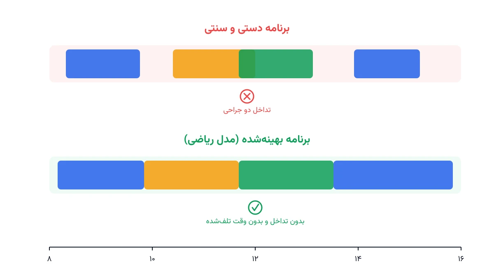

هر صبح، مدیر اتاق عمل یک بیمارستان باید تصمیم بگیرد کدام جراحی در کدام اتاق و از چه ساعتی شروع شود. این تصمیم ساده به نظر می‌رسد. اما هر اشتباه در آن، یا باعث بیکاری گران‌قیمت یک اتاق عمل می‌شود، یا جراحی یک بیمار را ساعت‌ها به تأخیر می‌اندازد.

## چرا زمان‌بندی اتاق عمل این‌قدر حیاتی است؟

اتاق عمل، گران‌ترین منبع فیزیکی هر بیمارستان است. هر دقیقه‌ای که یک اتاق عمل خالی بماند، هزینه واقعی و قابل‌محاسبه دارد؛ از حقوق تیم جراحی گرفته تا استهلاک تجهیزات. از طرف دیگر، هر جراحی که دیرتر از برنامه شروع شود، کل روز را به تأخیر می‌اندازد. گاهی حتی باعث کنسل‌شدن جراحی بعدی می‌شود.

مشکل از آنجا پیچیده می‌شود که طول هر جراحی قطعی نیست. یک آپاندکتومی ساده شاید ۴۵ دقیقه طول بکشد، اما همان جراحی در بیمار دیگر، به‌خاطر عارضه‌ای غیرمنتظره، می‌تواند دو برابر زمان ببرد. علاوه بر این، هر جراح فقط در یک اتاق می‌تواند حضور داشته باشد، و برخی تجهیزات تخصصی فقط در اتاق‌های خاصی موجودند.

## مدل ریاضی زمان‌بندی اتاق عمل

برای حل این مسئله با دقت، باید آن را به یک مدل ریاضی دقیق تبدیل کنیم. فرض کنید $n$ جراحی باید در طول یک روز کاری، میان $m$ اتاق عمل تخصیص یابند.

### متغیرهای تصمیم

برای هر جراحی $i$، متغیر $x_{i,r}$ برابر یک است اگر آن جراحی به اتاق $r$ تخصیص یابد. متغیر پیوسته $s_i$ هم زمان شروع واقعی جراحی $i$ را نشان می‌دهد. مدت زمان هر جراحی را با پارامتر $d_i$ نشان می‌دهیم.

### تابع هدف

هدف اصلی، کمینه‌کردن مجموع وزنی زمان بیکاری اتاق‌ها و اضافه‌کاری تیم جراحی پس از ساعت کاری رسمی است:

$$
\min \; Z = \sum_{r} w_1 \cdot \text{Idle}_r + \sum_{i} w_2 \cdot \text{Overtime}_i
$$

### قیدهای اصلی

هر جراحی باید دقیقاً به یک اتاق تخصیص یابد:

$$
\sum_{r} x_{i,r} = 1 \qquad \forall i
$$

دو جراحی که به یک اتاق تخصیص یافته‌اند، نباید در زمان با هم تداخل داشته باشند:

$$
s_i + d_i \le s_j \quad \text{یا} \quad s_j + d_j \le s_i \qquad \forall i,j \text{ در یک اتاق}
$$

و اگر جراح مشترکی میان دو جراحی وجود داشته باشد، همین قید عدم‌تداخل باید میان آن دو جراحی هم برقرار باشد، حتی اگر در دو اتاق متفاوت باشند. این دقیقاً جایی است که مسئله از یک زمان‌بندی ساده، به یک مسئله ترکیبیاتی واقعی تبدیل می‌شود.

## اهمیت این موضوع

زمان‌بندی اتاق عمل، یکی از پرهزینه‌ترین تصمیمات عملیاتی در کل زنجیره خدمات سلامت است. شبکه‌های درمانی بزرگی مثل کلینیک کلیولند آمریکا، سال‌هاست روی مدل‌های ریاضی زمان‌بندی اتاق عمل سرمایه‌گذاری می‌کنند. هدف این سرمایه‌گذاری، هم‌زمان کاهش بیکاری اتاق‌های عمل و کاهش زمان انتظار بیماران برای جراحی است.

مطالعات متعدد نشان داده‌اند که حتی بهبود ۱۰ درصدی در بهره‌وری اتاق عمل اثر بزرگی دارد. این بهبود می‌تواند معادل افزودن یک اتاق عمل کامل جدید باشد؛ بدون هیچ هزینه ساخت‌وسازی. این یعنی بهینه‌سازی زمان‌بندی، گاهی از نظر اقتصادی، ارزان‌ترین راه افزایش ظرفیت درمانی یک بیمارستان است. برای آشنایی با مسئله مشابه در بخش دیگری از بیمارستان، یادداشت [زمان‌بندی استریلیزاسیون ابزار جراحی](/notes/surgical-instrument-sterilization-scheduling/) تکمیل‌کننده خوبی برای همین موضوع است.

اگر می‌خواهید این نوع مدل‌سازی را به‌صورت ساخت‌یافته یاد بگیرید، دوره [بهینه‌سازی و تصمیم‌گیری سیستم‌های سلامت با پایتون](/courses/health-opt/) گزینه مناسبی است. این دوره دقیقاً برای همین هدف طراحی شده است.



## ظرفیت کار آکادمیک و پژوهشی

زمان‌بندی اتاق عمل یکی از پرتکرارترین موضوعات مقالات مدیریت عملیات سلامت (Healthcare Operations Research) است، و همچنان مسیرهای پژوهشی باز فراوانی دارد.

یک مسیر فعال، مدل‌سازی تصادفی طول جراحی است. یعنی به‌جای فرض قطعی‌بودن مدت هر جراحی، از توزیع احتمالی برآمده از داده تاریخی همان جراح استفاده شود. مسیر دیگر، زمان‌بندی مجدد پویا (Dynamic Rescheduling) در طول روز است، وقتی یک جراحی اورژانسی ناگهان وارد برنامه می‌شود. ترکیب این دو رویکرد با قیدهای منابع پرستاری و تخت‌های ریکاوری پس از عمل، هنوز فضای پژوهشی باز زیادی دارد. این فضا برای کار دانشگاهی مناسب است.

## پیاده‌سازی با پایتون

خبر خوب این است که نیازی به نرم‌افزار گران‌قیمت تجاری برای حل این مسئله نیست. کتابخانه متن‌باز [OR-Tools](https://developers.google.com/optimization) گوگل، به‌خصوص سالور [CP-SAT](https://developers.google.com/optimization/cp/cp_solver) آن، گزینه مناسبی برای این کار است. این سالور ساختار آماده‌ای به نام متغیر بازه‌ای (Interval Variable) دارد که دقیقاً برای این نوع مسائل ساخته شده است.

ورودی مدل، فهرستی از جراحی‌ها همراه مدت زمان تخمینی و جراح مسئول هر کدام است. این فهرست معمولاً از یک فایل اکسل یا CSV خوانده می‌شود. اسکلت اولیه مدل با متغیرهای بازه‌ای در CP-SAT به این شکل است:

```python
from ortools.sat.python import cp_model

model = cp_model.CpModel()
horizon = 480  # طول روز کاری بر حسب دقیقه

# برای هر جراحی، یک متغیر بازه‌ای در هر اتاق تعریف می‌کنیم
intervals_per_room = {r: [] for r in rooms}
for i, surgery in enumerate(surgeries):
    start = model.NewIntVar(0, horizon, f"start_{i}")
    room = model.NewIntVarFromDomain(
        cp_model.Domain.FromValues(rooms), f"room_{i}"
    )
    interval = model.NewFixedSizeIntervalVar(start, surgery.duration, f"iv_{i}")
```

ادامه قیود عدم‌تداخل با تابع `AddNoOverlap` و تابع هدف وزنی به همین شیوه تعریف می‌شوند. برای مسائلی که در آن‌ها طول جراحی قطعی نیست، کتابخانه [NumPy](https://numpy.org/) برای شبیه‌سازی سناریوهای مختلف طول جراحی مفید است.

اگر به [انجام پروژه بهینه‌سازی](/consultation/) برای بیمارستان یا مطب خودتان نیاز دارید، صفحه مشاوره نقطه شروع خوبی است.

## سوالات متداول

<h3>آیا این مدل فقط برای بیمارستان‌های بزرگ کاربرد دارد؟</h3>
<p>خیر. حتی یک مرکز جراحی سرپایی کوچک با دو یا سه اتاق عمل هم می‌تواند از نسخه ساده‌شده همین مدل بهره ببرد. دوره <a href="/courses/health-opt/" style="color:#2563EB; font-weight:bold;">بهینه‌سازی و تصمیم‌گیری سیستم‌های سلامت با پایتون</a> این موضوع را با مثال‌های عملی پوشش می‌دهد.</p>

<h3>چطور جراحی‌های اورژانسی را در این مدل جا می‌دهیم؟</h3>
<p>روش رایج، نگه‌داشتن یک یا دو بازه زمانی خالی به‌عنوان ظرفیت رزرو اورژانس در هر اتاق است، که خودش یک قید اضافه در مدل بهینه‌سازی است، نه یک استثنا بیرون از آن.</p>

<h3>برای پیاده‌سازی اختصاصی این مدل در بیمارستان خودم چه کار کنم؟</h3>
<p>چون داده واقعی و قیود هر بیمارستان با دیگری فرق دارد، بهتر است مدل را متناسب با شرایط واقعی تنظیم کنید. برای این کار می‌توانید درخواست <a href="/consultation/" style="color:#2563EB; font-weight:bold;">مشاوره</a> ثبت کنید.</p>
