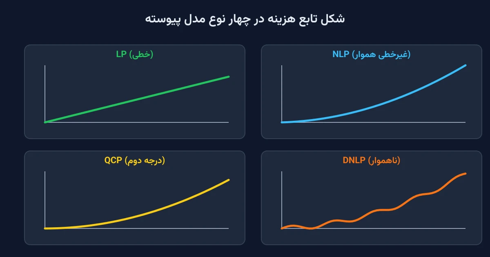

وقتی کسی تازه وارد دنیای بهینه‌سازی می‌شود، با یک مشت اسم اختصاری روبه‌رو می‌شود. اسم‌هایی مثل LP، NLP، MIP، MINLP و MPEC. این اسم‌ها ترسناک به‌نظر می‌رسند، اما همه‌شان یک کار می‌کنند: توصیف می‌کنند که یک مدل ریاضی چه شکلی دارد. شکل مدل هم تعیین می‌کند چه سالوری می‌تواند آن را حل کند و چقدر طول می‌کشد. این یادداشت یک نقشه راه ساده برای همه این انواع می‌دهد، بدون وابستگی به هیچ نرم‌افزار خاصی.

برای همه مثال‌ها از یک داستان ثابت استفاده می‌کنیم. دو خط تولید، L1 و L2، باید مجموعاً ۱۰۰ واحد از یک سفارش را تأمین کنند. هر مثال فقط فرمول مدل را نشان می‌دهد، نه راه‌حل عددی آن. هدف این است که شکل مسئله را بشناسید، نه اینکه آن را دستی حل کنید.

یک نکته مهم قبل از شروع: خطی بودن یک مدل، فقط به تابع هدف بستگی ندارد. اگر تابع هدف خطی باشد اما حتی یکی از قیدها غیرخطی باشد، کل مدل غیرخطی محسوب می‌شود. برعکسش هم همین‌طور است؛ اگر همه قیدها خطی باشند اما تابع هدف غیرخطی باشد، باز هم مدل غیرخطی است. برای خطی بودن یک مدل، هم تابع هدف و هم تک‌تک قیدها باید خطی باشند.

## چرا این دسته‌بندی اهمیت دارد

شرکتی مثل کاترپیلار وقتی مدل بهینه‌سازی زنجیره تأمین می‌سازد، اولین تصمیمش انتخاب سالور نیست؛ شناخت نوع مدل است. یک مهندس که مدلش را اشتباه دسته‌بندی کند، ممکن است یک مسئله غیرخطی را به یک سالور خطی بدهد. نتیجه چنین کاری یک جواب بی‌معنا است. یا برعکس، یک مسئله ساده خطی را با یک سالور غیرخطی سنگین حل کند و وقت زیادی تلف کند. شناخت درست نوع مدل، اولین قدم برای انتخاب ابزار درست است.

## مدل‌های پیوسته: از خطی تا غیرهموار

### برنامه‌ریزی خطی (Linear Programming یا LP)

ساده‌ترین نوع مدل است. تابع هدف و همه قیدها خطی هستند و متغیرها هر عدد حقیقی می‌توانند باشند. مثال: هزینه تولید هر واحد در L1 و L2 ثابت است و هر خط تولید سقف ظرفیت مشخصی دارد.

$$\min \; 20\,P_1 + 28\,P_2 \quad \text{s.t.} \quad P_1+P_2=100,\; 0\le P_1\le 70,\; 0\le P_2\le 60$$

### برنامه‌ریزی درجه دوم با قید درجه دوم (Quadratically Constrained Program یا QCP)

تابع هدف یا قیدها می‌توانند عبارت درجه دوم محدب داشته باشند. وقتی این عبارت‌ها به شکل خاصی نوشته شوند، مدل را برنامه‌ریزی مخروطی مرتبه دوم (Second-Order Cone Program یا SOCP) هم می‌نامند. مثال: محدودیت مشترک مصرف مواد اولیه دو خط تولید که به‌صورت درجه دوم از میزان تولید تعریف می‌شود.

$$P_1^2+P_2^2 \le 7500 \quad \text{(قید ظرفیت مشترک تجهیزات دو خط)}$$

### برنامه‌ریزی غیرخطی (Nonlinear Program یا NLP)

وقتی تابع هدف یا قیدها غیرخطی اما هموار و قابل‌مشتق‌گیری باشند، مدل NLP نام دارد. مثال: تابع هزینه تولید درجه دوم است، چون هزینه نهایی هر واحد اضافی با افزایش تولید بیشتر می‌شود.

$$\min \; (10+0.1P_1+0.002P_1^2)+(15+0.08P_2+0.003P_2^2)$$

### برنامه‌ریزی غیرخطی ناهموار (Discontinuous Nonlinear Program یا DNLP)

گاهی تابع هدف یک نقطه شکست دارد که مشتق‌پذیر نیست. مثال: وقتی تولید از یک آستانه مشخص عبور کند، خط تولید باید وارد شیفت اضافه‌کاری شود. این تغییر شیفت یک جهش کوچک و غیرهموار به هزینه اضافه می‌کند.

$$\min \; \big(10+0.1P_1+0.002P_1^2+\big|e\,\sin(f\,(P_1^{\min}-P_1))\big|\big)+\dots$$



## مدل‌های گسسته: وقتی تصمیم روشن/خاموش وارد می‌شود

### برنامه‌ریزی عدد صحیح مختلط (Mixed Integer Program یا MIP)

وقتی یک متغیر دودویی برای باز یا بسته بودن یک خط تولید اضافه می‌شود، مدل دیگر فقط خطی نیست. دلیلش این است که این تصمیم گسسته است. مثال: L2 فقط وقتی باز باشد اجازه تولید دارد و حداقل تولیدش هم باید رعایت شود.

$$P_2 \le 60\,y,\quad P_2 \ge 20\,y,\quad y\in\{0,1\}$$

این همان الگویی است که در یادداشت [only_enforce_if در برابر Big-M](/notes/cpsat-only-enforce-if-vs-big-m/) با جزئیات بیشتری بررسی شده است. در همین خانواده، متغیرهای نیمه‌پیوسته (semi-continuous) هم وجود دارند. قیدهای مجموعه مرتب ویژه نوع دوم (Special Ordered Set type 2 یا SOS2) هم برای منحنی‌های هزینه پلکانی یا تکه‌خطی استفاده می‌شوند.

### MIQCP و MINLP

وقتی تصمیم گسسته با یک قید یا تابع هدف درجه دوم ترکیب شود، اسم مدل عوض می‌شود. آن را برنامه‌ریزی عدد صحیح مختلط با قید درجه دوم می‌نامند. مخفف آن MIQCP است، از عبارت Mixed Integer Quadratically Constrained Program. وقتی همان تصمیم گسسته با یک تابع غیرخطی دلخواه ترکیب شود، مدل برنامه‌ریزی عدد صحیح مختلط غیرخطی است. مخفف آن MINLP است، از عبارت Mixed Integer Nonlinear Program. مثال: همان خط تولید باز/بسته L2 اما این‌بار با تابع هزینه درجه دوم واقعی به‌جای هزینه ثابت.

$$\min \; y\,(15+0.08P_2+0.003P_2^2) \quad \text{s.t.}\quad P_2\le 60y,\; y\in\{0,1\}$$

این دسته معمولاً سخت‌ترین مدل برای حل در مقیاس بزرگ است، چون هم گسستگی دارد و هم غیرخطی بودن.

## نسخه‌های سست‌شده (Relaxed Models)

هر مدلی که در بالا دیدیم، یک نسخه سست‌شده هم دارد. کافی است قید گسسته بودن یا محدودیت دامنه متغیرها را موقتاً کنار بگذاریم. این نسخه‌ها هم مخفف خودشان را دارند؛ برای مثال نسخه سست‌شده MIP را برنامه‌ریزی خطی سست‌شده (Relaxed MIP یا RMIP) می‌نامند. برای مثال، نسخه سست‌شده مدل MIP بالا این است که $y$ به‌جای دودویی بودن، بین صفر و یک هر عددی بگیرد.

$$0\le y\le 1 \quad \text{به‌جای} \quad y\in\{0,1\}$$

این نسخه سست‌شده یک کران پایین سریع روی جواب واقعی می‌دهد و در تحلیل حساسیت و شاخه‌و‌کران بسیار کاربرد دارد.

## سیستم‌ها و تعادل: وقتی هدفی برای بهینه‌کردن نیست

### سیستم غیرخطی مقید (Constrained Nonlinear System یا CNS)

بعضی مسئله‌ها اصلاً تابع هدف ندارند؛ فقط باید چند معادله و نامعادله هم‌زمان برقرار باشند. مثال: تعادل عرضه و تقاضا در یک بازار رقابتی، بدون اینکه کسی به‌دنبال کمینه‌کردن هزینه باشد. هر تولیدکننده مقداری عرضه می‌کند که به قیمت بازار بستگی دارد.

$$P_1+P_2=100,\quad P_1=40+0.5\lambda,\quad P_2=30+0.3\lambda$$

### مسئله مکمل مختلط (Mixed Complementarity Problem یا MCP)

این مدل رابطه مکمل بین دو متغیر را توصیف می‌کند: یا یک قید دقیقاً برقرار است، یا متغیر متناظرش صفر می‌شود. مثال: اگر قیمت بازار از هزینه نهایی L1 بیشتر باشد، L1 تا سقف ظرفیتش تولید می‌کند. در غیر این صورت، اصلاً تولید نمی‌کند.

$$0\le P_1 \perp \big(20-\lambda\big)\ge 0$$

### مسئله برنامه‌ریزی با قیدهای تعادلی (Mathematical Program with Equilibrium Constraints یا MPEC)

این مدل یک بازیگر را نشان می‌دهد که خودش دارد چیزی را بهینه می‌کند. یکی از قیدهای او، خودش یک تعادل بازار است. مثال: تولیدکننده L1 می‌خواهد سود خودش را بیشینه کند، درحالی‌که می‌داند قیمت بازار از تعادل عرضه‌و‌تقاضای بالا به‌دست می‌آید.

$$\max_{P_1} \; \lambda P_1 - 20P_1 \quad \text{s.t.}\quad \text{(تعادل بازار طبق مدل MCP بالا)}$$

این نوع مدل در تحلیل بازارهای رقابتی و استراتژی قیمت‌گذاری بین تولیدکنندگان بسیار پرکاربرد است.

## کدام سالور کدام نوع را می‌فهمد؟

هیچ سالوری همه این انواع را پوشش نمی‌دهد. هر سالور برای یک یا چند نوع مدل خاص ساخته شده است. فرمت ورودی آن هم معمولاً با زبان‌های مدل‌سازی AMPL یا GAMS سازگار است. جدول زیر چند سالور شناخته‌شده را برای هر نوع مدل نشان می‌دهد؛ این فهرست کامل نیست، فقط نقطه شروع خوبی است.

| نوع مدل | چند سالور رایج |
| --- | --- |
| LP | CPLEX، Gurobi، [HiGHS](https://highs.dev/)، COPT، FICO Xpress، MOSEK، Clp، SCIP |
| MIP | CPLEX، Gurobi، [CBC](https://github.com/coin-or/Cbc)، HiGHS، FICO Xpress، COPT، SCIP، SYMPHONY |
| QCP و SOCP | CPLEX، Gurobi، COPT، FICO Xpress، MOSEK |
| NLP | Ipopt، CONOPT، Knitro، MINOS، SNOPT، LOQO |
| MIQCP و MINLP | BARON، Couenne، ANTIGONE، Bonmin، SHOT، SCIP، Knitro |
| CNS | CONOPT، PATHNLP |
| MCP | PATH، MILES، Knitro، Gurobi |
| MPEC | filterMPEC، NLPEC، Knitro، Gurobi |

برای DNLP، سالور مستقلی وجود ندارد. معمولاً مدل یا به یک NLP هموار بازنویسی می‌شود، یا به یک سالور سراسری مثل BARON و Couenne سپرده می‌شود. این سالورها ناهمواری را با تقسیم فضای جستجو دور می‌زنند. سالور [CP-SAT](https://developers.google.com/optimization) گوگل هم برای مدل‌های گسسته و ترکیبیاتی قوی است، اما با متغیرهای پیوسته غیرخطی راحت نیست. بسیاری از این سالورها رایگان نیستند؛ اما [HiGHS](https://highs.dev/)، [CBC](https://github.com/coin-or/Cbc)، SCIP، Ipopt، Couenne و Bonmin متن‌باز و رایگان هستند. یادداشت [سه روش عملی استفاده از سالورها در Pyomo](/notes/pyomo-solvers/) این انتخاب را با جزئیات بیشتری توضیح می‌دهد.

## ظرفیت کار آکادمیک و پژوهشی

یک مسیر پژوهشی رایج، تبدیل یک مدل سخت مثل MPEC به یک مدل ساده‌تر مثل MIP است. این تبدیل از طریق خطی‌سازی شرایط بهینگی انجام می‌شود. این خطی‌سازی معمولاً با روش‌هایی مثل شرایط کاروش-کوهن-تاکر (KKT) و شرایط مکمل انجام می‌شود. زاویه دیگر، مقایسه کیفیت کران‌های سست‌شده بین فرمول‌بندی‌های مختلف یک مسئله واحد است. یادداشت [only_enforce_if در برابر Big-M](/notes/cpsat-only-enforce-if-vs-big-m/) هم به همین موضوع اشاره کرده است.

## پیاده‌سازی با پایتون

برای شروع، لازم نیست دنبال ابزار پولی بگردید. کتابخانه [Pyomo](https://www.pyomo.org/) می‌تواند همین مدل‌های LP و NLP را با سالورهای رایگان مثل HiGHS و Ipopt حل کند.

```python
from pyomo.environ import *

model = ConcreteModel()
model.P1 = Var(bounds=(0, 70))
model.P2 = Var(bounds=(0, 60))
model.demand = Constraint(expr=model.P1 + model.P2 == 100)

# تابع هدف خطی یا غیرخطی، بسته به نوع مدل، همین‌جا اضافه می‌شود
```

اگر برای مسئله خودتان نیاز به تشخیص نوع مدل و انتخاب سالور مناسب دارید، صفحه [مشاوره](/consultation/) نقطه شروع خوبی است.

## سوالات متداول

<h3>چرا باید نوع مدل را دقیق تشخیص بدهم؟</h3>
<p>چون انتخاب سالور و زمان حل مستقیماً به نوع مدل بستگی دارد. یک مدل MINLP را با سالور خطی نمی‌توان درست حل کرد.</p>

<h3>اگر فقط تابع هدف غیرخطی باشد ولی قیدها خطی باشند، چه؟</h3>
<p>باز هم مدل غیرخطی محسوب می‌شود. برای خطی بودن کامل یک مدل، هم تابع هدف و هم همه قیدها باید خطی باشند.</p>

<h3>از کجا شروع کنم تا این انواع مدل را بهتر یاد بگیرم؟</h3>
<p>دوره <a href="/courses/optimization-modeling/" style="color:#2563EB; font-weight:bold;">مبانی مدل‌سازی ریاضی و بهینه‌سازی با پایتون</a> از همین دسته‌بندی شروع می‌کند و با مثال‌های واقعی جلو می‌رود. برای راهنمایی روی مسئله خاص خودتان هم می‌توانید از طریق <a href="/consultation/" style="color:#2563EB; font-weight:bold;">مشاوره</a> با من در تماس باشید.</p>
