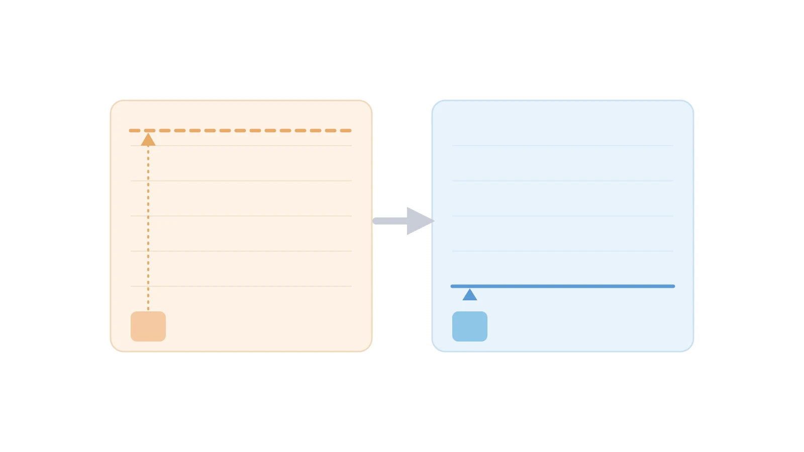

## چرا کد در مرحله نوشتن و تست روی لپ‌تاپ با کد در محیط پروداکشن فرق داره؟

یک مدل بهینه‌سازی که در محیط توسعه عالی کار می‌کند، ممکن است در پروداکشن دچار مشکل شود یا حتی از کار بیفتد، چون مشتری هر بلایی که حتی به ذهن شما هم نرسیده را سر کدتان می‌آورد. مثلاً دامنه‌ی یک متغیر را از صفر تا بی‌نهایت تعریف می‌کند و بعد انتظار دارد سالور با همین دامنه‌ی نامتناهی با خوبی و خوشی زندگی کند. یا قیدهایی را که فقط در ذهن خودش هستند، هیچ‌جا نمی‌نویسد، اما توقع دارد سالور مثل کریس‌انجل، آن‌ها را از هوا حدس بزند.

یک نمونه‌ی اولیه معمولاً روی یک مجموعه‌داده‌ی کنترل‌شده و با زمان کافی اجرا می‌شود. اما یک سیستم پروداکشن ممکن است فقط چند ثانیه برای هر تصمیم وقت داشته باشد. ورودی‌هایش هم دائم در حال تغییرند و پیچیدگی‌اش با اضافه‌شدن محصولات، منابع و قوانین جدید رشد می‌کند. چنین سیستمی باید حتی بعد از رفتن توسعه‌دهندگانش هم کار کند.


## درس اول: قبل از انتخاب تکنیک، مسئله‌ی درست را مدل کنید

هشدار اصلی این درس این است که کار را از یک فناوری شروع نکنید. نه از MIP، نه از برنامه‌ریزی محدودیت، نه از QUBO و نه از یک سالور خاص.

یک شرکت سازنده‌ی شتاب‌دهنده‌ی سخت‌افزاری، یک مسئله‌ی زمان‌بندی را از قبل در قالب QUBO به تیم داد. نمونه‌ها بین ۲۰۰۰ تا ۲۵۰۰۰ وظیفه داشتند، بعضی با میلیون‌ها وابستگی تقدمی. تیم تشخیص داد این در واقع یک مسئله‌ی زمان‌بندی پروژه با منابع محدود یا RCPSP است، نه یک مسئله‌ی مناسب برای QUBO.

راه‌حل این بود که گراف وابستگی‌ها به زیرگراف‌های دوبخشی کامل تجزیه شود و هرکدام در قالب یک «ابرگره» جمع‌آوری شود. سپس از یک سری مدل MIP برای گروه‌های وظیفه، و از برنامه‌ریزی محدودیت برای مسئله‌ی ساده‌شده‌ی تقدمی استفاده شد. در یکی از نمونه‌های نماینده، بیش از ۱۹ میلیون قید تقدمی به تنها ۱۶ یال کاهش یافت. مدل‌های MIP چند ثانیه طول کشیدند و مسئله‌ی ساده‌شده در کسری از ثانیه حل شد.

توصیه‌ی نویسنده این است: اول مسئله‌ی کسب‌وکار را بفهمید، بعد داده را بشناسید، و بعد مدل را بسازید.

## درس دوم: فرمول‌بندی می‌تواند از سخت‌افزار مهم‌تر باشد

اضافه‌کردن توان محاسباتی گاهی کمک می‌کند، اما فرمول‌بندی ریاضی معمولاً تأثیر بیشتری دارد.

در یک مدل شبکه‌ی برق، یک نیروگاه وقتی روشن است تا ۲۰۰ مگاوات تولید می‌کند و وقتی خاموش است صفر. یک قید big-M با عدد بسیار بزرگ، یعنی چیزی شبیه $P\le99999\cdot \text{IsOn}$، رهاسازی خطی مدل را بیش از حد شل می‌کند. جایگزین‌کردن آن با ظرفیت فیزیکی واقعی، یعنی $P\le200\cdot \text{IsOn}$، همان جواب‌های صحیح را نگه می‌دارد اما رهاسازی را سفت‌تر می‌کند. همین تغییر ساده می‌تواند درخت شاخه‌و‌کران را به‌شدت کوچک‌تر کند.



توصیه‌های این بخش شامل حذف قیدهای زائد، شکستن تقارن، تجزیه‌ی مسئله، و دادن دامنه‌ی هرچه واقعی‌تر به متغیرهاست. ایده‌ی اصلی این است که هرچه اطلاعات مفیدتری به سالور بدهید، نتیجه بهتر می‌شود. به گفته‌ی نویسنده، بهینه‌سازی در این سطح، هم ریاضی است و هم [مهندسی نرم‌افزار](/courses/optimization-modeling/).

برای نشان‌دادن این تفاوت، همین مثال نیروگاه را می‌توان به‌صورت زیر در پایومو نوشت.

```python
import pyomo.environ as pyo

model = pyo.ConcreteModel()
model.is_on = pyo.Var(domain=pyo.Binary)
model.power = pyo.Var(bounds=(0, None))

# فرمول‌بندی ضعیف: کران بزرگ و دلخواه، رهاسازی خیلی شل می‌شود
# model.cap = pyo.Constraint(expr=model.power <= 99999 * model.is_on)

# فرمول‌بندی درست: همان ظرفیت فیزیکی واقعی نیروگاه
model.cap = pyo.Constraint(expr=model.power <= 200 * model.is_on)

# بقیه‌ی قیدهای تعادل بار و هزینه‌ی سوخت، به همین شیوه تکمیل می‌شوند.
```

## درس سوم: وقتی ساختار مسئله بازی در میاره فرمول‌بندی را عوض کنید

مشتری این مورد، Birchbox بود؛ یک شرکت تجارت الکترونیک مبتنی بر اشتراک. مسئله، تخصیص حدود ۱۰۰ محصول به هزاران جعبه‌ی مشترکان بود، با رعایت قوانین جفت‌شدن، انحصار و موجودی. مدل یکپارچه‌ی اولیه‌ی MIP گاهی ۳۰ تا ۵۰ ساعت طول می‌کشید و گاهی اصلاً جواب قابل‌استفاده‌ای نمی‌داد.

دو مشکل ساختاری اصلی وجود داشت. اول، تقارن: جعبه‌ای با همان محصولات اما ترتیب متفاوت، همان جعبه محسوب می‌شود، اما سالور پیکربندی‌های هم‌ارز را دوباره کاوش می‌کرد. دوم، یک تابع هدف وزن‌دار واحد که چند هدف رقیب را با هم قاطی می‌کرد. راه‌حل‌های تدریجی مثل پرتوربیشن کافی نبودند، پس تیم فرمول‌بندی را از نو ساخت.

رویکرد جدید، «برنامه‌ریزی عدد صحیح رفت‌وبرگشتی» یا RIP نام گرفت و از ایده‌ی تولید ستون الهام گرفت. جعبه‌های معتبر به‌عنوان الگوهایی در نظر گرفته می‌شوند که زیرمسئله‌ها نیازمحور تولیدشان می‌کنند، پس جعبه‌های هم‌ارز دوباره کشف نمی‌شوند. تابع هدف وزن‌دار هم با اهداف سلسله‌مراتبی جایگزین شد: اول شدنی‌بودن، بعد تعداد جعبه، بعد حداقل محصول.

نتیجه چشمگیر بود: زمان حل از چند روز به حدود ۱۰ دقیقه رسید، یعنی بیش از ۹۹ درصد کاهش. مدیران عملیات توانستند قوانین کسب‌وکاری را امتحان کنند که قبلاً خیلی کند بود. سرعت، خودش به یک قابلیت کسب‌وکاری تبدیل شد.

## درس چهارم: مدل را تنظیم دقیق کنید و «به‌اندازه‌ی کافی خوب» را تعریف کنید

تنظیمات پیش‌فرض سالور قوی اما عمومی‌اند. یک سیستم پروداکشن امکان می‌دهد سالور را بارها، دقیقاً روی ساختار مسئله‌ی خودتان، محک بزنید.

در یک کاربرد شبکه‌ی برق، اضافه‌کردن ذخیره‌سازی انرژی پیچیدگی را بالا برد. یک حل پایه حدود ۹۴ ثانیه طول می‌کشید، اما با افزودن ۱۲۵ باتری، زمان اجرا از ۱۲۰۰ ثانیه هم گذشت. تیم پیکربندی‌های مختلف سالور را روی سناریوهای واقعی پروداکشن محک زد. تغییر در تنظیمات presolve و MIPFocus، سخت‌ترین سناریوها را از ۲۰ دقیقه به حدود ۵۵ ثانیه رساند.

یک مشتری تجارت الکترونیک هم دسته‌های ۵۰۰ تا ۱۰۰۰ سفارشی را شبانه‌روزی مسیردهی می‌کرد. برای دسته‌های معمولی، یک فاصله‌ی مجاز مطلق برابر ۵۰، جواب‌هایی کاملاً کافی از نظر کسب‌وکار می‌داد. فاصله‌ی تنگ‌تر فقط برای اجراهای حساس‌تر حفظ شد؛ یعنی خودِ این فاصله یک تصمیم کسب‌وکاری بود.

جمله‌ی کلیدی این بخش این است: «به‌اندازه‌ی کافی بهینه، به‌موقع» می‌تواند بسیار باارزش‌تر از «کاملاً بهینه، با تأخیر» باشد.

## درس پنجم: معماری نرم‌افزار، مقیاس‌پذیری را تعیین می‌کند

جریان‌های کاری قدیمی، با هر تغییر کوچک، کل مدل را از نو می‌سازند و دوباره حل می‌کنند. مقاله این را به ساختن یک خانه تشبیه می‌کند؛ کسی برای اضافه‌کردن یک گاراژ، کل خانه را خراب نمی‌کند.

توصیه این است که از API‌های مدرن سالورها استفاده شود. این API‌ها اجازه می‌دهند مدل ساخته شود، حل شود، تغییر کند، و بدون از دست‌دادن وضعیت قبلی دوباره حل شود. شروع گرم و ساخت تدریجی مدل، حجم زیادی از کار تکراری را حذف می‌کنند.

یک مدل توسعه‌ی ظرفیت شبکه‌ی برق، برای ارزیابی تصمیم‌های میلیارددلاری درباره‌ی نیروگاه‌ها و خطوط انتقال استفاده می‌شد. جریان کاری قدیمی برای ۲۲ تکرار، ۴۰۷۳ ثانیه طول می‌کشید. بعد از بازطراحی، کل زمان ساخت و حل به ۱۸۴ ثانیه رسید؛ یعنی حدود ۲۲ برابر سریع‌تر. اثر کسب‌وکاری این بود که برنامه‌ریزان توانستند صدها سناریو را بررسی کنند، نه فقط چند تا.

## درس ششم: با بهینه‌سازی پروداکشن مثل یک نرم‌افزار پروداکشن رفتار کنید

چنین سیستمی باید قابل‌تکرار، قابل‌عیب‌یابی و قابل‌تست باشد. توصیه‌های این بخش شامل نسخه‌بندی تنظیمات پارامترها، نگه‌داشتن آرتیفکت‌های قابل‌تکرار از هر اجرا، و استفاده از نام‌های معنادار برای متغیرهاست. مستندسازی فرمول‌بندی ریاضی، جدا از پیاده‌سازی کد، هم به بازبینی‌های بعدی کمک می‌کند.

تغییرات بزرگ نیاز به تست رگرسیون دارند. برای یکی از مشتریان، ارتقا از Gurobi نسخه‌ی ۹ به نسخه‌ی ۱۳ یک نمونه‌ی خوب بود. تیم مدل‌ها را روی صدها سناریوی واقعی دوباره اجرا کرد و کیفیت جواب‌ها را مورد‌به‌مورد بررسی کرد. این ارتقا در نهایت ۳۰ تا ۴۰ درصد سرعت بیشتر برای طولانی‌ترین مدل‌ها به همراه داشت. سیستم جدید باید اعتماد را به دست بیاورد، نه اینکه فرض شود.

## درس اضافه: پل‌زدن بین بهینه‌سازی و عملیات

بزرگ‌ترین دستاوردها از جایی آمدند که تیم فهمید سازمان واقعاً باید چه چیزی را تصمیم بگیرد. تخصص بهینه‌سازی به‌تنهایی کافی نیست، و دانش عملیاتی هم به‌تنهایی کافی نیست؛ هر دو با هم لازم‌اند.

درباره‌ی هوش مصنوعی، نویسنده می‌گوید امروز بعید است AI جایگزین سالور، به‌عنوان موتور تصمیم‌گیری، شود. اما عامل‌های هوش مصنوعی می‌توانند دور آن را هماهنگ کنند: ترتیب‌دهی مدل‌ها، عیب‌یابی شدنی‌نبودن، و پیشنهاد تنظیمات سالور بر اساس اجراهای قبلی.

جمع‌بندی نهایی این است: چند چیز باید با هم ترکیب شوند؛ درک کسب‌وکار، فرمول‌بندی درست، تخصص سالور و مهندسی نرم‌افزار. همین ترکیب، یک نمونه‌ی اولیه را از یک سیستم پروداکشنِ قابل‌اتکا جدا می‌کند.

اگر به [انجام پروژه بهینه‌سازی](/consultation/) برای مسئله خودتان نیاز دارید یا می‌خواهید [مدل‌سازی ریاضی](/courses/optimization-modeling/) را از پایه یاد بگیرید، این دو صفحه نقطه شروع خوبی هستند.

## سوالات متداول

**آیا این شش درس فقط برای مسئله‌های MIP کاربرد دارند؟**

نه؛ اصولشان عمومی‌اند و برای برنامه‌ریزی محدودیت، بهینه‌سازی غیرخطی و حتی مدل‌های یادگیری ماشین هم صدق می‌کنند. برای یادگیری عمیق‌تر مدل‌سازی درست مسئله، <a style="color:#2563EB; font-weight:bold;" href="/courses/optimization-modeling/">دوره‌ی مدل‌سازی بهینه‌سازی</a> را ببینید.

**چرا فاصله‌ی مجاز MIP gap یک تصمیم کسب‌وکاری است، نه فقط یک پارامتر فنی؟**

چون هزینه‌ی صرف‌شده برای رسیدن از یک جواب خوب به جواب کاملاً بهینه، گاهی بسیار بیشتر از ارزش آن بهبود کوچک است. این هزینه را فقط کسب‌وکار می‌تواند بسنجد، نه فقط مهندس مدل.

**اگر مدل پروداکشن‌مان کند شد یا جواب نداد چه کار کنیم؟**

معمولاً مشکل در ساختار مدل است، نه فقط در قدرت سخت‌افزار. برای بررسی دقیق‌تر، <a style="color:#2563EB; font-weight:bold;" href="/consultation/">مشاوره‌ی تخصصی</a> دریافت کنید.
