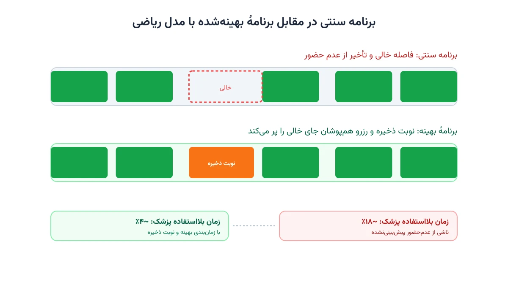

هر درمانگاه سرپایی هر روز با یک معمای یکسان روبه‌رو است. باید برای ده‌ها بیمار نوبت تعیین کند، بدون اینکه از قبل بداند کدام‌یک واقعاً سر وقت می‌آیند. این یادداشت نشان می‌دهد چطور می‌توان این معما را با یک مدل بهینه‌سازی دقیق حل کرد. راه‌حل، حدس و تجربه شخصی منشی پذیرش نیست.

## چرا زمان‌بندی نوبت‌دهی سرپایی این‌قدر دشوار است؟

روی کاغذ، نوبت‌دهی ساده به نظر می‌رسد: هر بیمار یک بازه زمانی می‌گیرد و پزشک یکی‌یکی ویزیت می‌کند. اما در عمل، چند عامل این مسئله را پیچیده می‌کنند.

نرخ عدم‌حضور بیماران (No-show Rate) در بسیاری از درمانگاه‌ها بین ۱۰ تا ۳۰ درصد است. اگر برای هر بیمار دقیقاً یک نوبت خالی نگه دارید، این درصد از وقت پزشک بی‌استفاده می‌ماند. اگر برای جبران آن نوبت‌های همزمان رزرو کنید (Overbooking)، وقتی همه بیماران سر وقت بیایند، زمان انتظار به‌شدت بالا می‌رود.

طول هر ویزیت هم ثابت نیست. یک معاینه ساده شاید ده دقیقه طول بکشد، اما ویزیت بیمار مزمن با چند سؤال، می‌تواند نیم ساعت وقت بگیرد. مدلی که طول ویزیت را ثابت فرض کند، همیشه یا وقت پزشک را هدر می‌دهد. یا باعث تأخیر زنجیره‌ای در کل روز می‌شود.

## مدل ریاضی مسئله نوبت‌دهی

برای حل این مسئله، ابتدا باید آن را به زبان دقیق ریاضی ترجمه کنیم. فرض کنید $n$ بیمار باید در طول یک روز کاری با $m$ بازه زمانی ویزیت شوند.

### متغیرهای تصمیم

متغیر دودویی $x_{p,s}$ برابر یک است اگر بیمار $p$ به بازه زمانی $s$ تخصیص یابد، و در غیر این صورت صفر است. متغیر کمکی $w_{s}$ هم نشان می‌دهد آیا بازه $s$ به‌صورت هم‌پوشان (بیش از یک بیمار) رزرو شده یا نه.

### تابع هدف

هدف، کمینه‌کردن مجموع وزنی زمان انتظار بیماران و زمان بیکاری پزشک است:

$$
\min \; Z = \sum_{p} w_1 \cdot \text{Wait}_p + \sum_{s} w_2 \cdot \text{Idle}_s
$$

وزن‌های $w_1$ و $w_2$ نشان می‌دهند درمانگاه به کدام هدف اهمیت بیشتری می‌دهد: رضایت بیمار یا بهره‌وری پزشک.

### قیدهای اصلی

هر بیمار باید دقیقاً به یک بازه تخصیص یابد:

$$
\sum_{s} x_{p,s} = 1 \qquad \forall p
$$

ظرفیت هر بازه محدود است، اما برای بازه‌های پرخطر (با احتمال بالای عدم‌حضور) می‌توان سقف را به دو رساند:

$$
\sum_{p} x_{p,s} \le \text{cap}_s \qquad \forall s
$$

قید دیگر، ترتیب زمانی است: مجموع طول ویزیت‌های تخصیص‌یافته به هر بازه، نباید از طول آن بازه بیشتر شود. این دقیقاً جایی است که احتمال عدم‌حضور هر بیمار، به‌صورت یک پارامتر تصادفی وارد مدل می‌شود. همین نکته، مسئله را به یک بهینه‌سازی تصادفی تبدیل می‌کند.

## اهمیت این موضوع

نوبت‌دهی بهینه، فقط یک مسئله ریاضی انتزاعی نیست؛ مستقیماً روی درآمد و کیفیت درمان اثر می‌گذارد. شبکه‌های بزرگ درمانی مثل کایزر پرمننته، سال‌هاست روی مدل‌های پیش‌بینی عدم‌حضور و زمان‌بندی هوشمند سرمایه‌گذاری می‌کنند. هدف این سرمایه‌گذاری، کوتاه‌نگه‌داشتن صف انتظار و جلوگیری از هدررفت ظرفیت پزشکان است.

وقتی زمان پزشک هدر برود، هزینه فرصت آن مستقیماً به بیمار بعدی یا به کل سیستم سلامت منتقل می‌شود. از طرف دیگر، صف طولانی باعث نارضایتی بیمار و حتی ترک درمان می‌شود. مدل بهینه‌سازی، این دو هدف متضاد را به‌طور هم‌زمان در نظر می‌گیرد؛ کاری که با روش‌های دستی و تجربه‌محور عملاً ممکن نیست. برای آشنایی با مسئله مشابه در بخش دیگری از بیمارستان، یادداشت [زمان‌بندی صندلی دیالیز](/notes/dialysis-chair-scheduling/) را هم ببینید.



## ظرفیت کار آکادمیک و پژوهشی

این مسئله یکی از فعال‌ترین حوزه‌های پژوهش در مدیریت عملیات سلامت (Healthcare Operations Management) است. چند مسیر پژوهشی باز در این زمینه وجود دارد.

مدل‌سازی تصادفی دو‌مرحله‌ای (Two-stage Stochastic Programming) یکی از رویکردهای رایج است. مرحله اول، تخصیص اولیه نوبت‌ها را تعیین می‌کند. مرحله دوم هم واکنش به عدم‌حضورهای واقعی را مدل می‌کند. موضوع دیگر، یادگیری آنلاین نرخ عدم‌حضور هر بیمار بر اساس سابقه اوست، نه یک نرخ ثابت و یکسان برای همه. ترکیب این دو رویکرد، یعنی تخمین پویای ریسک عدم‌حضور به‌همراه بهینه‌سازی تصادفی، هنوز جای کار پژوهشی زیادی دارد. این فرصت پژوهشی وقتی چند پزشک و چند نوع ویزیت هم‌زمان در نظر گرفته شوند، بزرگ‌تر هم می‌شود.

## پیاده‌سازی با پایتون

خبر خوب این است که برای حل این مسئله، نیازی به نرم‌افزار گران‌قیمت تجاری نیست. کتابخانه متن‌باز [OR-Tools](https://developers.google.com/optimization) گوگل، به‌خصوص سالور [CP-SAT](https://developers.google.com/optimization/cp/cp_solver) آن، برای این نوع مسائل ترکیبیاتی گسسته بسیار مناسب است.

ورودی مدل، یک فهرست از بیماران با طول ویزیت تخمینی و احتمال عدم‌حضور هر کدام است. این فهرست معمولاً از یک فایل اکسل یا CSV خوانده می‌شود. اسکلت اولیه مدل در CP-SAT به این شکل است:

```python
from ortools.sat.python import cp_model

model = cp_model.CpModel()
num_patients = len(patients)
num_slots = len(slots)

# متغیر تخصیص: آیا بیمار p به بازه s می‌رود؟
x = {}
for p in range(num_patients):
    for s in range(num_slots):
        x[p, s] = model.NewBoolVar(f"x_{p}_{s}")

# هر بیمار دقیقاً یک بازه می‌گیرد
for p in range(num_patients):
    model.Add(sum(x[p, s] for s in range(num_slots)) == 1)

# ظرفیت هر بازه (با احتساب رزرو هم‌پوشان در بازه‌های پرخطر)
for s in range(num_slots):
    model.Add(sum(x[p, s] for p in range(num_patients)) <= slot_capacity[s])
```

ادامه قیود زمانی و تابع هدف وزنی به همین شیوه تعریف می‌شوند. برای مسائل بزرگ‌تر با چند پزشک و چند اتاق معاینه، ساختار شبکه هم به کار می‌آید. کتابخانه [NetworkX](https://networkx.org/) برای مدل‌سازی جریان بیماران در این ساختار مناسب است.

اگر به [انجام پروژه بهینه‌سازی](/consultation/) برای مسئله خودتان نیاز دارید یا می‌خواهید [مدل‌سازی ریاضی](/courses/optimization-modeling/) را از پایه یاد بگیرید، این دو صفحه نقطه شروع خوبی هستند.

## سوالات متداول

<h3>بهترین نرخ overbooking برای یک درمانگاه چقدر است؟</h3>
<p>عدد ثابتی وجود ندارد. این نرخ باید از داده تاریخی همان درمانگاه و احتمال عدم‌حضور واقعی بیماران آن به دست آید، نه یک قاعده سرانگشتی عمومی.</p>

<h3>آیا این مدل فقط برای درمانگاه‌های بزرگ کاربرد دارد؟</h3>
<p>خیر. حتی یک مطب کوچک با یک پزشک هم می‌تواند از نسخه ساده‌شده همین مدل برای کاهش زمان انتظار بیماران بهره ببرد. دوره <a href="/courses/health-opt/" style="color:#2563EB; font-weight:bold;">بهینه‌سازی و تصمیم‌گیری سیستم سلامت با پایتون</a> این موضوع را با مثال‌های عملی پوشش می‌دهد.</p>

<h3>برای پیاده‌سازی اختصاصی این مدل در درمانگاه خودم چه کار کنم؟</h3>
<p>چون داده‌ها و قیود هر درمانگاه با دیگری فرق دارد، بهتر است مدل را متناسب با شرایط واقعی تنظیم کنید. برای این کار می‌توانید درخواست <a href="/consultation/" style="color:#2563EB; font-weight:bold;">مشاوره</a> ثبت کنید.</p>
