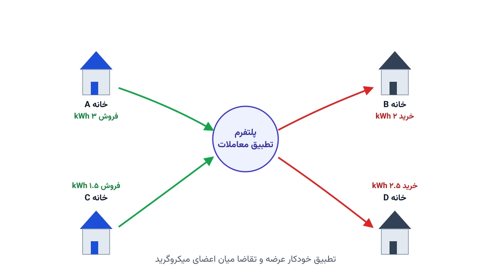

تصور کنید در یک محله، نیمی از خانه‌ها پنل خورشیدی روی پشت‌بام دارند. ظهرها که آفتاب تند است، این خانه‌ها برق بیشتری تولید می‌کنند تا مصرف می‌کنند. همسایه‌های بدون پنل، همان ساعت نیاز به برق دارند. راه سنتی این است که مازاد برق به قیمتی پایین به شبکه فروخته شود. همان همسایه هم برق موردنیازش را با قیمتی بالاتر از شبکه بخرد. اما اگر این دو مستقیماً با هم معامله کنند چه می‌شود؟

این دقیقاً ایده‌ی «تجارت انرژی نظیر‌به‌نظیر» یا P2P Energy Trading است. در این مدل، مصرف‌کننده‌ها و تولیدکننده‌های کوچک به‌جای وابستگی کامل به توزیع‌کننده‌ی برق، مستقیماً با هم برق معامله می‌کنند. یک پلتفرم نرم‌افزاری، با حل یک مسئله بهینه‌سازی، بهترین تطبیق میان خریداران و فروشندگان را پیدا می‌کند. نتیجه این است که هر دو طرف سودی بیشتر از قیمت شبکه سراسری به‌دست می‌آورند.

## اهمیت موضوع

با گسترش پنل‌های خورشیدی خانگی، میکروگرید‌های محلی دیگر یک ایده‌ی آزمایشگاهی نیستند. شرکتی مثل LO3 Energy، در پروژه‌ی معروف «میکروگرید بروکلین»، یکی از نخستین بازارهای محلی انرژی را در عمل پیاده کرد. ساکنان این محله می‌توانستند برق خورشیدی مازاد خود را مستقیماً به همسایه‌شان بفروشند. این مثال نشان داد تجارت نظیر‌به‌نظیر فقط یک مفهوم تئوری در کنفرانس‌های دانشگاهی نیست.

اهمیت این موضوع از چند جا می‌آید. اول، با معامله‌ی مستقیم، مازاد انرژی تجدیدپذیر بهتر مصرف می‌شود. دوم، فشار روی خطوط توزیع اصلی کاهش می‌یابد، چون برق در همان محله مصرف می‌شود. سوم، مشارکت مردم در بازار انرژی افزایش می‌یابد. این مشارکت انگیزه‌ی سرمایه‌گذاری در پنل خورشیدی را هم بیشتر می‌کند. برای شرکت‌های توزیع برق، طراحی درست این بازارها یک فرصت کسب‌وکار تازه است، نه فقط یک چالش فنی.

## مسئله از نگاه بهینه‌سازی

فرض کنید در یک میکروگرید، چند خانه داریم که هرکدام می‌توانند هم مصرف‌کننده باشند و هم تولیدکننده. هر خانه در هر بازه‌ی زمانی، یک پیش‌بینی تولید خورشیدی و یک پیش‌بینی مصرف دارد. تفاوت این دو، مازاد یا کسری انرژی آن خانه را مشخص می‌کند. مسئله‌ی بهینه‌سازی باید تصمیم بگیرد چه مقدار انرژی میان هر جفت خانه مبادله شود.

این مسئله شبیه مسئله‌ی حمل‌ونقل کلاسیک است، اما با دو تفاوت مهم. تفاوت اول این است که قیمت معامله هم یک متغیر تصمیم است، نه فقط مقدار انرژی. تفاوت دوم این است که ظرفیت فیزیکی خطوط برق میان خانه‌ها باید رعایت شود. در غیر این صورت، شبکه بار بیش از حد می‌کشد و افت ولتاژ رخ می‌دهد. هدف معمول، بیشینه‌کردن «رفاه اجتماعی» کل میکروگرید است. منظور از این رفاه، مجموع صرفه‌جویی خریداران و سود فروشندگان نسبت به قیمت شبکه‌ی سراسری است.



## چالش‌های پیاده‌سازی در عمل

پیاده‌سازی این بازارها به‌اندازه‌ی فرمول‌بندی ریاضی‌شان ساده نیست. اول، هر خانه باید یک کنتور هوشمند داشته باشد که مصرف و تولید لحظه‌ای را گزارش کند. دوم، چارچوب قانونی برق باید فروش مستقیم میان مشترکان را اصلاً مجاز بداند، که در بسیاری از کشورها هنوز روشن نیست. سوم، اعتماد میان همسایه‌ها هم مهم است؛ کسی می‌خواهد مطمئن شود قیمت‌ها منصفانه محاسبه شده‌اند. به همین دلیل، بیشتر پروژه‌های پایلوت این حوزه، مثل همان پروژه‌ی بروکلین، ابتدا با مقیاس کوچک و زیر نظارت دقیق شروع می‌شوند.

## فرمول‌بندی ریاضی

می‌توان این مسئله را به‌صورت یک مدل برنامه‌ریزی خطی (LP) نوشت. فرض کنید $i$ و $j$ نشان‌دهنده‌ی خانه‌ها باشند و $t$ نشان‌دهنده‌ی بازه‌ی زمانی. متغیر تصمیم اصلی، $x_{ij,t}$ است: مقدار انرژی‌ای که خانه‌ی $i$ در بازه‌ی $t$ به خانه‌ی $j$ می‌فروشد. در مدل‌های پیشرفته‌تر، قیمت هر معامله هم متغیر است. در مدل‌های ساده‌تر، این قیمت را عددی ثابت و میان قیمت خرید و فروش شبکه در نظر می‌گیرند.

تابع هدف، بیشینه‌کردن مجموع صرفه‌جویی‌هاست.

$$
\max \sum_{t} \sum_{i,j} \left( c^{grid}_{buy} - c^{P2P}_{ij,t} \right) x_{ij,t}
$$

سه دسته قید اصلی هم باید رعایت شوند. دسته‌ی اول، تعادل عرضه و تقاضای هر خانه در هر بازه است.

$$
\sum_{j} x_{ij,t} \le \text{مازاد تولید خانه } i \text{ در زمان } t
$$

دسته‌ی دوم، سقف ظرفیت خط انتقال میان هر جفت خانه است. دسته‌ی سوم هم نبود مقدار منفی برای خرید یا فروش است.

$$
0 \le x_{ij,t} \le \text{ظرفیت خط}_{ij}
$$

در عمل، این مدل باید برای صدها بازه‌ی زمانی در طول یک سال حل شود. این تکرار، خودش یک چالش محاسباتی جدی ایجاد می‌کند.

## ظرفیت کار آکادمیک/پژوهشی

این حوزه هنوز سوالات باز زیادی دارد که فرصت خوبی برای پژوهش‌های دانشجویی فراهم می‌کند. یک جهت، طراحی مکانیزم قیمت‌گذاری عادلانه است. به‌جای قیمت ثابت، می‌توان از نظریه‌ی بازی‌ها یا حراج ترکیبی استفاده کرد. جهت دوم، مدل‌سازی عدم‌قطعیت تولید خورشیدی و تقاضا با رویکرد تصادفی یا استوار است. این جهت می‌تواند با مباحث دوره [مدل‌سازی عدم‌قطعیت](/courses/uncertainty-modeling/) ترکیب شود.

جهت سوم، تلفیق باتری خانگی با تجارت نظیر‌به‌نظیر است. در این حالت، خانه‌ها به‌جای فروش فوری مازاد، آن را ذخیره می‌کنند. بعد، در ساعتی با قیمت بهتر، آن را می‌فروشند. جهت چهارم هم بررسی تأثیر این بازارها روی پایداری ولتاژ شبکه‌ی توزیع است. این موضوع در یادداشت [بهینه‌سازی شبکه هوشمند](/notes/smart-grid-optimization/) هم به‌طور جزئی مطرح شده است. هرکدام از این مسیرها می‌تواند موضوع یک پایان‌نامه‌ی کارشناسی ارشد یا مقاله‌ی علمی باشد.

## پیاده‌سازی با پایتون

خبر خوب این است که چنین مدلی را می‌توان کاملاً با ابزارهای متن‌باز پایتون حل کرد. نیازی به نرم‌افزار تجاری گران‌قیمت نیست. [Pyomo](https://www.pyomo.org/) برای نوشتن مدل ریاضی، و [HiGHS](https://highs.dev/) یا [CBC](https://github.com/coin-or/Cbc) به‌عنوان سالور رایگان، برای این مقیاس مسئله کاملاً کافی هستند. برای شبکه‌های بزرگ‌تر با صدها خانه، [Google OR-Tools](https://developers.google.com/optimization) هم گزینه‌ای برای بخش تطبیق معاملات است.

ساختار کلی کد این‌طور شروع می‌شود:

```python
import pyomo.environ as pyo

model = pyo.ConcreteModel()

# مجموعه خانه‌ها و بازه‌های زمانی
model.H = pyo.Set(initialize=houses)
model.T = pyo.Set(initialize=time_slots)

# متغیر تصمیم: مقدار انرژی مبادله‌شده از i به j در زمان t
model.x = pyo.Var(model.H, model.H, model.T, domain=pyo.NonNegativeReals)

# قید ظرفیت خط میان هر دو خانه
def line_capacity_rule(model, i, j, t):
    return model.x[i, j, t] <= line_capacity[i, j]
model.line_capacity = pyo.Constraint(model.H, model.H, model.T, rule=line_capacity_rule)
```

ادامه‌ی قیود تعادل عرضه‌وتقاضا و تابع هدف رفاه اجتماعی هم به همین شیوه تعریف می‌شوند. نکته‌ی مهم این است که این مدل برای یک محله‌ی کوچک، روی یک لپ‌تاپ معمولی در چند ثانیه حل می‌شود. برای شبکه‌های بزرگ با هزاران خانه و بازه‌ی زمانی ریز، باید به سراغ تجزیه‌ی مسئله یا روش‌های تقریبی رفت.

## سوالات متداول

<h3>آیا تجارت انرژی نظیر‌به‌نظیر نیاز به تغییر زیرساخت شبکه دارد؟</h3>
<p>نه لزوماً. بیشتر پروژه‌های آزمایشی روی همان شبکه‌ی توزیع موجود اجرا می‌شوند و فقط یک لایه‌ی نرم‌افزاری برای تطبیق معاملات و صدور صورت‌حساب اضافه می‌کنند. چالش اصلی، نرم‌افزار بازار و مدل بهینه‌سازی است، نه سیم‌کشی جدید.</p>

<h3>چه فرقی میان این مدل و net metering معمولی وجود دارد؟</h3>
<p>در net metering، خانه با شبکه‌ی سراسری تسویه می‌کند، نه با همسایه. در تجارت نظیر‌به‌نظیر، قیمت معامله میان دو طرف مستقیماً تعیین می‌شود و معمولاً برای هر دو طرف از قیمت شبکه بهتر است. این تفاوت دقیقاً همان چیزی است که در دوره <a href="/courses/advanced-power-system/" style="color:#2563EB; font-weight:bold;">سیستم قدرت پیشرفته</a> با جزئیات مدل‌سازی می‌شود.</p>

<h3>آیا می‌توان این مدل را برای یک پروژه‌ی واقعی یا پایان‌نامه پیاده‌سازی کرد؟</h3>
<p>بله، کاملاً. اگر داده‌های تولید و مصرف یک میکروگرید واقعی یا شبیه‌سازی‌شده را در اختیار دارید، می‌توان مدل را متناسب با آن داده‌ها تنظیم کرد. برای طراحی دقیق‌تر مدل یا تفسیر نتایج روی داده‌ی واقعی خودتان، می‌توانید از <a href="/consultation/" style="color:#2563EB; font-weight:bold;">مشاوره</a> کمک بگیرید.</p>
