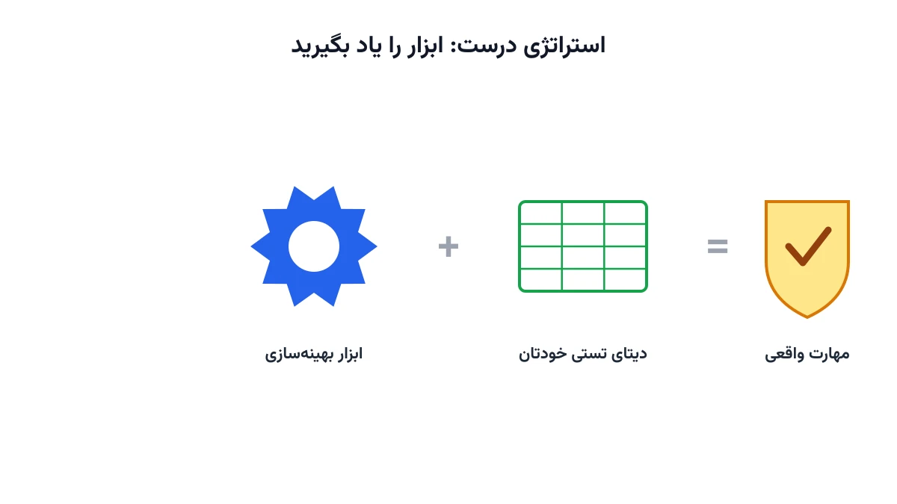

یکی از چیزهایی که هر کسی وارد دنیای پژوهش و بهینه‌سازی بشود، زود یاد می‌گیرد، این است: اکثر مقاله‌ها دیتای خودشان را به شما نمی‌دهند. مقاله را می‌خوانید، مدل ریاضی قشنگی می‌بینید، جدول نتایج عالی‌ای می‌بینید. اما وقتی دنبال دیتای ورودی می‌گردید، هیچی پیدا نمی‌کنید.

## چرا این اتفاق می‌افتد؟

برای این موضوع معمولاً دو دلیل می‌گویند:

۱. دیتا محرمانه است و نویسنده اجازه انتشارش را ندارد.
۲. نویسنده خودش عددسازی کرده و اصلاً دیتای واقعی‌ای در کار نبوده.

حالا بیایید رک باشیم. احتمالش را حدس بزنید: ۹۹ درصد موارد کدام‌یکی است؟

دقیقاً. اکثر وقت‌ها دیتا نه محرمانه است، نه جایی واقعاً وجود دارد که محرمانه باشد. فقط یک سری عدد تصادفی و قابل‌قبول کنار هم چیده شده، تا مدل روی کاغذ خوب جواب بدهد.

برای همین، راه عملی این است: به‌جای دنبال دیتای واقعی گشتن پشت هر مقاله، از دیتای عمومی و در دسترس استفاده کنید. دیتاستی که منبعش مشخص است، قابل بازتولید است، و کسی مجبور نیست دروغ کسی را باور کند.

و لطفاً این جمله خنده‌دار را هم دیگر تکرار نکنید، همان جمله‌ای که شاید استادتان هم به شما گفته باشد: «برو از همان مقاله دیتایش را بیاور.» همان‌طور که دیدیم، خیلی وقت‌ها اصلاً دیتایی برای آوردن وجود ندارد. با این کار فقط خودتان و بقیه را خسته می‌کنید.

## حتی اگر دیتا را هم داشته باشید، چه؟

حالا بیایید یک قدم جلوتر برویم و فرض کنیم شما واقعاً دیتا را دارید. یعنی حتی می‌دانید فلان آدم کدام روز، با چه ادویه‌ای، آبگوشتش را می‌خورد! خیلی خب، که چه؟

آیا ابزار بهینه‌سازی‌ای هم که قرار است با آن دیتا کار کند را بلدید؟ داشتن دیتا فقط یک تکه از ماجراست، نه همه‌ی ماجرا.

ریسرچ دقیقاً شبیه یک پازل صدتکه‌ی به‌هم‌ریخته است. اگر فقط یک تکه را جایی بچسبانید، به جایی نمی‌رسید. باید مدل‌سازی بلد باشید، دیتا را تمیز کنید، ابزار درست را انتخاب کنید، نتیجه را درست تحلیل و اعتبارسنجی کنید. تازه همه‌ی این‌ها کنار هم، یک تصویر معنادار می‌سازند.

این «به‌جایی‌نمی‌رسی» را معمولاً سال پنجم دکتری می‌فهمید؛ همان موقعی که سنوات را خورده‌اید و استاد می‌گوید زودتر دفاع کنید.

## استراتژی درست چیست؟

پس یک استراتژی روباست همین است:

ابزار را خودتان یاد بگیرید. روی یک دیتای تستی، حتی ساده و ساختگی، خودتان پیاده‌سازی‌اش کنید. منتظر و وابسته‌ی مقاله‌ی فلان و بهمان نمانید؛ همان مقاله‌های «وانگ و ژانگ» یا «صاحبی و همکاران». همان مقاله‌هایی که آدم با دیدن رفرنس‌شان سرگیجه می‌گیرد؛ اصلاً صاحبی کیست و همکارانش کیان؟

چون اگر منتظر آن دیتا و آن مقاله‌ی خاص بمانید، ممکن است هیچ‌وقت شروع نکنید. اگر هنوز با اجزای یک مدل خوب بهینه‌سازی آشنا نیستید، یادداشت [مدل‌سازی ریاضی و اهمیت آن](/notes/mathematical-modeling-art/) نقطه شروع خوبی است.

## سوالات متداول

<h3>پس اصلاً چرا باید مقاله بخوانیم؟</h3>

مقاله برای فرمول‌بندی، ساختار مدل و ایده‌های حل‌کردن ارزشمند است، نه لزوماً برای دیتای دقیقش. فرمول را از مقاله یاد بگیرید و دیتا را خودتان، از منابع عمومی یا تستی، تهیه کنید.

<h3>از کجا بفهمم دیتای یک مقاله ساختگی است یا واقعی؟</h3>

اگر دیتا یا کد در یک مخزن عمومی مثل گیت‌هاب پیوست نشده باشد، این یک علامت هشدار است. اگر نویسنده هیچ اشاره‌ای هم به منبع واقعی داده نکرده باشد، بهتر است با احتیاط بیشتری به آن مقاله نگاه کنید.

<h3>برای یادگیری درست ابزارهای بهینه‌سازی از کجا شروع کنم؟</h3>

دوره <a href="/courses/optimization-modeling/" style="color:#2563EB; font-weight:bold;">مدل‌سازی بهینه‌سازی</a> دقیقاً از همین‌جا شروع می‌کند: فرمول‌بندی درست مسئله و پیاده‌سازی آن با ابزارهای واقعی. اگر برای مسئله خودتان راهنمایی لازم دارید، از طریق صفحه <a href="/consultation/" style="color:#2563EB; font-weight:bold;">مشاوره</a> می‌توانید با ما در ارتباط باشید.

## جمع‌بندی

دیتای یک مقاله، به‌ندرت دیتای واقعی است، و حتی اگر باشد، فقط یک تکه از پازل پژوهش است. استراتژی روباست این نیست که دنبال دیتای فلان مقاله بگردید. استراتژی روباست این است که خودتان ابزار را یاد بگیرید و روی دیتای تستی پیاده‌سازی‌اش کنید. همین یک تصمیم، سال‌ها از عمر پژوهشی‌تان را نجات می‌دهد.
