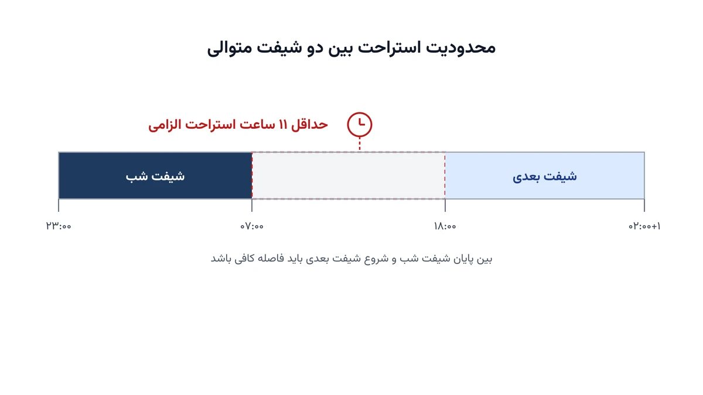

هر بیمارستان یک تقویم کشیک دارد. پزشک کدام روز، کدام شیفت را پوشش می‌دهد؟ این سؤال ساده به نظر می‌رسد. اما پشت آن، یک قید بسیار جدی پنهان است: استراحت. پزشکی که شب کشیک بوده، نمی‌تواند صبح همان روز دوباره سرکار بیاید. خستگی پزشک، فقط مسئله او نیست؛ مستقیماً به ایمنی بیمار هم مربوط می‌شود. در این یادداشت یک مدل بهینه‌سازی کامل برای این مسئله می‌سازیم.

## مسئله واقعی چیست؟

بخش‌هایی مثل اورژانس، شب و روز تعطیلی ندارند. هر شیفت باید تعداد مشخصی پزشک داشته باشد. هم‌زمان، چند قانون سخت‌گیرانه هم باید رعایت شود. میان پایان یک شیفت شب و شروع شیفت بعدی، باید چند ساعت استراحت فاصله باشد. تعداد شب‌های پیاپی هر پزشک هم محدود است. علاوه بر این، شیفت‌های سنگین باید عادلانه بین همه پزشکان بخش تقسیم شود.

این محدودیت‌ها تصادفی نیستند. بسیاری از کشورها آن‌ها را به‌صورت قانون کار پزشکی تدوین کرده‌اند. در اتحادیه اروپا، دستورالعمل زمان کار اروپا (European Working Time Directive) سقف ساعت کاری هفتگی و حداقل استراحت را مشخص می‌کند. در آمریکا، نهاد ACGME قوانین مشابهی برای دستیاران تخصصی دارد. مدل بهینه‌سازی باید همه این قیدها را هم‌زمان رعایت کند، نه فقط پوشش شیفت را.

## اهمیت این موضوع

وقتی پزشک خسته باشد، احتمال خطای پزشکی بالا می‌رود. این موضوع صرفاً یک نگرانی نظری نیست. سازمان‌هایی مثل NHS در بریتانیا، سال‌هاست با چالش زمان‌بندی کشیک پزشکان و رعایت سقف ساعت کاری دست‌وپنجه نرم می‌کنند. وقتی صدها پزشک و دستیار در ده‌ها بخش مختلف کار می‌کنند، چیدن دستی یک برنامه تقریباً غیرممکن می‌شود. این برنامه باید هم‌زمان پوشش را تضمین کند و هم قانون استراحت را نقض نکند.

از طرف دیگر، نارضایتی پزشکان از شیفت‌های نابرابر، یکی از عوامل اصلی فرسودگی شغلی در حوزه درمان است. مدلی که بار شیفت شب را عادلانه توزیع کند، مستقیماً روی ماندگاری نیروی متخصص اثر می‌گذارد. این دقیقاً همان مسئله‌ای است که یادداشت [زمان‌بندی نیروی کار بیمارستان در مقیاس بزرگ](/notes/hospital-staff-scheduling-lns/) هم از زاویه دیگری به آن پرداخته است.



## اشتباهی که در عمل زیاد تکرار می‌شود

خیلی از برنامه‌های دستی، فقط به «شیفت بعدی» نگاه می‌کنند. اگر پزشکی شب شنبه کار کرده، صبح یکشنبه برایش بسته می‌شود. اما همین پزشک ممکن است عصر یکشنبه هم آزاد باشد، در حالی که عملاً هنوز به اندازه کافی استراحت نکرده است. قید استراحت واقعی باید بر اساس ساعت دقیق پایان و شروع شیفت تعریف شود، نه فقط بر اساس برچسب «روز بعد». این یک نکته ساده است، اما نادیده‌گرفتنش باعث نقض پنهان قانون کار می‌شود.

## مدل ریاضی

متغیر تصمیم اصلی مدل، یک متغیر دودویی است. اگر پزشک $p$ در روز $d$ شیفت $s$ را کار کند، مقدار آن یک می‌شود:

$$x_{p,d,s} \in \{0,1\} \quad \forall p \in P,\, d \in D,\, s \in \{\text{صبح}, \text{عصر}, \text{شب}\}$$

هدف مدل، کمینه‌کردن کمبود نیرو و نابرابری شیفت‌های شب بین پزشکان است:

$$\min \sum_{d,s} u_{d,s} + \lambda \sum_{p} \left| N_p - \bar{N} \right|$$

که در آن $u_{d,s}$ کمبود نیروی شیفت $s$ در روز $d$ است، و $N_p$ تعداد شب‌های کاری پزشک $p$ است. اولین قید، پوشش هر شیفت را تضمین می‌کند:

$$\sum_{p} x_{p,d,s} + u_{d,s} \geq r_{d,s} \quad \forall d,s$$

هر پزشک در هر روز حداکثر یک شیفت می‌گیرد:

$$\sum_{s} x_{p,d,s} \leq 1 \quad \forall p,d$$

مهم‌ترین قید مدل، قید استراحت است. اگر پزشکی شب کار کرده، نباید فردای همان روز صبح یا عصر هم کشیک باشد:

$$x_{p,d,\text{شب}} + x_{p,d+1,\text{صبح}} \leq 1 \quad \forall p,d$$

$$x_{p,d,\text{شب}} + x_{p,d+1,\text{عصر}} \leq 1 \quad \forall p,d$$

و در نهایت، تعداد شب‌های پیاپی هر پزشک در هر بازه سه‌روزه محدود می‌شود:

$$\sum_{k=d}^{d+2} x_{p,k,\text{شب}} \leq 2 \quad \forall p,d$$

## ظرفیت کار آکادمیک/پژوهشی

این مسئله برای پژوهشگران حوزه تحقیق در عملیات سلامت، میدانی بسیار غنی است. می‌توان قید استراحت ساده را به یک مدل زمان‌پیوسته تبدیل کرد. این مدل فاصله دقیق به ساعت را محاسبه می‌کند، نه فقط شیفت بعدی را ممنوع می‌کند. موضوع دیگر، مدل‌سازی تصادفی تقاضای اورژانس است؛ چون در روزهای پرحادثه، نیاز واقعی به پزشک از برنامه از پیش‌تعیین‌شده فاصله می‌گیرد.

زاویه سوم، ترکیب عدالت چندمعیاره است. عدالت فقط در تعداد شب‌ها معنا ندارد؛ باید شیفت‌های آخر هفته و تعطیلات رسمی را هم در نظر گرفت. در مقیاس بزرگ، تکنیک جستجوی همسایگی بزرگ (Large Neighborhood Search) هم کمک می‌کند. این تکنیک حل سریع‌تر مدل را در بیمارستان‌های چندبخشی ممکن می‌سازد.

## پیاده‌سازی با پایتون

خبر خوب این است که چنین مدلی را می‌توان کاملاً با ابزارهای متن‌باز و رایگان پایتون حل کرد. نیازی به سالور تجاری گران‌قیمت نیست. کتابخانه [OR-Tools](https://developers.google.com/optimization) گوگل، به‌خصوص سالور [CP-SAT](https://developers.google.com/optimization/cp/cp_solver) آن، دقیقاً برای این نوع مسائل زمان‌بندی طراحی شده است.

ساختار کلی مدل در CP-SAT ساده است. ابتدا متغیرهای بولی برای هر پزشک، هر روز و هر شیفت تعریف می‌شوند. سپس قید پوشش، قید یک‌شیفت‌در‌روز و قید استراحت اضافه می‌شوند:

```python
from ortools.sat.python import cp_model

model = cp_model.CpModel()
physicians = range(n_physicians)
days = range(n_days)
shifts = ["morning", "evening", "night"]

# متغیر تصمیم: آیا پزشک p در روز d شیفت s را کار می‌کند؟
x = {}
for p in physicians:
    for d in days:
        for s in shifts:
            x[p, d, s] = model.NewBoolVar(f"x_{p}_{d}_{s}")

# قید: حداکثر یک شیفت در روز برای هر پزشک
for p in physicians:
    for d in days:
        model.Add(sum(x[p, d, s] for s in shifts) <= 1)

# قید استراحت: بعد از شیفت شب، صبح و عصر فردا ممنوع است
for p in physicians:
    for d in days[:-1]:
        model.Add(x[p, d, "night"] + x[p, d + 1, "morning"] <= 1)
        model.Add(x[p, d, "night"] + x[p, d + 1, "evening"] <= 1)

# ادامه قیود پوشش، محدودیت شب‌های پیاپی و تابع هدف به همین شیوه تعریف می‌شوند.
```

اگر دانشگاه یا بیمارستانی بخواهد چنین مدلی را واقعاً پیاده کند، آشنایی با [مدل‌سازی ریاضی](/courses/optimization-modeling/) پیش‌نیاز خوبی است. دوره [بهینه‌سازی و تصمیم‌گیری سیستم‌های سلامت با پایتون](/courses/health-opt/) هم دقیقاً همین نوع مسائل را با پروژه‌های عملی پوشش می‌دهد.

## سوالات متداول

<h3>چرا نمی‌توان این برنامه را با اکسل چید؟</h3>
<p>با چند پزشک و چند روز، اکسل جواب می‌دهد. اما با ده‌ها پزشک، چند بخش و قید استراحت هم‌زمان، فضای جواب به‌سرعت منفجر می‌شود. سالور CP-SAT می‌تواند هزاران حالت را در چند ثانیه بررسی کند.</p>

<h3>آیا این مدل برای دستیاران تخصصی هم کاربرد دارد؟</h3>
<p>بله. قوانین استراحت دستیاران معمولاً حتی سخت‌گیرانه‌تر از پزشکان ثابت است. فقط کافی است پارامترهای حداقل استراحت و سقف شب‌های پیاپی را با قوانین محلی تطبیق دهید.</p>

<h3>اگر بخواهیم این مدل را برای بیمارستان خودمان پیاده‌سازی کنیم چه کنیم؟</h3>
<p>هر بیمارستان قوانین داخلی و قراردادهای خاص خودش را دارد. برای تطبیق دقیق مدل با این قوانین، بهتر است از یک <a href="/consultation/" style="color:#2563EB; font-weight:bold;">مشاوره</a> تخصصی کمک بگیرید.</p>

<h3>برای یادگیری کامل این حوزه از کجا شروع کنم؟</h3>
<p>دوره <a href="/courses/health-opt/" style="color:#2563EB; font-weight:bold;">بهینه‌سازی و تصمیم‌گیری سیستم‌های سلامت با پایتون</a> مسیر کاملی از مبانی تا پیاده‌سازی پروژه‌های واقعی این حوزه را پوشش می‌دهد.</p>
