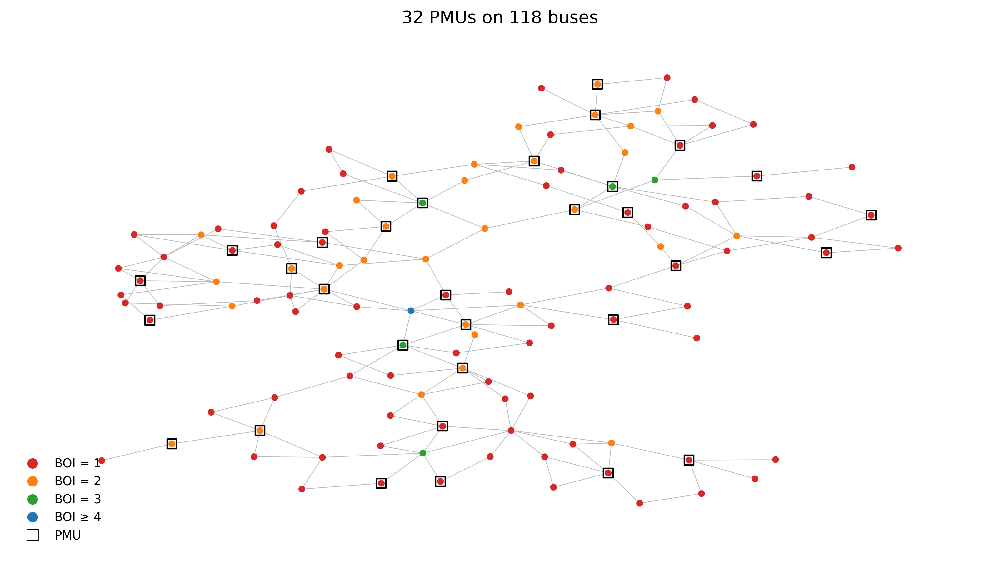
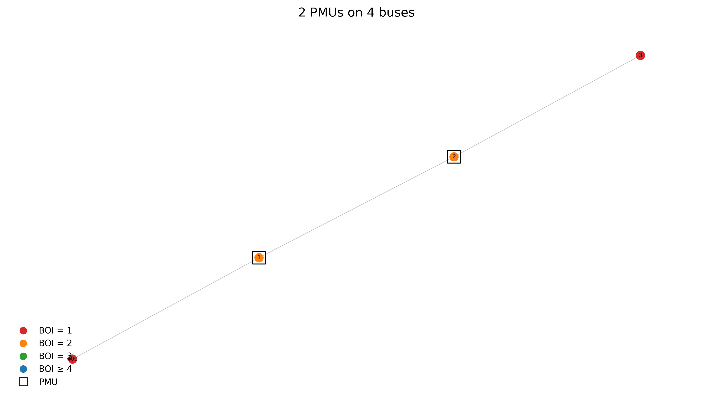
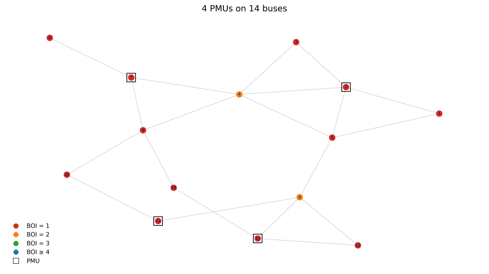
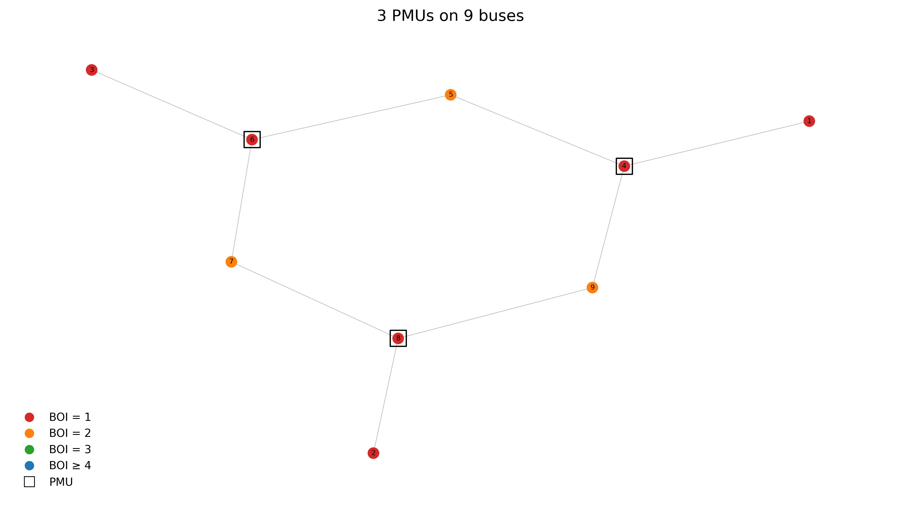
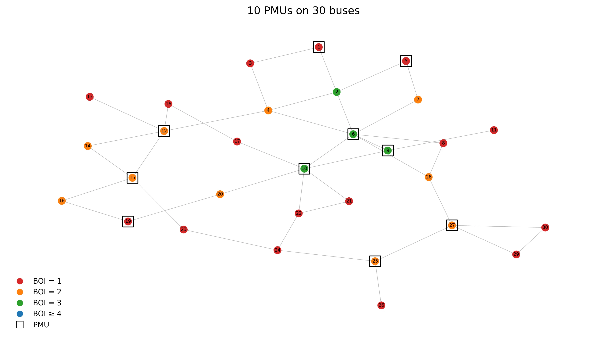
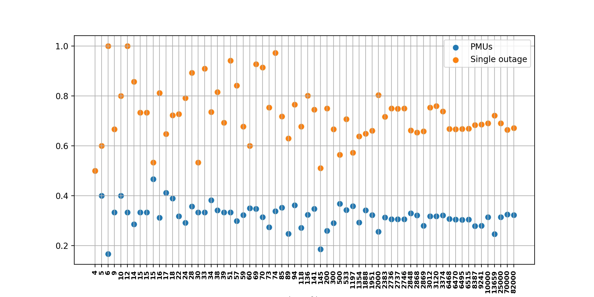
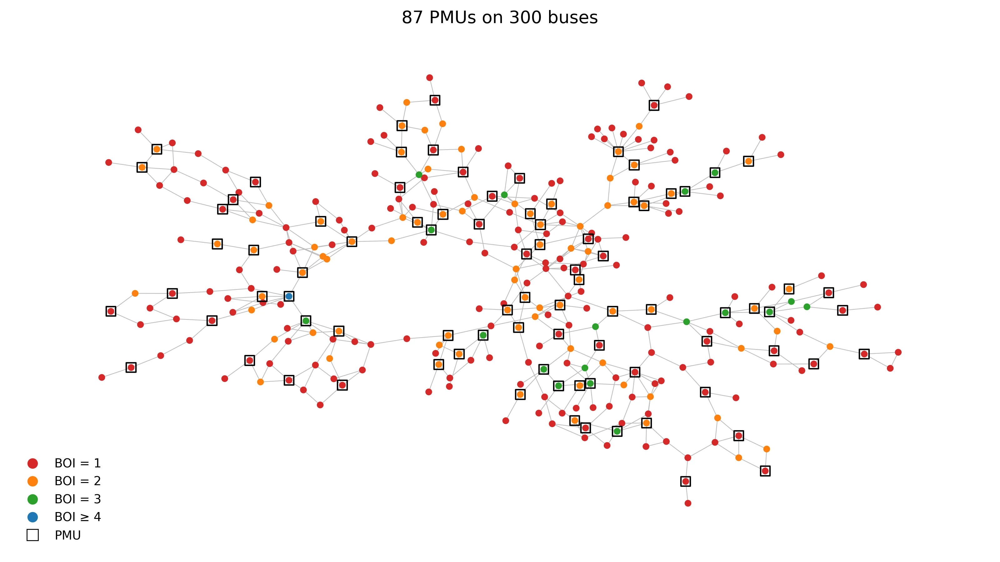
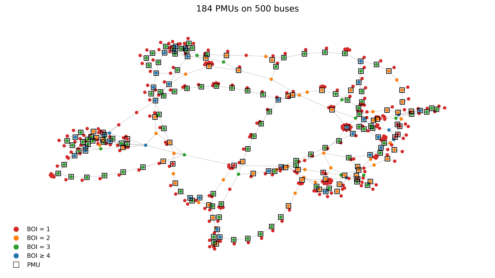

بهره‌بردار شبکه قدرت برای کنترل، حفاظت و تخمین حالت باید بداند در هر لحظه **دامنه و زاویه ولتاژ** همه باس‌ها چقدر است. وقتی این اطلاعات برای تمام باس‌ها در دسترس باشد، می‌گوییم شبکه **رؤیت‌پذیر (Observable)** است.

واحد اندازه‌گیری فازوری یا **PMU (Phasor Measurement Unit)** یکی از ابزارهای اصلی این کار است. اما PMU ارزان نیست؛ هزینه خود دستگاه، کانال‌های مخابراتی و نصب در پست باعث می‌شود که نصب آن روی همه باس‌ها منطقی نباشد. پس سؤال اصلی این است:

> **کمترین تعداد PMU را کجا نصب کنیم تا کل شبکه رؤیت‌پذیر شود؟**

در این یادداشت این مسئله را با سالور **CP-SAT** از کتابخانه OR-Tools مدل می‌کنیم و آن را روی ۶۶ شبکه استاندارد، از یک شبکه ۴ باسه تا یک شبکه مصنوعی ۸۲٬۰۰۰ باسه، اجرا می‌کنیم.

---

## PMU دقیقاً چه چیزی را می‌بیند؟

یک PMU که روی باس $i$ نصب شود:

- ولتاژ (دامنه و زاویه) **خود باس $i$** را مستقیماً اندازه می‌گیرد؛
- جریان **همه خطوط متصل** به باس $i$ را هم اندازه می‌گیرد.

با داشتن ولتاژ باس $i$، جریان خط و امپدانس خط، ولتاژ باس طرف دیگر خط با قانون اهم محاسبه می‌شود. بنابراین:

> یک PMU روی باس $i$، **خود باس $i$ و تمام همسایه‌های آن** را رؤیت‌پذیر می‌کند.

این قاعده ساده، مسئله فنی را به یک مسئله گرافی تبدیل می‌کند: باس‌ها گره‌اند، خطوط یال‌اند و ما دنبال کوچک‌ترین مجموعه‌ای از گره‌ها هستیم که هر گره یا خودش در مجموعه باشد یا همسایه یکی از اعضای مجموعه باشد. این همان مسئله کلاسیک **مجموعه احاطه‌گر کمینه (Minimum Dominating Set)** است که NP-hard است.

برای این‌که این قاعده کاملاً ملموس شود، ساده‌ترین حالت ممکن را ببینید: یک شبکه خطی فقط ۴ باسه.



با نصب PMU روی باس‌های ۱ و ۲، باس ۳ از طریق همسایگی با باس ۲ دیده می‌شود و کل شبکه رؤیت‌پذیر است. همین منطق ساده، روی شبکه‌های هزاران باسه هم بدون تغییر اعمال می‌شود؛ فقط تعداد متغیرها و قیود بیشتر می‌شود.

---

## مدل ریاضی

برای هر باس $i$ یک متغیر دودویی تعریف می‌کنیم: اگر روی باس $i$ یک PMU نصب شود، $x_i = 1$؛ در غیر این صورت $x_i = 0$.

$$
x_i \in \{0, 1\} \qquad \forall i \in \mathcal{B}
$$

اگر $\mathcal{N}(i)$ مجموعه همسایه‌های باس $i$ باشد، مدل به این شکل است:

$$
\min \sum_{i \in \mathcal{B}} x_i
$$

$$
x_i + \sum_{j \in \mathcal{N}(i)} x_j \ \geq\ 1 \qquad \forall i \in \mathcal{B}
$$

قید دوم می‌گوید: هر باس باید **دست‌کم یک بار** دیده شود؛ یا خودش PMU داشته باشد یا یکی از همسایه‌هایش.

نکته جالب این است که این قید در واقع یک **OR منطقی** است: «$x_i$ یا $x_{j_1}$ یا $x_{j_2}$ یا ...». در CP-SAT می‌توانیم آن را مستقیماً با `add_bool_or` بنویسیم؛ که هم خواناتر است و هم سالور را در استفاده از تکنیک‌های SAT (مثل انتشار بند و یادگیری از تعارض) آزادتر می‌گذارد.

---

## فقط رؤیت‌پذیری کافی نیست: سنجش استحکام جواب

جواب کمینه معمولاً **شکننده** است. برای اینکه کیفیت جواب را بهتر بسنجیم، سه شاخص تعریف می‌کنیم:

**۱. شاخص رؤیت‌پذیری باس (BOI):** تعداد PMUهایی که باس $i$ را می‌بینند:

$$
\text{BOI}_i = x_i + \sum_{j \in \mathcal{N}(i)} x_j
$$

**۲. شاخص افزونگی رؤیت‌پذیری سیستم (SORI):** میانگین BOI روی همه باس‌ها:

$$
\text{SORI} = \frac{1}{|\mathcal{B}|} \sum_{i \in \mathcal{B}} \text{BOI}_i
$$

**۳. باس‌های تک‌نقطه‌ای:** باس‌هایی که $\text{BOI}_i = 1$ دارند. اگر همان یک PMU از کار بیفتد (خرابی دستگاه، قطع کانال مخابراتی، حمله سایبری)، این باس‌ها **رؤیت‌پذیری خود را از دست می‌دهند.**

در تصاویر این یادداشت، رنگ هر باس نشان‌دهنده BOI آن است:
قرمز = ۱، نارنجی = ۲، سبز = ۳، آبی = ۴ یا بیشتر. باس‌هایی که مربع مشکی دارند محل نصب PMU هستند.

---

## مثال اول: شبکه ۱۴ باسه IEEE



سالور با **۴ PMU** روی باس‌های **۲، ۷، ۱۱ و ۱۳** کل شبکه را رؤیت‌پذیر می‌کند. یعنی تنها حدود ۲۹ درصد باس‌ها نیاز به تجهیز دارند.

اما به رنگ‌ها دقت کنید: از ۱۴ باس، **۱۲ باس قرمز** هستند و فقط باس‌های ۴ و ۶ دو بار دیده می‌شوند. SORI این جواب برابر ۱٫۱۴ است. به زبان ساده: این طرح ارزان است، اما خرابی تقریباً هر PMU بخشی از شبکه را «کور» می‌کند.

برای اینکه ببینید همین الگو در ابعاد دیگر چه شکلی پیدا می‌کند، دو نمونه کوچک‌تر و بزرگ‌تر را هم ببینید:



در یک شبکه کوچک ۹ باسه، فقط **۳ PMU** کافی است. توپولوژی این شبکه تقریباً یک درخت است؛ به همین دلیل نسبت PMU به باس نسبتاً کوچک می‌ماند.



در شبکه ۳۰ باسه IEEE، **۱۰ PMU** لازم است. چند باس سبز (BOI = 3) هم دیده می‌شود؛ یعنی ساختار این شبکه کمی چگال‌تر از شبکه ۱۴ باسه است.

## مثال دوم: شبکه ۱۱۸ باسه IEEE

در تصویر ابتدای یادداشت، شبکه ۱۱۸ باسه با **۳۲ PMU** کاملاً رؤیت‌پذیر شده است (حدود ۲۷ درصد باس‌ها). در این شبکه بزرگ‌تر، باس‌های نارنجی و سبز بیشتری می‌بینیم و SORI به حدود ۱٫۳۸ می‌رسد؛ اما هنوز حدود **۶۸ درصد** باس‌ها فقط با یک PMU دیده می‌شوند.

---

## آزمایش روی ۶۶ شبکه: از ۴ تا ۸۲٬۰۰۰ باس

مدل را روی ۶۶ شبکه استاندارد اجرا کردیم؛ از شبکه‌های کوچک توزیع و انتقال گرفته تا شبکه‌های PEGASE، RTE فرانسه، شبکه‌های مصنوعی ACTIVSg و شبکه مصنوعی کل آمریکا (Synthetic USA).



در این نمودار، محور افقی تعداد باس‌های هر شبکه است و برای هر شبکه دو مقدار نسبی رسم شده:

- **نقاط آبی:** نسبت تعداد PMU به تعداد باس‌ها؛
- **نقاط نارنجی:** نسبت باس‌هایی که با خرابی یک PMU رؤیت‌پذیری را از دست می‌دهند.

چند نمونه از نتایج:

| شبکه (تعداد باس) | تعداد PMU | نسبت PMU | SORI | سهم باس‌های تک‌نقطه‌ای |
|---:|---:|---:|---:|---:|
| ۱۴ | ۴ | ۰٫۲۹ | ۱٫۱۴ | ۸۶٪ |
| ۳۰ | ۱۰ | ۰٫۳۳ | ۱٫۶۰ | ۵۳٪ |
| ۳۹ | ۱۳ | ۰٫۳۳ | ۱٫۳۳ | ۶۹٪ |
| ۵۷ | ۱۷ | ۰٫۳۰ | ۱٫۱۱ | ۸۹٪ |
| ۱۱۸ | ۳۲ | ۰٫۲۷ | ۱٫۳۸ | ۶۹٪ |
| ۳۰۰ | ۸۷ | ۰٫۲۹ | ۱٫۴۰ | ۶۷٪ |
| ۲٬۰۰۰ | ۵۱۲ | ۰٫۲۶ | ۱٫۲۷ | ۸۰٪ |
| ۹٬۲۴۱ | ۲٬۵۸۰ | ۰٫۲۸ | ۱٫۴۶ | ۶۹٪ |
| ۲۵٬۰۰۰ | ۷٬۸۷۱ | ۰٫۳۱ | ۱٫۴۱ | ۶۹٪ |
| ۸۲٬۰۰۰ | ۲۶٬۴۲۸ | ۰٫۳۲ | ۱٫۴۳ | ۶۷٪ |

> تعداد PMU در جدول، مقدار **بهینه اثبات‌شده** است. اما مسئله معمولاً چند جواب بهینه دارد؛ بنابراین SORI و سهم باس‌های تک‌نقطه‌ای ممکن است بین اجراهای مختلف کمی تغییر کند.

برای این‌که حس مقیاس را از نزدیک ببینید، دو نمونه بزرگ‌تر از جدول بالا را هم به‌صورت تصویری می‌آوریم:



شبکه ۳۰۰ باسه ساختار چندخوشه‌ای دارد؛ چند زیرشبکه کم‌ارتباط که با چند خط رابط به هم وصل‌اند. CP-SAT بدون هیچ تنظیم خاصی، همین ساختار را تشخیص می‌دهد و PMUها را در نقاط اتصال خوشه‌ها متمرکز می‌کند.



در ۵۰۰ باس، نقاط آبی (BOI ≥ 4) هم ظاهر می‌شوند؛ یعنی برخی باس‌های پرتراکم، حتی در جواب کمینه هم با چند PMU هم‌زمان دیده می‌شوند. این نشان می‌دهد که افزونگی در عمل **یکنواخت توزیع نمی‌شود**؛ در برخی نقاط شبکه رایگان به دست می‌آید و در جاهای دیگر باید برای آن هزینه کرد.

### چه چیزهایی از این نتایج یاد می‌گیریم؟

**۱. حدود یک‌سوم باس‌ها کافی است.** در شبکه‌های کوچک نسبت PMU بین ۰٫۱۷ تا ۰٫۴۷ نوسان دارد، اما با بزرگ شدن شبکه این نسبت در بازه حدود **۰٫۲۵ تا ۰٫۳۳** پایدار می‌شود. این یک قاعده سرانگشتی مفید برای برآورد اولیه بودجه است.

**۲. جواب کمینه شکننده است.** در بیشتر شبکه‌ها، **۶۰ تا ۹۰ درصد** باس‌ها فقط با یک PMU دیده می‌شوند. حالت حدی، شبکه ۶ باسه است: یک PMU کل شبکه را می‌بیند، اما خرابی همان یک دستگاه **۱۰۰ درصد** شبکه را کور می‌کند. ارزان‌ترین طرح لزوماً طرح قابل‌اعتماد نیست.

**۳. CP-SAT در مقیاس بزرگ هم قدرتمند است.** همه ۶۶ شبکه به **جواب بهینه اثبات‌شده** رسیدند. شبکه ۱۳٬۶۵۹ باسه PEGASE در کمتر از یک ثانیه و شبکه ۸۲٬۰۰۰ باسه در حدود ۶ ثانیه حل شد (با ۸ هسته پردازشی). جالب اینکه سخت‌ترین مورد، شبکه ۸۲٬۰۰۰ باسه نبود؛ شبکه ۲٬۰۰۰ باسه ACTIVSg حدود ۴ ثانیه طول کشید. **اندازه شبکه به‌تنهایی تعیین‌کننده سختی مسئله نیست؛ ساختار گراف هم مهم است.**

---

## پیاده‌سازی با پایتون

اسکلت اصلی مدل در CP-SAT بسیار کوتاه است. بخش‌های اصلی در ادامه آمده؛ خواندن داده شبکه‌ها، حل، محاسبه شاخص‌ها و رسم شکل‌ها را خودتان کامل کنید:

```python
from ortools.sat.python import cp_model
from collections import defaultdict

def build_pmu_model(connect):
    # Normalize branches and collect bus set
    connect = list({(min(i, j), max(i, j)) for i, j in connect if i != j})
    buses = list({b for e in connect for b in e})

    model = cp_model.CpModel()
    install = {b: model.new_bool_var(f"install_{b}") for b in buses}

    # Adjacency list of the network graph
    adj = defaultdict(list)
    for i, j in connect:
        adj[i].append(j)
        adj[j].append(i)

    # Observability: each bus must see at least one PMU (itself or a neighbour)
    for b in buses:
        model.add_bool_or([install[b]] + [install[k] for k in adj[b]])

    # TODO: objective, solve, BOI / SORI evaluation
    ...
```

---

## توسعه‌های مدل

مدل پایه را می‌توان به چند شکل واقعی‌تر کرد:

- **باس‌های بدون تزریق (Zero-Injection Buses):** در این باس‌ها، قانون جریان کیرشهف اطلاعات اضافه می‌دهد و تعداد PMU لازم کمتر می‌شود.
- **افزونگی N-1:** با تبدیل سمت راست قید از ۱ به ۲، هر باس حداقل با دو PMU دیده می‌شود و طرح در برابر خرابی یک دستگاه مقاوم می‌شود.
- **بهینه‌سازی دومرحله‌ای (Lexicographic):** ابتدا کمترین تعداد PMU را پیدا کنید، سپس با ثابت نگه داشتن آن، SORI را بیشینه کنید. چون مسئله جواب‌های بهینه متعدد دارد، معمولاً می‌توان بدون هزینه اضافه، جواب مقاوم‌تری پیدا کرد.
- **محدودیت کانال:** هر PMU تعداد محدودی کانال اندازه‌گیری جریان دارد و نمی‌تواند همه خطوط یک باس پرتراکم را ببیند.
- **نصب مرحله‌ای:** وقتی بودجه در چند سال توزیع شده، ترتیب نصب PMUها هم یک تصمیم بهینه‌سازی است.

---

## جمع‌بندی

جایابی PMU نمونه‌ای عالی از این است که یک مسئله مهندسی واقعی چطور به یک مسئله ترکیبیاتی تمیز تبدیل می‌شود. با چند خط کد در CP-SAT می‌توان این مسئله را حتی برای شبکه‌ای با ۸۲ هزار باس در چند ثانیه به‌صورت بهینه حل کرد.

اما درس مهم‌تر این است: **بهینه بودن از نظر هزینه با قابل‌اعتماد بودن یکی نیست.** طرح کمینه، بیشتر شبکه را به یک نقطه شکست وابسته می‌کند و مهندس باید بین هزینه و افزونگی تعادل برقرار کند.

اگر می‌خواهید مدل‌سازی با OR-Tools و CP-SAT را به‌صورت پروژه‌محور یاد بگیرید، [دوره OR-Tools](https://www.udemy.com/course/ortools-course/?couponCode=DISCOUNT_ORTOOLS) را ببینید. برای مسائل بهینه‌سازی در سیستم‌های قدرت هم [دوره پیشرفته بهینه‌سازی سیستم قدرت](https://optexpert.org/courses/advanced-power-system/) گزینه مناسبی است.

نسخه انگلیسی این بحث را هم می‌توانید در [مقاله لینکدین](https://www.linkedin.com/pulse/cp-meets-power-grid-pmu-allocation-alireza-soroudi-phd-ewwmf/) بخوانید.
