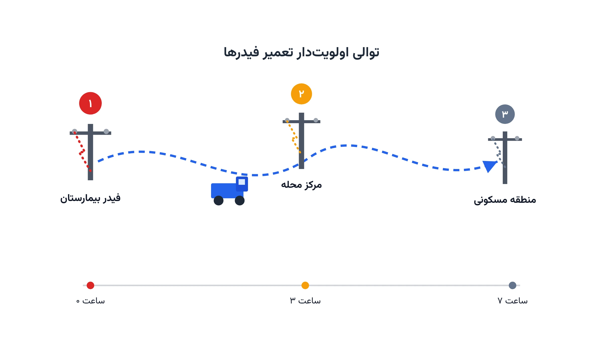

توفانی قدرتمند از میان شهر عبور کرده است. دهها تیر برق شکسته‌اند و صدها هزار مشترک بی‌برق مانده‌اند. تیم‌های تعمیر شرکت توزیع برق باید هرچه سریع‌تر وارد عمل شوند. اما منابع محدود است: تعداد گروه‌های تعمیر ثابت، و نقاط آسیب‌دیده بسیار زیاد. کدام گروه باید اول کجا برود؟ این سؤال ساده، در پس خود یک مسئله بهینه‌سازی ترکیبی پیچیده پنهان کرده است.

این مسئله را «مسیریابی و زمان‌بندی بازیابی پس از بلایا» می‌نامند. هر نقطه آسیب‌دیده زمان مشخصی برای تعمیر نیاز دارد. جابه‌جایی بین نقاط هم زمان و هزینه دارد. برخی تأسیسات، مثل بیمارستان یا تصفیه‌خانه آب، اولویت بسیار بالاتری دارند. در شبکه‌های توزیع برق شعاعی، گاهی تعمیر یک نقطه، پیش‌نیاز روشن‌شدن نقطه بعدی است. این ترکیب از مسیریابی، زمان‌بندی، و توالی وابسته، مسئله را از یک VRP ساده پیچیده‌تر می‌کند.

## فرمول‌بندی ریاضی مسئله

فرض کنید مجموعه نقاط آسیب‌دیده را با $N$ نشان دهیم و گروه‌های تعمیر را با $K$. هر نقطه $i$ وزن اولویت $w_i$ و زمان تعمیر $p_i$ دارد. زمان جابه‌جایی بین دو نقطه $i$ و $j$ را $\tau_{ij}$ می‌نامیم. متغیر $C_i$ زمان پایان تعمیر نقطه $i$ است. هدف، کمینه‌کردن مجموع وزنی زمان‌های پایان است؛ یعنی اولویت دادن به تأسیسات حیاتی.

$$
\min \sum_{i \in N} w_i C_i
$$

هر نقطه باید دقیقاً به یک گروه تعمیر اختصاص یابد:

$$
\sum_{k \in K} x_{ik} = 1 \quad \forall i \in N
$$

اگر گروه $k$ بلافاصله بعد از نقطه $i$ به نقطه $j$ برود، قید زیر توالی زمانی را تضمین می‌کند:

$$
C_j \ge C_i + \tau_{ij} + p_j - M(1-y_{ijk})
$$

در این رابطه $y_{ijk}$ یک متغیر صفر-و-یک است که نشان می‌دهد گروه $k$ مستقیماً از $i$ به $j$ رفته است. مقدار $M$ عددی بسیار بزرگ است تا قید فقط وقتی فعال شود که $y_{ijk}=1$ باشد. وقتی شبکه شعاعی است، قید دیگری هم لازم است: زمان پایان تعمیر نقطه بالادست باید از زمان شروع نقطه پایین‌دست کمتر باشد.

این قید پیش‌نیازی، دقیقاً همان ویژگی خاص شبکه‌های توزیع برق است. بدون آن، مدل ممکن است توالی‌ای پیشنهاد دهد که در عمل غیرممکن است.

## اهمیت این موضوع

بازیابی سریع برق پس از بلایا، تأثیر مستقیم بر جان انسان‌ها دارد. بیمارستان‌ها به برق برای دستگاه‌های حیاتی نیاز دارند. تصفیه‌خانه‌های آب بدون برق متوقف می‌شوند. هرچه بازگشت برق سریع‌تر باشد، آسیب‌های جانی و اقتصادی کمتر می‌شود. شرکتی مثل فلوریدا پاور اند لایت (Florida Power & Light) در آمریکا، هرساله با فصل طوفان‌های گرمسیری دست‌وپنجه نرم می‌کند. این شرکت باید هزاران گروه تعمیر را در عرض چند روز، در سطح یک ایالت، هماهنگ کند.

گاهی پیش از رسیدن گروه تعمیر، مسیر جاده‌ای هم مسدود است. در چنین حالتی، باید ابتدا [مسیرهای مسدود از آوار پاک‌سازی شوند](/notes/debris-clearance-arc-routing/). این دو مسئله—پاک‌سازی آوار و تعمیر برق—اغلب به‌طور همزمان و هماهنگ اجرا می‌شوند. هماهنگی ضعیف بین تیم‌ها، می‌تواند بازگشت برق را روزها عقب بیندازد. از سوی دیگر، تخصیص نادرست گروه‌ها به اولویت‌های اشتباه، هزینه انسانی واقعی دارد.

## ظرفیت پژوهشی و آکادمیک

این حوزه، ترکیبی از چند شاخه کلاسیک پژوهش عملیاتی است. ادبیات علمی به آن گاهی «مسئله پیمانکار مسافر چندگانه» یا k-TRP می‌گوید. نسخه بازیابی بلایا، قیدهای پیش‌نیازی و اولویت را هم اضافه می‌کند. این ترکیب، هنوز به‌اندازه VRP کلاسیک بالغ نشده است. فرصت خوبی برای مقاله یا پایان‌نامه باقی مانده است.

مسیر اول، مدل‌سازی عدم‌قطعیت در زمان تعمیر و میزان آسیب است. آسیب واقعی تا رسیدن گروه به محل، اغلب نامشخص است. مسیر دوم، هماهنگی چند نوع گروه تخصصی—مثل گروه برقی و گروه درخت‌بری—است. مسیر سوم، یادگیری ماشین برای پیش‌بینی محل و شدت آسیب پیش از اعزام گروه‌هاست. مسیر چهارم، مدل‌های پویا است که با رسیدن گزارش‌های جدید آسیب، برنامه را بازبینی می‌کنند.



## پیاده‌سازی با پایتون

خبر خوب این است که این مدل را می‌توان کاملاً با ابزارهای متن‌باز حل کرد. نیازی به نرم‌افزار تجاری گران‌قیمت نیست. ماژول [CP-SAT](https://developers.google.com/optimization/cp/cp_solver) از کتابخانه [OR-Tools](https://developers.google.com/optimization)، برای این نوع مسئله ترکیبی بسیار مناسب است. کتابخانه [NetworkX](https://networkx.org/) هم برای مدل‌سازی ساختار شعاعی شبکه و قیدهای پیش‌نیازی کاربرد دارد. داده‌های موقعیت نقاط آسیب‌دیده و زمان تعمیر هرکدام را می‌توان از یک فایل ساده CSV خواند. این فایل باید شامل ستون‌های شناسه نقطه، اولویت، و زمان تعمیر تخمینی باشد.

```python
from ortools.sat.python import cp_model

# داده‌های نمونه: پنج نقطه آسیب‌دیده و دو گروه تعمیر
sites = ["بیمارستان", "مرکز_محله", "منطقه_1", "منطقه_2", "پست_فرعی"]
priority = {"بیمارستان": 10, "مرکز_محله": 5, "منطقه_1": 2, "منطقه_2": 2, "پست_فرعی": 4}
repair_time = {"بیمارستان": 90, "مرکز_محله": 60, "منطقه_1": 45, "منطقه_2": 45, "پست_فرعی": 70}
crews = ["گروه_1", "گروه_2"]
horizon = 600

model = cp_model.CpModel()
start, end, interval, presence = {}, {}, {}, {}

for s in sites:
    for k in crews:
        presence[s, k] = model.NewBoolVar(f"x_{s}_{k}")
        start[s, k] = model.NewIntVar(0, horizon, f"start_{s}_{k}")
        end[s, k] = model.NewIntVar(0, horizon, f"end_{s}_{k}")
        interval[s, k] = model.NewOptionalIntervalVar(
            start[s, k], repair_time[s], end[s, k], presence[s, k], f"iv_{s}_{k}")
    model.AddExactlyOne(presence[s, k] for k in crews)

for k in crews:
    model.AddNoOverlap([interval[s, k] for s in sites])

completion = {}
for s in sites:
    completion[s] = model.NewIntVar(0, horizon, f"C_{s}")
    for k in crews:
        model.Add(completion[s] == end[s, k]).OnlyEnforceIf(presence[s, k])

model.Minimize(sum(priority[s] * completion[s] for s in sites))

solver = cp_model.CpSolver()
solver.Solve(model)
```

این مدل پایه، گروه‌ها را طوری زمان‌بندی می‌کند که تعمیر تأسیسات حیاتی، مثل فیدر بیمارستان، در اولویت بالاتر قرار گیرد. برای افزودن زمان جابه‌جایی واقعی بین نقاط، می‌توان از قید توالی (circuit constraint) ماژول CP-SAT استفاده کرد. قید پیش‌نیازی شبکه شعاعی هم با یک محدودیت ساده start[j] >= end[i] قابل‌افزودن است.

اگر به [انجام پروژه بهینه‌سازی](/consultation/) برای مسئله خودتان نیاز دارید یا می‌خواهید [مدل‌سازی ریاضی](/courses/optimization-modeling/) را از پایه یاد بگیرید، این دو صفحه نقطه شروع خوبی هستند.

## سوالات متداول

<h3>چرا نمی‌توان همه گروه‌ها را فقط به نزدیک‌ترین نقطه آسیب‌دیده فرستاد؟</h3>
<p>نزدیک‌بودن، همیشه معیار درستی نیست. اگر نزدیک‌ترین نقطه یک منطقه کم‌اهمیت باشد و بیمارستان کمی دورتر، اولویت باید با بیمارستان بماند. مدل زمان‌بندی وزنی دقیقاً همین نوع تصمیم را به‌صورت کمّی می‌گیرد.</p>

<h3>آیا برای یادگیری این نوع مدل‌سازی باید پیش‌زمینه قوی در بهینه‌سازی داشت؟</h3>
<p>آشنایی مقدماتی با برنامه‌نویسی پایتون کافی است. دوره <a href="/courses/vrp-python/" style="color:#2563EB; font-weight:bold;">مسیریابی و بهینه‌سازی با پایتون</a> دقیقاً همین نوع مسائل مسیریابی و زمان‌بندی ترکیبی را قدم‌به‌قدم آموزش می‌دهد.</p>

<h3>اگر شرکت توزیع برق ما ساختار شبکه و تعداد گروه‌های متفاوتی داشته باشد چه؟</h3>
<p>مدل کاملاً قابل‌تطبیق با ساختار واقعی هر شبکه توزیع است. برای پیاده‌سازی اختصاصی متناسب با داده‌ها و محدودیت‌های سازمان شما، از طریق <a href="/consultation/" style="color:#2563EB; font-weight:bold;">مشاوره</a> می‌توانیم جزئیات را بررسی کنیم.</p>
