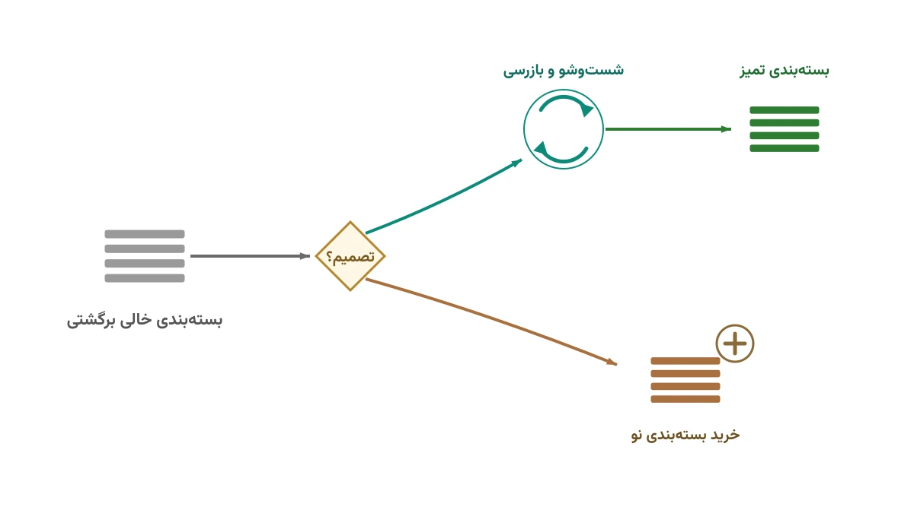

شرکتی مثل CHEP را در نظر بگیرید. این شرکت استرالیایی، میلیون‌ها پالت چوبی آبی‌رنگ را در سراسر دنیا اجاره می‌دهد. یک تولیدکننده مواد غذایی، پالت پر را به فروشگاه می‌فرستد. فروشگاه بار را خالی می‌کند. حالا یک پالت خالی روی دستش مانده است. این پالت باید یا به چرخه برگردد، یا دور ریخته شود. همین تصمیم ساده، وقتی هزاران فروشگاه و صدها تولیدکننده درگیرش باشند، به یک مسئله بهینه‌سازی شبکه تبدیل می‌شود.

بسته‌بندی‌های برگشت‌پذیر فقط پالت نیستند. قفسه‌های پلاستیکی میوه، کگ‌های فلزی آبجو و جعبه‌های حمل قطعات خودرو هم همین داستان را دارند. هر کدام هزینه ساخت بالایی دارند. به همین دلیل، فقط یک‌بار استفاده‌شدنی نیستند. شرکت باید تصمیم بگیرد این بسته‌بندی‌های خالی را کجا جمع کند و کجا تمیز و بازرسی کند. همچنین باید تصمیم بگیرد چه زمانی به‌جای شست‌وشو، یک نمونه تازه بخرد. این دقیقاً جایی است که مدل‌سازی ریاضی وارد می‌شود.

## چرا این یک مسئله بهینه‌سازی شبکه است

فرض کنید چند مرکز مشتری دارید که هر هفته به تعداد مشخصی بسته‌بندی پر نیاز دارند. در مقابل، همان مراکز به همان نسبت، بسته‌بندی خالی تولید می‌کنند. بین این دو، باید چند «مرکز خدمات» (Service Center) برای شست‌وشو، تعمیر و بازرسی بسته‌بندی برگشتی احداث کنید. سوال اول این است: این مراکز کجا باشند؟ سوال دوم این است: چه حجمی از بسته‌بندی خالی از هر مشتری به کدام مرکز خدمات فرستاده شود؟

سوال سوم، و شاید مهم‌ترین سوال، این است. همیشه درصدی از بسته‌بندی‌ها در بازار گم یا خراب می‌شوند. آیا باید آن‌ها را با خرید نمونه نو جایگزین کرد؟ یا بهتر است ظرفیت شست‌وشو را افزایش دهیم؟ این تصمیم بین «خرید تازه» و «بازچرخانی» دقیقاً همان تعادلی است که هزینه کل شرکت را تعیین می‌کند. بدون یک مدل ریاضی، این تصمیم معمولاً با حدس گرفته می‌شود.

## فرمول‌بندی ریاضی مسئله

مجموعه مشتریان را با $i \in I$ و مکان‌های کاندیدای مرکز خدمات را با $j \in J$ نشان می‌دهیم. هر مشتری $i$ به تقاضای ثابت $d_i$ بسته‌بندی پر در هر دوره نیاز دارد. همان مشتری، با نرخ بازگشت $r_i$، بسته‌بندی خالی تولید می‌کند. متغیر دودویی $y_j$ یک است اگر مرکز خدمات $j$ احداث شود. متغیر $f_{ij}$ حجم بسته‌بندی خالی است که از مشتری $i$ به مرکز $j$ فرستاده می‌شود. متغیر $g_{ji}$ حجم بسته‌بندی تمیزشده‌ای است که از مرکز $j$ به مشتری $i$ برمی‌گردد. متغیر پیوسته $b_j$ هم تعداد بسته‌بندی نویی است که در مرکز $j$ خریداری و وارد چرخه می‌شود.

تابع هدف، کمینه‌کردن مجموع چهار جزء هزینه است. جزء اول هزینه ثابت احداث مراکز خدمات است. جزء دوم هزینه حمل‌ونقل رفت و برگشت است. جزء سوم هزینه شست‌وشو و بازرسی هر واحد بسته‌بندی است و جزء چهارم هزینه خرید بسته‌بندی نو. این را می‌توان این‌طور نوشت:

$$\min \sum_{j \in J} c_j y_j + \sum_{i \in I}\sum_{j \in J} (t_{ij} f_{ij} + t_{ji} g_{ji}) + \sum_{j \in J} w_j \Big(\sum_{i \in I} f_{ij}\Big) + p \sum_{j \in J} b_j$$

مهم‌ترین قید، موازنه جریان در هر مرکز خدمات است. آنچه وارد می‌شود، به‌علاوه هر خرید تازه تخصیص‌یافته به آن مرکز، باید با آنچه خارج می‌شود برابر باشد. علت ساده است؛ بسته‌بندی در مرکز خدمات انباشته یا گم نمی‌شود:

$$\sum_{i \in I} f_{ij} + b_j = \sum_{i \in I} g_{ji} \quad \forall j \in J$$

قید دوم، تضمین تحویل کامل تقاضای هر مشتری است. مجموع بسته‌بندی تمیزی که از همه مراکز به مشتری $i$ می‌رسد، باید دقیقاً برابر تقاضای آن مشتری باشد:

$$\sum_{j \in J} g_{ji} = d_i \quad \forall i \in I$$

قید سوم، سقف واقعی بازگشت را مدل می‌کند. حجم بسته‌بندی خالی ارسالی از مشتری $i$ به همه مراکز، نمی‌تواند از نرخ بازگشت واقعی آن مشتری بیشتر باشد. دلیل ساده است؛ بخشی از بسته‌بندی همیشه در بازار گم می‌شود:

$$\sum_{j \in J} f_{ij} \le r_i \quad \forall i \in I$$

قید آخر هم می‌گوید جریان فقط از مراکز بازشده عبور می‌کند، نه از مراکز بسته:

$$f_{ij} \le M \, y_j \quad \forall i \in I, j \in J$$

## اهمیت این موضوع

شرکتی مثل CHEP بیش از ۳۰۰ میلیون پالت در سراسر جهان دارد. اگر فقط یک درصد از این پالت‌ها به‌جای بازگشت، گم شوند، هزینه جایگزینی به‌سرعت به میلیون‌ها دلار می‌رسد. در صنایع لبنیات و آبجوسازی هم همین داستان با قفسه و کگ تکرار می‌شود. این یعنی طراحی بد شبکه شست‌وشو، نه یک هزینه کوچک عملیاتی، بلکه یک ریسک مالی بزرگ است.

از طرف دیگر، این مسئله مستقیماً به اقتصاد چرخشی گره خورده است. هر بار که یک پالت یا قفسه بازچرخانی می‌شود، به‌جای تولید یک نمونه نو، چوب و پلاستیک کمتری مصرف می‌شود. زباله کمتری هم تولید می‌شود. شرکت‌هایی که این شبکه را درست طراحی می‌کنند، هم هزینه کمتری می‌پردازند و هم ردپای زیست‌محیطی کوچک‌تری از خود به‌جا می‌گذارند. به همین دلیل، این مسئله هم‌زمان یک مسئله مالی و یک مسئله پایداری است.



## ظرفیت کار آکادمیک و پژوهشی

این مسئله برای پژوهش دانشگاهی هم میدان مناسبی است. نسخه قطعی آن یک مسئله طراحی شبکه با قید موازنه جریان است، اما نسخه واقعی تقریباً همیشه نامطمئن است. نرخ بازگشت بسته‌بندی هر هفته متفاوت است و از قبل دقیق معلوم نیست. این موضوع مستقیماً به برنامه‌ریزی تصادفی دومرحله‌ای و بهینه‌سازی استوار مرتبط می‌شود، دو حوزه‌ای که در ادبیات زنجیره تأمین بسیار فعال هستند.

زاویه پژوهشی دوم، افزودن بعد زمانی و ظرفیت محدود شست‌وشو در هر دوره است. به این ترتیب، مسئله به یک مدل موجودی چنددوره‌ای چرخشی تبدیل می‌شود. زاویه سوم هم ترکیب این مدل با تصمیم قیمت‌گذاری اجاره بسته‌بندی است، شبیه مدل کسب‌وکار واقعی CHEP. هرکدام از این بسط‌ها می‌تواند موضوع مستقلی برای یک مقاله یا پایان‌نامه باشد.

## پیاده‌سازی با پایتون

خبر خوب این است که برای حل این مدل نیازی به نرم‌افزار گران‌قیمت تجاری نیست. مدل بالا یک برنامه خطی عدد صحیح مختلط ساده است و ابزارهای متن‌باز پایتون به‌خوبی از پس آن برمی‌آیند. در این مثال از [OR-Tools](https://developers.google.com/optimization) گوگل استفاده می‌کنیم، دقیقاً همان کتابخانه‌ای که در یادداشت [جابه‌جایی کانتینر خالی](/notes/empty-container-repositioning/) هم دیدیم. ماژول `linear_solver` آن، با سالور متن‌باز [CBC](https://github.com/coin-or/Cbc)، برای این مقیاس مسئله کاملاً کافی است.

برای مسائل بزرگ‌تر با چند دوره زمانی، می‌توان همین ساختار را در [Pyomo](https://www.pyomo.org/) هم بازنویسی کرد. سپس می‌توان آن را به سالورهای دیگری مثل [HiGHS](https://highs.dev/) وصل کرد. داده ورودی، یعنی تقاضا، نرخ بازگشت و هزینه‌های حمل، معمولاً از یک فایل اکسل یا CSV ساده خوانده می‌شود. پیچیدگی اصلی کار در مدل‌سازی درست قیود است، نه در فرمت فایل ورودی.

```python
from ortools.linear_solver import pywraplp

solver = pywraplp.Solver.CreateSolver("CBC")

# y_j: آیا مرکز خدمات j احداث شود؟
y = {j: solver.BoolVar(f"y_{j}") for j in service_centers}

# f_ij: حجم بسته‌بندی خالی از مشتری i به مرکز j
f = {(i, j): solver.NumVar(0, solver.infinity(), f"f_{i}_{j}")
     for i in customers for j in service_centers}

# قید سقف بازگشت واقعی هر مشتری
for i in customers:
    solver.Add(sum(f[i, j] for j in service_centers) <= return_rate[i])

# ادامه قیود موازنه جریان، تحویل تقاضا و تابع هدف به همین شیوه تعریف می‌شوند
```

## سوالات متداول

<h3>آیا این مدل فقط برای پالت کاربرد دارد؟</h3>
<p>خیر. هر بسته‌بندی برگشت‌پذیر گران‌قیمتی، از قفسه میوه تا کگ آبجو و سبد حمل قطعات، همین ساختار ریاضی را دارد. فقط پارامترهای هزینه و نرخ بازگشت تغییر می‌کنند.</p>

<h3>چرا به‌جای مدل قطعی، سراغ برنامه‌ریزی تصادفی نرویم؟</h3>
<p>برای شروع، مدل قطعی ساده‌تر است و دید درستی از ساختار مسئله می‌دهد. وقتی نرخ بازگشت واقعاً نامطمئن باشد، می‌توان همین مدل را به یک مدل دومرحله‌ای تصادفی گسترش داد؛ موضوعی که دوره <a href="/courses/vrp-python/" style="color:#2563EB; font-weight:bold;">بهینه‌سازی زنجیره تأمین و حمل‌ونقل با پایتون</a> آن را هم پوشش می‌دهد.</p>

<h3>اگر داده واقعی شرکت خودم را داشته باشم، چطور این مدل را پیاده‌سازی کنم؟</h3>
<p>اگر شبکه پولینگ واقعی‌تان چند سطح، چند نوع بسته‌بندی یا محدودیت ظرفیت پیچیده دارد، بهتر است مدل را متناسب با داده خودتان تنظیم کنیم. برای این کار می‌توانید از طریق <a href="/consultation/" style="color:#2563EB; font-weight:bold;">مشاوره</a> با من در تماس باشید.</p>
