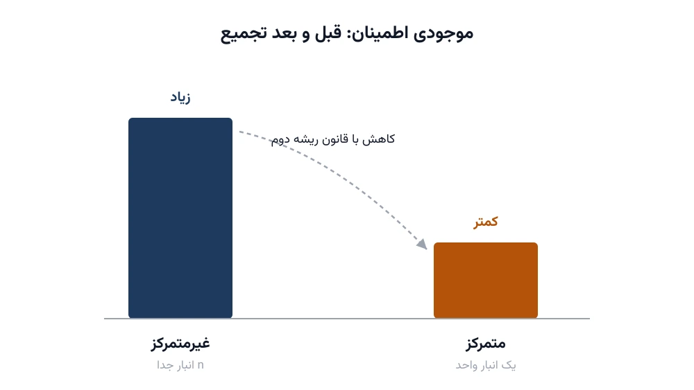

فرض کنید مدیر زنجیره تأمین یک خرده‌فروش بزرگ هستید. ده انبار منطقه‌ای دارید، هرکدام برای یک شهر. هر انبار باید موجودی اطمینان نگه دارد، چون تقاضای هر شهر از قبل دقیق معلوم نیست. حالا سؤال اصلی این است: اگر همین ده انبار را در یک انبار بزرگ ادغام کنید، موجودی اطمینان کل شرکت چه می‌شود؟ جواب، شهودی نیست. این پرسش هسته‌ی مفهومی به نام تجمیع موجودی (Risk Pooling) است.

## اهمیت این موضوع

تجمیع موجودی یکی از قدرتمندترین و در عین حال کم‌هزینه‌ترین تصمیمات طراحی زنجیره تأمین است. بدون خرید هیچ تجهیز جدیدی، فقط با تغییر ساختار شبکه انبارها، می‌توان موجودی اطمینان لازم را به‌شدت کاهش داد. شرکتی مثل آمازون دقیقاً با همین موازنه روبه‌رو است. مراکز توزیع کمتر و بزرگ‌تر، موجودی کمتری می‌خواهند، اما فاصله تا مشتری را بیشتر می‌کنند. تصمیم درست، به ساختار تقاضا، هزینه نگهداری و هزینه حمل‌ونقل هر کسب‌وکار بستگی دارد.

این موازنه در صنایعی با کالای گران یا موجودی حساس، اهمیت مضاعفی دارد. قطعات یدکی صنعتی، داروهای خاص و کالاهای فصلی پرریسک، همگی نمونه‌هایی‌اند که هزینه نگهداری موجودی اضافی بسیار بالاست. در این موارد، حتی کاهش ده درصدی موجودی اطمینان، میلیون‌ها تومان صرفه‌جویی سالانه به همراه دارد. به همین دلیل، تجمیع موجودی معمولاً اولین جایی است که مشاوران زنجیره تأمین سراغش می‌روند.

## چرا تجمیع موجودی کار می‌کند؟

فرض کنید تقاضای روزانه هر فروشگاه، مستقل از بقیه و با میانگین یکسان باشد. انحراف معیار تقاضای هر فروشگاه را با $\sigma$ نشان می‌دهیم. اگر $n$ فروشگاه مستقل داشته باشیم، انحراف معیار تقاضای کل (جمع تمام فروشگاه‌ها) این‌طور محاسبه می‌شود:

$$\sigma_{\text{total}} = \sqrt{n} \cdot \sigma$$

نکته کلیدی همین‌جاست. اگر هر فروشگاه جدا موجودی اطمینان نگه دارد، مجموع موجودی اطمینان برابر $n$ برابر موجودی یک فروشگاه است. اما اگر یک انبار مرکزی تقاضای همه را پوشش دهد، فقط به اندازه $\sqrt{n}$ برابر نیاز دارد، نه $n$ برابر. این تفاوت بین $n$ و $\sqrt{n}$ را [قانون ریشه دوم](/notes/newsvendor-safety-stock/) می‌نامند.

موجودی اطمینان لازم برای رسیدن به سطح خدمت دلخواه، با فرمول زیر به دست می‌آید. در آن $z$ ضریب سطح خدمت و $L$ زمان تحویل است:

$$SS = z \cdot \sigma \cdot \sqrt{L}$$

برای حالت غیرمتمرکز با $n$ انبار مستقل، موجودی اطمینان کل برابر است با:

$$SS_{\text{decentralized}} = n \cdot z \cdot \sigma \cdot \sqrt{L}$$

برای حالت متمرکز با یک انبار واحد که تقاضای همه را پوشش می‌دهد:

$$SS_{\text{centralized}} = z \cdot \sigma \cdot \sqrt{n \cdot L}$$

نسبت این دو مقدار دقیقاً برابر $\sqrt{n}$ است. برای ده فروشگاه، تجمیع کامل می‌تواند موجودی اطمینان را حدود سه برابر کاهش دهد.

## وقتی تعداد انبار بین یک و همه چیز است

در عمل، انتخاب فقط بین «یک انبار مرکزی» و «یک انبار برای هر فروشگاه» نیست. می‌توان شبکه را به $k$ انبار منطقه‌ای تقسیم کرد که هرکدام گروهی از فروشگاه‌ها را پوشش می‌دهند. وقتی $k$ کم باشد، تجمیع بیشتر و موجودی اطمینان کمتر است، اما مسافت تا مشتری و هزینه حمل‌ونقل افزایش می‌یابد. این دقیقاً جایی است که مسئله تبدیل به یک مسئله بهینه‌سازی واقعی می‌شود، نه یک فرمول ساده.

هزینه کل شبکه را می‌توان تابعی از تعداد انبار $k$ نوشت. جمله اول هزینه نگهداری موجودی اطمینان است. جمله دوم هزینه حمل‌ونقل تقریبی، بر اساس مدل تقریب پیوسته در نظریه مکان‌یابی است. جمله سوم هزینه ثابت راه‌اندازی هر انبار است:

$$C(k) = h \cdot z \cdot \sigma \sqrt{n \cdot k \cdot L} + \frac{T_0}{\sqrt{k}} + k \cdot f$$

در این فرمول، $h$ هزینه نگهداری هر واحد موجودی است. $T_0$ ضریب هزینه حمل‌ونقل و $f$ هزینه ثابت هر انبار در هر دوره است. جمله اول با افزایش $k$ بیشتر می‌شود، چون تجمیع کمتر می‌شود. جمله دوم با افزایش $k$ کمتر می‌شود، چون انبارها به مشتری نزدیک‌تر می‌شوند. همین کشمکش، یک $k$ بهینه با کمترین هزینه کل ایجاد می‌کند.

## یک مثال عددی ساده

فرض کنید شرکتی ۱۰۰ فروشگاه دارد. انحراف معیار تقاضای روزانه هر فروشگاه ۵۰ واحد و زمان تحویل یک روز است. ضریب سطح خدمت ۹۵ درصد برابر با $z=1.65$ است. هزینه نگهداری هر واحد موجودی در روز ۲۰۰ تومان در نظر گرفته می‌شود. هزینه ثابت هر انبار در روز ۵۰۰ هزار تومان است. ضریب هزینه حمل‌ونقل $T_0$ هم ۲۰ میلیون تومان فرض می‌شود.

با جایگذاری در فرمول بالا، مقادیر مختلف $k$ از ۱ تا ۱۰۰ را امتحان می‌کنیم. هزینه کل ابتدا کاهش و سپس افزایش می‌یابد. در این مثال فرضی، نقطه کمینه معمولاً چند انبار منطقه‌ای است، نه یک انبار و نه صد انبار جداگانه. عدد دقیق به نسبت هزینه حمل‌ونقل به هزینه نگهداری موجودی بستگی دارد.



نکته مهم این است که همبستگی تقاضای فروشگاه‌ها، نتیجه را به‌شدت تغییر می‌دهد. اگر تقاضای دو فروشگاه کاملاً هم‌بسته باشد، تجمیع هیچ سودی ندارد. تقاضای فروشگاه‌هایی با الگوی مصرف مشابه، معمولاً همبستگی بیشتری نسبت به فروشگاه‌های دور از هم دارند. به همین دلیل، تجمیع در عمل معمولاً سودمندتر از حالت تئوری کاملاً مستقل است، اما هرگز کمتر از حالت کاملاً هم‌بسته.

## ظرفیت کار آکادمیک و پژوهشی

تجمیع موجودی یکی از پرکارترین حوزه‌های تحقیق در عملیات در دو دهه اخیر بوده است. یک مسیر پژوهشی، افزودن همبستگی غیرصفر بین تقاضای فروشگاه‌هاست. در این حالت فرمول ساده ریشه دوم دیگر دقیق نیست و باید از ماتریس کوواریانس استفاده کرد. مسیر دوم، ترکیب تجمیع موجودی با مکان‌یابی تسهیلات است. به‌جای فرض ثابت بودن گروه‌بندی فروشگاه‌ها، محل هر انبار و تخصیص فروشگاه‌ها به آن هم‌زمان بهینه می‌شود.

مسیر سوم که کمتر کاوش شده، تجمیع جزئی نام دارد. به‌جای تجمیع کامل موجودی، فقط بخشی از آن (مثلاً موجودی اطمینان اقلام کم‌گردش) متمرکز و بقیه غیرمتمرکز می‌ماند. این مدل‌های ترکیبی برای پایان‌نامه کارشناسی ارشد و دکتری مناسب‌اند. هم پایه ریاضی روشنی دارند و هم داده واقعی آن‌ها، مثل فروش فروشگاهی و هزینه حمل‌ونقل، معمولاً در دسترس پژوهشگر است.

## پیاده‌سازی با پایتون

این مسئله برخلاف بسیاری از مطالب این سایت، یک مسئله برنامه‌ریزی محدودیت یا عدد صحیح کلاسیک نیست؛ یک مسئله بهینه‌سازی پیوسته و غیرخطی است. برای چنین مسائلی، [Pyomo](https://www.pyomo.org/) همراه با یک سالور غیرخطی مثل [IPOPT](https://coin-or.github.io/Ipopt/) گزینه‌ای رایگان و متن‌باز است. $k$ در عمل باید عدد صحیح باشد. روش معمول این است که ابتدا $k$ را پیوسته فرض کنیم و جواب بهینه را با IPOPT پیدا کنیم. سپس چند عدد صحیح نزدیک به آن جواب را در فرمول هزینه جای‌گذاری می‌کنیم و بهترین را انتخاب می‌کنیم.

```python
from pyomo.environ import (
    ConcreteModel, Var, Objective, Constraint, NonNegativeReals, minimize
)

model = ConcreteModel()

# پارامترهای مسئله
n, sigma, L = 100, 50, 1
z, h, f, T0 = 1.65, 200, 500_000, 20_000_000

# متغیر تصمیم: تعداد انبار (در این مرحله پیوسته)
model.k = Var(domain=NonNegativeReals, bounds=(1, n))

# ادامه تابع هدف (هزینه موجودی + حمل‌ونقل + ثابت) و قید پایین‌کران k
# به همین شیوه تعریف می‌شوند.
```

برای مرحله گرد کردن به عدد صحیح، کافی است تابع $C(k)$ را مستقیم در [NumPy](https://numpy.org/) محاسبه کنید. چند $k$ صحیح اطراف جواب پیوسته را امتحان کنید و کمینه را نگه دارید. این ترکیب از سالور غیرخطی رایگان و جست‌وجوی محلی صحیح، نیازی به نرم‌افزار تجاری گران‌قیمت ندارد. برای اکثر شرکت‌های متوسط کاملاً کافی است.

## سوالات متداول

<h3>آیا تجمیع موجودی همیشه بهترین تصمیم است؟</h3>
<p>نه. وقتی هزینه حمل‌ونقل بسیار بالا یا زمان تحویل حیاتی باشد (مثل داروی اورژانسی)، نگه‌داشتن موجودی نزدیک به مشتری می‌تواند با وجود موجودی اطمینان بیشتر، در مجموع ارزان‌تر یا ضروری‌تر باشد.</p>

<h3>قانون ریشه دوم با چه فرضی درست است؟</h3>
<p>این قانون با فرض استقلال کامل تقاضای نقاط مختلف دقیق‌ترین حالت را می‌دهد. در دنیای واقعی تقاضاها معمولاً اندکی هم‌بسته‌اند، پس سود واقعی تجمیع کمی کمتر از پیش‌بینی فرمول ساده خواهد بود.</p>

<h3>چطور می‌توانم این مدل را برای شبکه توزیع واقعی شرکتم اجرا کنم؟</h3>
<p>هر شبکه توزیع واقعی قیدها و داده‌های خاص خودش را دارد؛ برای پیاده‌سازی دقیق روی داده شرکت شما، گرفتن <a href="/consultation/" style="color:#2563EB; font-weight:bold;">مشاوره</a> تخصصی، مسیر مطمئن‌تری نسبت به اجرای فرمول عمومی است. همچنین دوره <a href="/courses/vrp-python/" style="color:#2563EB; font-weight:bold;">بهینه‌سازی زنجیره تأمین و حمل‌ونقل با پایتون</a> این مدل‌ها را با جزئیات بیشتر پوشش می‌دهد.</p>
