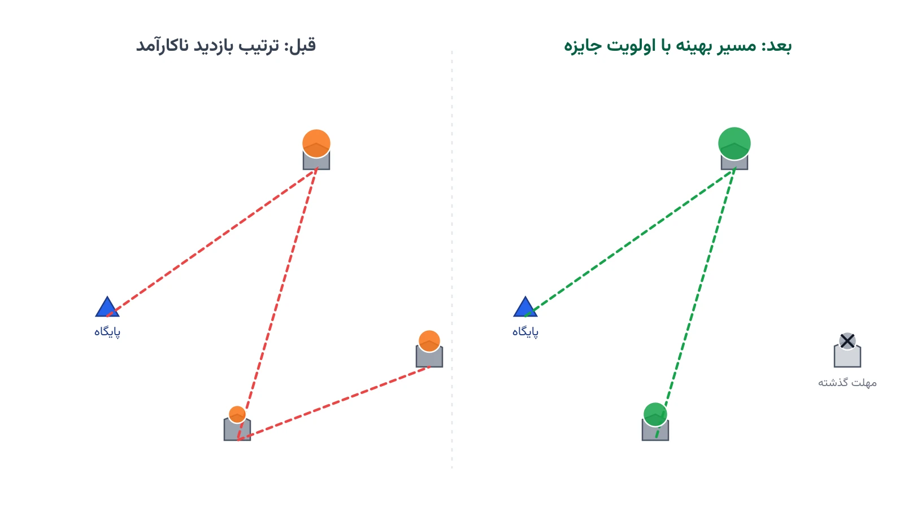

زلزله‌ای ویرانگر یک شهر را لرزانده است. چند ساختمان فروریخته‌اند. صدای افراد گرفتار، هنوز از زیر آوار شنیده می‌شود. اما تیم‌های نجات محدودند. هر تیم فقط چند ساعت فرصت دارد. این‌جا زمان، باارزش‌تر از هر منبع دیگری است.

فرمانده عملیات باید فوری تصمیم بگیرد. کدام تیم، به کدام نقطه برود؟ و به چه ترتیبی؟ این تصمیم شبیه یک مسئله مسیریابی کلاسیک است. اما یک تفاوت اساسی دارد. هر نقطه، به‌جای فقط هزینه سفر، یک جایزه هم دارد. جایزه این‌جا، جان انسان است.

در پژوهش عملیاتی، این مسئله را مسیریابی گروهی با جایزه یا Team Orienteering Problem می‌نامند. نسخه ویژه حوزه بحران آن، مسیریابی تیم‌های جست‌وجو و نجات نام دارد. ارزش هر منطقه، با گذشت زمان افت می‌کند. این افت، دقیقاً همان مفهوم «ساعت طلایی» در عملیات امداد است.

## اهمیت این موضوع

در زلزله‌های بزرگ، بیشتر جان‌های نجات‌یافته در همان ساعات اول پیدا می‌شوند. بعد از این بازه، احتمال زنده‌ماندن افراد زیر آوار به‌سرعت کاهش می‌یابد. پس تخصیص درست تیم‌ها به مناطق، اثر مستقیم روی تعداد جان‌های نجات‌یافته دارد. یک برنامه ضعیف یعنی تیم‌ها وقت را در مسیرهای غیربهینه از دست بدهند.

سازمان‌هایی مانند تیم‌های امداد شهری فدرال آمریکا (FEMA Urban Search and Rescue) با این چالش روبه‌رو هستند. شبکه بین‌المللی INSARAG زیر نظر سازمان ملل هم همین وضعیت را تجربه کرده است. این شبکه، بعد از زلزله بزرگ ترکیه و سوریه در سال ۲۰۲۳، ده‌ها تیم بین‌المللی را هماهنگ کرد. هماهنگی این حجم از تیم‌ها، بدون یک چارچوب تصمیم‌گیری روشن، عملاً ناممکن است.

این مسئله، نسخه‌ای تخصصی از مسائل مسیریابی وسایل نقلیه است. دوره [بهینه‌سازی زنجیره تأمین و حمل‌ونقل با پایتون](/courses/vrp-python/) پایه این نوع مدل‌سازی مسیریابی را پوشش می‌دهد. تفاوت اصلی این‌جا، وجود جایزه‌ای است که با گذشت زمان کاهش می‌یابد، نه فقط هزینه سفر میان نقاط.

## فرمول‌بندی ریاضی مسئله

فرض کنید $N$ مجموعه مناطق آسیب‌دیده کاندید بازدید باشد. گره صفر، پایگاه عملیاتی و نقطه شروع و پایان هر تیم است. مجموعه $K$ تیم‌های نجات را نشان می‌دهد. هر منطقه $i$ یک جایزه $p_i$ دارد؛ برآوردی از جان‌های قابل‌نجات. هر منطقه مهلت مؤثر $d_i$ هم دارد؛ پایان ساعت طلایی آن. زمان سفر بین دو نقطه را با $t_{ij}$ نشان می‌دهیم. بودجه زمانی هر تیم، یعنی طول شیفت عملیاتی، برابر $T_{max}$ است.

متغیر دودویی $x_{ijk}$ نشان می‌دهد تیم $k$ مستقیماً از $i$ به $j$ می‌رود. متغیر $y_i$ نشان می‌دهد منطقه $i$ اصلاً بازدید می‌شود یا نه. متغیر $s_i$ هم زمان ورود تیم به منطقه $i$ را ثبت می‌کند. هدف مدل، کمینه‌کردن جان‌های ازدست‌رفته نیست؛ بیشینه‌کردن جایزه جمع‌آوری‌شده است:

$$ \max \sum_{i \in N} p_i\, y_i $$

هر منطقه حداکثر یک‌بار، و فقط اگر بازدید شود، وارد مسیر یکی از تیم‌ها می‌شود:

$$ \sum_{k \in K}\sum_{j} x_{jik} = y_i \qquad \forall i \in N $$

در هر گره بازدیدشده، مسیر تیم باید پیوسته باشد؛ یعنی ورود و خروج برابر است:

$$ \sum_{j} x_{jik} = \sum_{j} x_{ijk} \qquad \forall i \in N,\ k \in K $$

ترتیب زمانی حرکت، با این قید کنترل و از زیرتور جلوگیری می‌شود:

$$ s_j \ge s_i + t_{ij} - M\,(1 - x_{ijk}) \qquad \forall i,j \in N,\ k \in K $$

مهلت هر منطقه و سقف شیفت تیم هم باید رعایت شوند:

$$ s_i \le d_i + M\,(1-y_i), \qquad s_i \le T_{max} \qquad \forall i \in N $$

در این روابط، $M$ یک عدد بزرگ کمکی است؛ فقط برای غیرفعال‌کردن قید در حالت‌های نامرتبط. این فرمول‌بندی، نسخه‌ای از مسئله کلاسیک Orienteering Problem با چند وسیله نقلیه است. تفاوت کلیدی، تابع هدف است؛ کمینه‌کردن هزینه نیست، بیشینه‌کردن جایزه زمان‌دار است.



## ظرفیت پژوهشی و آکادمیک

این حوزه، فضای پژوهشی تازه و نسبتاً کم‌کاوش‌شده‌ای دارد. مسیر اول، جایزه زمان‌دار پیوسته است؛ نه یک مهلت سخت، بلکه تابعی نزولی و پیوسته از احتمال بقا. مسیر دوم، عدم‌قطعیت در تعداد و مکان دقیق گرفتارشدگان است. این عدم‌قطعیت، بهینه‌سازی استوار یا تصادفی را می‌طلبد.

مسیر سوم، ناهمگنی تیم‌هاست؛ برخی تیم سگ‌یاب دارند، برخی تجهیزات سنگین برش بتن. تخصیص درست نوع تیم به نوع آسیب، خودش یک بعد تصمیم اضافه است. مصالحه میان حداکثرکردن جان نجات‌یافته و حداقل‌کردن ساعت‌کاری کل تیم‌ها هم یک مسئله دوهدفه کلاسیک است. رویکرد [اپسیلون-محدودیت](/notes/epsilon-constraint-bi-objective/) ابزار مناسبی برای کاوش این نوع مصالحه‌هاست.

مسیر چهارم، ترکیب پهپادهای ارزیابی خسارت با تیم‌های زمینی است. پهپاد می‌تواند پیش از اعزام تیم، جایزه هر منطقه را دقیق‌تر برآورد کند. این ترکیب، یک مسئله دومرحله‌ای جالب برای پایان‌نامه یا مقاله علمی می‌سازد.

## پیاده‌سازی با پایتون

خبر خوب این است که این مدل، نیاز به نرم‌افزار گران‌قیمت ندارد. کتابخانه متن‌باز [OR-Tools](https://developers.google.com/optimization) گوگل، ابزاری دقیقاً برای همین کلاس مسائل دارد. ماژول مسیریابی آن، امکان تعریف گره‌های اختیاری با جریمه عدم‌بازدید را می‌دهد. همین قابلیت، دقیقاً معادل جایزه جمع‌آوری‌شده در مدل ماست.

داده ورودی را می‌توان از یک فایل CSV خواند. این فایل شامل زمان سفر بین نقاط، برآورد جمعیت گرفتار هر منطقه، و مهلت مؤثر هر منطقه است. کتابخانه pandas خواندن و پاک‌سازی این جدول را ساده می‌کند. برای مسائل بزرگ‌تر با ده‌ها منطقه، [CP-SAT](https://developers.google.com/optimization/cp) در همان OR-Tools هم گزینه مناسبی است.

کد زیر، یک سناریوی ساده با دو تیم و چهار منطقه آسیب‌دیده را حل می‌کند:

```python
from ortools.constraint_solver import routing_enums_pb2
from ortools.constraint_solver import pywrapcp

# گره صفر، پایگاه عملیاتی است؛ باقی گره‌ها مناطق آسیب‌دیده‌اند
travel_time = [
    [0, 12, 18, 25, 30],
    [12, 0, 10, 22, 28],
    [18, 10, 0, 15, 20],
    [25, 22, 15, 0, 14],
    [30, 28, 20, 14, 0],
]
reward = [0, 90, 70, 60, 40]          # جایزه هر منطقه: برآورد جان‌های قابل‌نجات
deadline = [500, 90, 150, 200, 240]   # پایان ساعت طلایی هر منطقه، به دقیقه
num_teams = 2
shift_budget = 240                    # بودجه زمانی هر تیم، به دقیقه

manager = pywrapcp.RoutingIndexManager(len(travel_time), num_teams, 0)
routing = pywrapcp.RoutingModel(manager)

def time_callback(from_index, to_index):
    i = manager.IndexToNode(from_index)
    j = manager.IndexToNode(to_index)
    return travel_time[i][j]

transit_idx = routing.RegisterTransitCallback(time_callback)
routing.SetArcCostEvaluatorOfAllVehicles(transit_idx)
routing.AddDimension(transit_idx, 0, shift_budget, True, "Time")
time_dim = routing.GetDimensionOrDie("Time")

for node in range(1, len(travel_time)):
    index = manager.NodeToIndex(node)
    time_dim.CumulVar(index).SetMax(deadline[node])
    routing.AddDisjunction([index], reward[node] * 1000)

params = pywrapcp.DefaultRoutingSearchParameters()
params.first_solution_strategy = (
    routing_enums_pb2.FirstSolutionStrategy.PATH_CHEAPEST_ARC
)
solution = routing.SolveWithParameters(params)

for v in range(num_teams):
    index = routing.Start(v)
    route = []
    while not routing.IsEnd(index):
        route.append(manager.IndexToNode(index))
        index = solution.Value(routing.NextVar(index))
    print(f"تیم {v + 1}: {route}")
```

جریمه بزرگ هر گره، باعث می‌شود سالور داخلی OR-Tools تا حد امکان آن را در مسیر بگنجاند. اگر مهلت یک منطقه خیلی زود باشد، ممکن است هیچ تیمی به‌موقع نرسد. در آن حالت، مدل آن گره را به‌عمد نادیده می‌گیرد. همین رفتار، دقیقاً تصمیمی است که یک فرمانده واقعی هم در شرایط کمبود وقت می‌گیرد.

## سوالات متداول

<h3>این مدل با مسائل لجستیک امداد یا تخلیه اضطراری که قبلاً معرفی شده‌اند چه فرقی دارد؟</h3>
<p>در لجستیک امداد، کالا از انبار به‌سمت مردم حرکت می‌کند. در این مسئله، تیم انسانی حرکت می‌کند و باید انتخاب کند کدام منطقه را اصلاً ببیند. جایزه هر منطقه هم با گذشت زمان افت می‌کند، نه ثابت می‌ماند.</p>

<h3>برای یادگیری این نوع مدل‌سازی مسیریابی با جایزه از کجا شروع کنم؟</h3>
<p>دوره <a href="/courses/vrp-python/" style="color:#2563EB; font-weight:bold;">بهینه‌سازی زنجیره تأمین و حمل‌ونقل با پایتون</a> پایه لازم برای کار با OR-Tools و مدل‌سازی مسائل مسیریابی را می‌سازد.</p>

<h3>آیا می‌توان این مدل را برای یک سازمان امداد واقعی با داده واقعی پیاده‌سازی کرد؟</h3>
<p>بله. تعداد تیم‌ها، زمان سفر واقعی و برآورد جایزه هر منطقه باید جایگزین داده نمونه شوند. از طریق <a href="/consultation/" style="color:#2563EB; font-weight:bold;">مشاوره</a> می‌توانید جزئیات پروژه و داده‌های در دسترس‌تان را مطرح کنید.</p>
