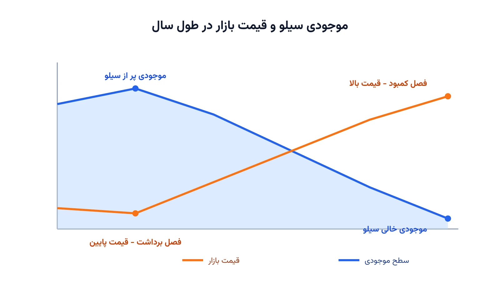

تصور کنید مدیر یک سیلوی غله هستید. فصل برداشت که می‌رسد، قیمت گندم در بازار به‌شدت پایین می‌آید. اگر همان موقع همه را بفروشید، سود کمی نصیبتان می‌شود. اگر بخشی را در سیلو نگه دارید و چند ماه بعد بفروشید، قیمت معمولاً بالاتر رفته است. اما نگهداری هم رایگان نیست. ظرفیت انبار محدود است و هر روز نگهداری هزینه دارد. سوال اصلی این است: هر دوره چقدر بخریم و چقدر انبار کنیم؟ چقدر هم بفروشیم تا در پایان فصل بیشترین سود ممکن را ببریم؟

این مسئله با مدل‌های آشنای کنترل موجودی فرق دارد. در مدل نیوزبوی یا موجودی ایمنی، هدف پاسخ‌گویی به یک تقاضای نامعلوم مشتری است. اینجا اصلاً تقاضای مشتری مطرح نیست. تصمیم اصلی یک نوع آربیتراژ زمانی روی قیمت بازار است؛ کِی بخریم و نگه داریم، کِی بفروشیم. در ادبیات بهینه‌سازی به این مسئله «مسئله انبار» یا Warehouse Problem گفته می‌شود، مسئله‌ای کلاسیک با ریشه در برنامه‌ریزی خطی چندمرحله‌ای.

## اهمیت این موضوع در دنیای واقعی

این تصمیم برای صنایعی که کالای فصلی تولید یا معامله می‌کنند حیاتی است. محصولات کشاورزی، گاز طبیعی و حتی برخی فلزات صنعتی الگوی قیمتی فصلی دارند. شرکتی مثل کارگیل (Cargill) در تجارت جهانی غلات، هرساله باید همین تصمیم را برای ده‌ها انبار و بندر مختلف بگیرد. یک تصمیم نادرست در این مقیاس، به معنای از دست رفتن میلیون‌ها دلار سود بالقوه است.

شرکت‌های انرژی هم با نسخه مشابهی از این مسئله روبه‌رو هستند. ذخیره‌سازی گاز طبیعی در تابستان برای فروش در زمستان، دقیقاً همین ساختار ریاضی را دارد. تفاوت فقط در نرخ تزریق و برداشت است، نه در منطق تصمیم. وقتی مدل درست باشد، حتی چند درصد بهبود در زمان‌بندی خرید و فروش کافی است. روی حجم بالای تجارت جهانی، همین چند درصد به رقمی قابل‌توجه تبدیل می‌شود.



## فرمول‌بندی ریاضی مسئله

فرض کنید افق برنامه‌ریزی را به $T$ دوره، مثلاً هفته یا ماه، تقسیم کرده‌ایم. در هر دوره $t$، قیمت بازار $p_t$ از قبل تخمین زده شده است. متغیرهای تصمیم عبارت‌اند از مقدار خرید $b_t$، مقدار فروش $s_t$ و موجودی پایان دوره $I_t$. هزینه نگهداری هر واحد در هر دوره هم با $h$ نشان داده می‌شود.

تابع هدف، بیشینه‌کردن سود کل در طول افق برنامه‌ریزی است:

$$\max \sum_{t=1}^{T} \big(p_t\, s_t - p_t\, b_t - h\, I_t\big)$$

موازنه موجودی باید در هر دوره برقرار بماند:

$$I_t = I_{t-1} + b_t - s_t \qquad \forall t = 1,\dots,T$$

ظرفیت فیزیکی انبار و نرخ تزریق و برداشت هم محدودند:

$$0 \le I_t \le C, \qquad b_t \le R^{in}, \qquad s_t \le R^{out}$$

در این‌جا $C$ ظرفیت کل انبار است. $R^{in}$ و $R^{out}$ هم به‌ترتیب حداکثر نرخ خرید و فروش در هر دوره هستند. معمولاً یک قید موجودی پایانی هم اضافه می‌شود تا انبار در پایان افق خالی یا در سطح مشخصی بماند. این مدل کاملاً خطی است، پس برخلاف بسیاری از مسائل زمان‌بندی این سایت، نیازی به متغیر دودویی یا برنامه‌ریزی محدودیت ندارد.

## ظرفیت کار آکادمیک و پژوهشی

نسخه قطعی این مسئله ساده و حل‌شده است، اما نسخه واقعی آن پر از عدم‌قطعیت است. قیمت آینده بازار دقیقاً معلوم نیست؛ اینجا جای کار با بهینه‌سازی تصادفی یا یادگیری تقویتی باز است. یک مسیر پژوهشی جذاب، ترکیب این مدل با پیش‌بینی قیمت با یادگیری ماشین است.

مسیر دیگر، افزودن ریسک است. یک مدل میانگین-واریانس یا معیار ارزش در معرض ریسک می‌تواند جایگزین این تابع هدف شود. این مدل به‌جای بیشینه‌کردن صرف سود مورد انتظار، بین سود و ریسک نوسان قیمت موازنه برقرار می‌کند. مسیر سوم، گسترش مدل به چند کالا و چند انبار است. در این حالت تصمیم‌های ذخیره‌سازی روی هم اثر می‌گذارند و ظرفیت حمل‌ونقل بین انبارها هم محدود است. این مسئله در تقاطع اقتصاد مالی، تحقیق در عملیات و مدیریت زنجیره تأمین قرار دارد. به همین دلیل ظرفیت خوبی برای مقاله در مجلات این حوزه‌ها دارد.

## پیاده‌سازی با پایتون

خبر خوب این است که این مدل را می‌توان کاملاً با ابزارهای متن‌باز و رایگان پایتون حل کرد. هیچ نیازی به سالور تجاری گران‌قیمت نیست. چون مدل کاملاً خطی است، کتابخانه‌هایی مثل [PuLP](https://coin-or.github.io/pulp/) یا [Pyomo](https://www.pyomo.org/) به همراه سالورهای متن‌باز مثل [HiGHS](https://highs.dev/) یا [CBC](https://github.com/coin-or/Cbc) گزینه‌های مناسبی هستند. برای مسائل با صدها دوره زمانی هم، این سالورها در کسری از ثانیه به جواب بهینه قطعی می‌رسند.

داده‌های ورودی مدل را می‌توان از یک فایل اکسل یا CSV ساده خواند، شامل ستون‌هایی مثل شماره دوره و قیمت پیش‌بینی‌شده بازار. اگر می‌خواهید چنین مدل‌های بهینه‌سازی زنجیره تأمین را از پایه با پایتون یاد بگیرید، یک گزینه خوب هست. دوره [بهینه‌سازی زنجیره تأمین و حمل‌ونقل با پایتون](/courses/vrp-python/) دقیقاً برای همین هدف طراحی شده است.

ساختار کامل مدل، همراه با یک نمونه داده واقعی قیمت ماهانه گندم، در کد زیر آمده است. این کد کاملاً اجراست؛ کافی است آن را مستقیم روی سیستم خودتان کپی و اجرا کنید. توجه کنید نسخه‌های ۴ به بعد کتابخانه PuLP ساختار API متفاوتی دارند. برای سازگاری، نسخه کلاسیک آن را با `pip install "pulp<3"` نصب کنید.

```python
import pulp

# قیمت فرضی گندم به تومان بر کیلوگرم در ۱۲ ماه سال؛ کف قیمت در فصل برداشت (مرداد-شهریور)
months = ["فروردین", "اردیبهشت", "خرداد", "تیر", "مرداد", "شهریور",
          "مهر", "آبان", "آذر", "دی", "بهمن", "اسفند"]
price = {"فروردین": 10500, "اردیبهشت": 9800, "خرداد": 9200, "تیر": 8700,
         "مرداد": 7800, "شهریور": 7500, "مهر": 8200, "آبان": 9000,
         "آذر": 9900, "دی": 10800, "بهمن": 11600, "اسفند": 12300}

CAPACITY, MAX_BUY, MAX_SELL = 500_000, 120_000, 120_000  # کیلوگرم
HOLDING_COST, TRANSACTION_COST = 35, 5                   # تومان بر کیلوگرم

model = pulp.LpProblem("Seasonal_Storage_Arbitrage", pulp.LpMaximize)
month_ids = list(range(len(months)))
buy = pulp.LpVariable.dicts("buy", month_ids, lowBound=0, upBound=MAX_BUY)
sell = pulp.LpVariable.dicts("sell", month_ids, lowBound=0, upBound=MAX_SELL)
inventory = pulp.LpVariable.dicts("inventory", month_ids, lowBound=0, upBound=CAPACITY)

# تابع هدف: بیشینه‌کردن سود = درآمد فروش - هزینه خرید - هزینه نگهداری - هزینه ناچیز معامله
model += pulp.lpSum(
    price[months[i]] * sell[i] - price[months[i]] * buy[i]
    - HOLDING_COST * inventory[i] - TRANSACTION_COST * (buy[i] + sell[i])
    for i in month_ids
)

# قید موازنه موجودی در هر ماه، و موجودی صفر در ابتدا و انتهای سال
prev_inventory = 0
for i in month_ids:
    model += inventory[i] == prev_inventory + buy[i] - sell[i]
    prev_inventory = inventory[i]
model += inventory[month_ids[-1]] == 0

model.solve(pulp.PULP_CBC_CMD(msg=False))

clean = lambda x: 0.0 if abs(x) < 1e-6 else x  # رفع خطای گرد‌کردن نزدیک صفر مثل -0.0

print(f"سود کل بهینه: {pulp.value(model.objective):,.0f} تومان\n")
print(f"{'ماه':<10}{'قیمت':>10}{'خرید':>12}{'فروش':>12}{'موجودی پایان ماه':>20}")
for i, m in enumerate(months):
    print(f"{m:<10}{price[m]:>10,}{clean(buy[i].value()):>12,.0f}"
          f"{clean(sell[i].value()):>12,.0f}{clean(inventory[i].value()):>20,.0f}")
```

خروجی این کد، برنامه دقیق خرید، فروش و موجودی هر ماه سیلو را به همراه سود کل بهینه نشان می‌دهد.

اگر به [انجام پروژه بهینه‌سازی](/consultation/) برای مسئله خودتان نیاز دارید یا می‌خواهید [مدل‌سازی ریاضی](/courses/optimization-modeling/) را از پایه یاد بگیرید، این دو صفحه نقطه شروع خوبی هستند.

## سوالات متداول

<h3>آیا این مدل فقط برای کالاهای کشاورزی کاربرد دارد؟</h3>
<p>نه. هر کالایی که نوسان قیمت فصلی یا دوره‌ای دارد و قابل انبارش است، با همین ساختار قابل مدل‌سازی است. نمونه‌هایش از گاز طبیعی تا فلزات صنعتی را شامل می‌شود. تفاوت فقط در پارامترهای ظرفیت و هزینه نگهداری است.</p>

<h3>چرا این مسئله را با برنامه‌ریزی خطی حل می‌کنیم، نه برنامه‌ریزی محدودیت؟</h3>
<p>چون همه متغیرهای این مدل پیوسته‌اند و رابطه‌ها خطی هستند. برنامه‌ریزی محدودیت معمولاً برای مسائل با متغیرهای گسسته و قیدهای منطقی پیچیده مناسب‌تر است. برای یادگیری عمیق‌تر این مدل‌های زنجیره تأمین، دوره <a href="/courses/vrp-python/" style="color:#2563EB; font-weight:bold;">بهینه‌سازی زنجیره تأمین و حمل‌ونقل با پایتون</a> نقطه شروع خوبی است.</p>

<h3>اگر قیمت آینده بازار را دقیق ندانیم چه باید کرد؟</h3>
<p>در آن حالت مدل باید به‌صورت تصادفی یا با چند سناریوی قیمت بازنویسی شود. برای پیاده‌سازی اختصاصی این نوع مدل‌ها روی داده‌های واقعی کسب‌وکار شما، می‌توانید از طریق <a href="/consultation/" style="color:#2563EB; font-weight:bold;">مشاوره</a> با ما در ارتباط باشید.</p>
