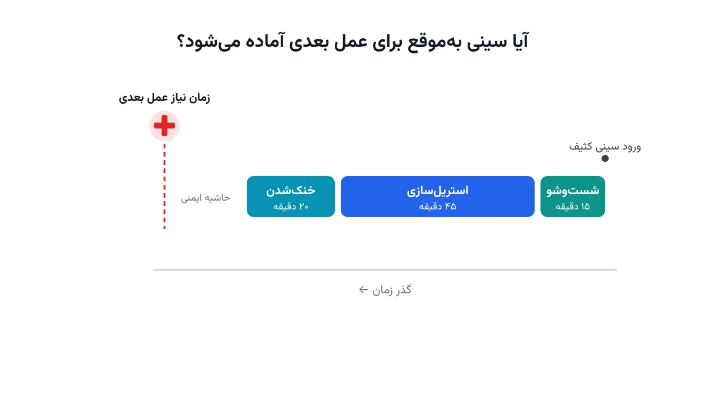

وقتی یک جراحی چند دقیقه دیرتر از زمان تعیین‌شده شروع می‌شود، معمولاً اولین گمان، کمبود پزشک یا پرستار است. اما در بسیاری از بیمارستان‌ها، دلیل واقعی چیز دیگری است. سینی ابزار جراحی هنوز از واحد استریل‌سازی مرکزی برنگشته. این یادداشت درباره یک مسئله کمتر دیده‌شده اما بسیار واقعی است؛ هماهنگ‌کردن زمان‌بندی استریل‌سازی ابزار جراحی با برنامه اتاق عمل.

## واحد استریل‌سازی مرکزی دقیقاً چه می‌کند؟

واحد استریل‌سازی مرکزی، که معمولاً با نام CSSD شناخته می‌شود، قلب پنهان هر بیمارستان جراحی‌محور است. هر سینی ابزار، پس از پایان یک عمل، مسیر مشخصی را طی می‌کند. نخست گندزدایی و شست‌وشو در دستگاه washer-disinfector انجام می‌شود. سپس نوبت بازرسی و چیدن دوباره ابزار در سینی می‌رسد. در نهایت، سینی وارد مرحله استریل‌سازی در اتوکلاو بخار می‌شود. بعد از استریل‌سازی هم یک دوره خنک‌شدن اجباری لازم است. تا این دوره تمام نشود، سینی نباید وارد انبار یا اتاق عمل بعدی شود.

هر کدام از این مراحل زمان مشخصی می‌برد. شست‌وشو در واشر معمولاً حدود پانزده تا بیست دقیقه طول می‌کشد. چرخه استریل‌سازی بخار، بسته به نوع ابزار، بین سی تا شصت دقیقه زمان می‌برد. دوره خنک‌شدن هم معمولاً بیست تا سی دقیقه دیگر اضافه می‌کند. یعنی از لحظه ورود یک سینی کثیف تا آماده‌شدن دوباره‌اش، حدود یک ساعت و نیم زمان لازم است.

نکته کلیدی این است که تعداد سینی‌های هر نوع ابزار محدود است. یک بیمارستان معمولاً برای هر نوع عمل، فقط دو یا سه مجموعه کامل از آن سینی دارد. اگر چند جراحی هم‌زمان به یک نوع سینی نیاز داشته باشند، باید صبر کنند. باید منتظر بمانند تا چرخه شست‌وشو و استریل‌سازی سینی قبلی کامل شود. این دقیقاً همان‌جایی است که یک مسئله زمان‌بندی کلاسیک شکل می‌گیرد. منابعی مثل واشر، اتوکلاو و تکنسین، همگی ظرفیت محدود دارند.

## چرا این مسئله به بهینه‌سازی نیاز دارد؟

شاید فکر کنید کافی است چند سینی اضافه خرید تا مشکل حل شود. اما خرید هر مجموعه سینی جراحی می‌تواند هزینه‌ای قابل‌توجه داشته باشد. نگهداری سینی‌های اضافه هم هزینه انبارداری و کنترل موجودی دارد. راهکار واقعی، اغلب ترکیبی از دو چیز است: سرمایه‌گذاری محدود در سینی‌های اضافه، و زمان‌بندی هوشمندانه‌تر چرخه‌های شست‌وشو و استریل‌سازی.

شرکتی مثل استریس (STERIS)، یکی از تأمین‌کنندگان شناخته‌شده تجهیزات و خدمات استریل‌سازی بیمارستانی در جهان، با این چالش آشناست. چنین شرکت‌هایی باید ظرفیت واحد استریل‌سازی را با نوسانات روزانه برنامه جراحی هماهنگ کنند. وقتی این هماهنگی درست انجام نشود، نتیجه فقط هزینه اضافه نیست. نتیجه، لغو یا تأخیر واقعی جراحی است. یک تأخیر ده‌دقیقه‌ای در شروع یک عمل، به‌تنهایی کوچک به نظر می‌رسد. اما وقتی در طول روز برای چند اتاق عمل تکرار شود، به ساعت‌ها ظرفیت ازدست‌رفته تبدیل می‌شود.

از منظر داده هم موضوع جذاب است. هر سینی، هر چرخه شست‌وشو، و هر چرخه استریل‌سازی، سابقه زمانی دقیقی دارد. این یعنی مدیر عملیات بیمارستان می‌تواند یک مدل بهینه‌سازی واقعی بسازد. دیگر لازم نیست فقط بر اساس حدس و تجربه شخصی تصمیم بگیرد.

## ظرفیت کار آکادمیک و پژوهشی این موضوع

این مسئله فضای پژوهشی غنی‌ای دارد که هنوز به‌طور کامل کاوش نشده است. یک مسیر، مدل‌سازی تصادفی طول عمل‌های جراحی است. تأخیر یک عمل، زمان بازگشت سینی به واحد استریل‌سازی را هم جابه‌جا می‌کند. پس هر مدل واقع‌بینانه باید این عدم‌قطعیت را در نظر بگیرد.

مسیر دوم، بهینه‌سازی مشترک برنامه اتاق عمل و برنامه استریل‌سازی است. این دو برنامه معمولاً جدا از هم طراحی می‌شوند. اما اگر هم‌زمان بهینه شوند، نتیجه بهتری به دست می‌آید. استریل‌سازی دیگر صرفاً پیرو برنامه جراحی نیست؛ بلکه خودش هم در طراحی برنامه جراحی اثر می‌گذارد.

مسیر سوم، زمان‌بندی واکنشی است. وقتی یک عمل اورژانسی وارد برنامه می‌شود، همه‌چیز به‌هم می‌ریزد. سیستم باید در عرض چند ثانیه واکنش نشان دهد. باید زمان‌بندی چرخه‌های استریل‌سازی باقی‌مانده روز را بازبینی کند. ترکیب ردیابی سینی‌ها با برچسب RFID و بازبهینه‌سازی لحظه‌ای، یکی از جذاب‌ترین حوزه‌های تحقیقاتی فعلی در مدیریت عملیات بیمارستانی است.

## فرمول‌بندی ریاضی مسئله

برای ساده‌سازی، مسئله را به شکل زمان‌بندی کارگاهی چندمرحله‌ای مدل می‌کنیم. این مدل با منابع محدود کار می‌کند. فرض کنید مجموعه‌ای از سینی‌ها به نام $i \in I$ داریم. هر سینی باید سه مرحله متوالی را طی کند: شست‌وشو، استریل‌سازی، و خنک‌شدن. هر مرحله مدت‌زمان ثابت و شناخته‌شده‌ای دارد.

متغیرهای تصمیم اصلی، زمان شروع هر مرحله برای هر سینی هستند:

$$w_i, \quad s_i, \quad c_i \quad \text{به ترتیب زمان شروع شست‌وشو، استریل‌سازی و خنک‌شدن سینی } i$$

قید توالی مراحل تضمین می‌کند که هر مرحله فقط بعد از پایان مرحله قبلی شروع شود:

$$s_i \ge w_i + d^{wash}_i, \qquad c_i \ge s_i + d^{ster}_i \qquad \forall i \in I$$

در این روابط، $d^{wash}_i$ و $d^{ster}_i$ مدت شست‌وشو و استریل‌سازی سینی $i$ هستند. محدودیت ظرفیت واشرها و اتوکلاوها هم به‌صورت قید عدم‌هم‌پوشانی روی هر ماشین تعریف می‌شود. دو سینی که از یک واشر یا یک اتوکلاو استفاده می‌کنند، نباید در زمان روی هم بیفتند.

مهم‌ترین قید، قید سررسید است. هر سینی باید پیش از زمان شروع جراحی بعدی که به آن نیاز دارد، آماده باشد:

$$c_i + d^{cool}_i \le t^{need}_i \qquad \forall i \in I$$

تابع هدف می‌تواند چند شکل داشته باشد. یک گزینه، کمینه‌کردن مجموع تأخیرهای وزن‌دار نسبت به زمان نیاز هر سینی است. گزینه ساده‌تر، کمینه‌کردن تعداد سینی‌هایی است که دیرتر از موعد آماده می‌شوند. هر دو شکل‌بندی، یک مسئله زمان‌بندی NP-hard هستند. برای نمونه‌های واقعی بیمارستانی، سالورهای مبتنی بر برنامه‌ریزی محدودیت عملکرد بسیار خوبی دارند.



## پیاده‌سازی با پایتون

نکته مهم این است که برای حل این مسئله، نیازی به نرم‌افزار زمان‌بندی تجاری گران‌قیمت نیست. کتابخانه متن‌باز [OR-Tools](https://developers.google.com/optimization) گوگل دقیقاً برای این نوع مسائل طراحی شده است. به‌خصوص سالور [CP-SAT](https://developers.google.com/optimization/cp/cp_solver) آن، برای زمان‌بندی چندمرحله‌ای با منابع محدود عملکرد قوی‌ای دارد.

مفهوم کلیدی در CP-SAT، متغیر بازه‌ای یا interval variable است. این متغیر، شروع، مدت و پایان هر فعالیت را در قالب یک شیء واحد نگه می‌دارد. سپس با قید `AddNoOverlap`، می‌توان تضمین کرد که بازه‌های روی یک منبع مشترک، هرگز با هم تداخل نکنند.

اگر پیش‌تر با مدل‌سازی ریاضی آشنا نیستید، یادداشت [مدل‌سازی ریاضی](/notes/mathematical-modeling-art/) نقطه شروع خوبی است. برای دیدن مثال‌های کامل‌تر از زمان‌بندی منابع بیمارستانی، دوره [بهینه‌سازی و تصمیم‌گیری سیستم‌های سلامت با پایتون](/courses/health-opt/) را هم ببینید.

کد زیر فقط اسکلت اولیه مدل را نشان می‌دهد. ساخت متغیرهای بازه‌ای برای یک مرحله، و تعریف افق زمانی:

```python
from ortools.sat.python import cp_model

model = cp_model.CpModel()
horizon = 480  # دقیقه، طول یک شیفت کاری

trays = list(range(12))
wash_dur, ster_dur, cool_dur = 15, 45, 20

wash_intervals, ster_intervals = [], []
for i in trays:
    w_start = model.NewIntVar(0, horizon, f"w_start_{i}")
    w_end = model.NewIntVar(0, horizon, f"w_end_{i}")
    wash_iv = model.NewIntervalVar(w_start, wash_dur, w_end, f"wash_{i}")
    wash_intervals.append(wash_iv)
    # ادامه تعریف بازه استریل‌سازی، خنک‌شدن، و قیدهای عدم‌هم‌پوشانی
    # روی هر واشر و اتوکلاو به همین شیوه ساخته می‌شوند
```

ادامه قیود توالی، ظرفیت ماشین‌ها، و تابع هدف تأخیر وزن‌دار، به همین سیاق تعریف می‌شوند. این کار با `AddNoOverlap` و چند متغیر بولی کمکی انجام می‌شود.

یک نکته عملی مهم، اعتبارسنجی مدل با داده واقعی چند هفته است. قبل از اجرای کامل مدل روی کل بیمارستان، بهتر است فقط روی یک یا دو نوع سینی پرتردد آزمایش شود. این کار، اعتماد تیم عملیاتی به خروجی مدل را هم بیشتر می‌کند.

اگر به [انجام پروژه بهینه‌سازی](/consultation/) برای مسئله خودتان نیاز دارید، صفحه مشاوره نقطه شروع خوبی است.

## سوالات متداول

<h3>آیا این مدل فقط برای بیمارستان‌های بزرگ کاربرد دارد؟</h3>
<p>نه. حتی یک بیمارستان کوچک با دو یا سه اتاق عمل هم می‌تواند از زمان‌بندی دقیق‌تر چرخه‌های استریل‌سازی سود ببرد. هرچه تعداد سینی‌های مشترک بین اعمال جراحی بیشتر باشد، ارزش این بهینه‌سازی هم بیشتر می‌شود.</p>

<h3>چه تفاوتی بین این مسئله و زمان‌بندی معمول اتاق عمل وجود دارد؟</h3>
<p>زمان‌بندی اتاق عمل روی تخصیص زمان جراحی به اتاق‌ها و جراحان تمرکز دارد. این مسئله یک لایه پنهان‌تر را هدف می‌گیرد؛ چرخه عمر فیزیکی ابزار جراحی بین دو عمل متوالی.</p>

<h3>برای پیاده‌سازی این مدل در بیمارستان خودمان از کجا شروع کنیم؟</h3>
<p>بهترین نقطه شروع، ثبت دقیق زمان‌های واقعی شست‌وشو و استریل‌سازی برای چند هفته است. اگر به کمک برای طراحی و پیاده‌سازی اختصاصی این مدل نیاز دارید، می‌توانید از طریق <a href="/consultation/" style="color:#2563EB; font-weight:bold;">مشاوره</a> با ما در ارتباط باشید.</p>
