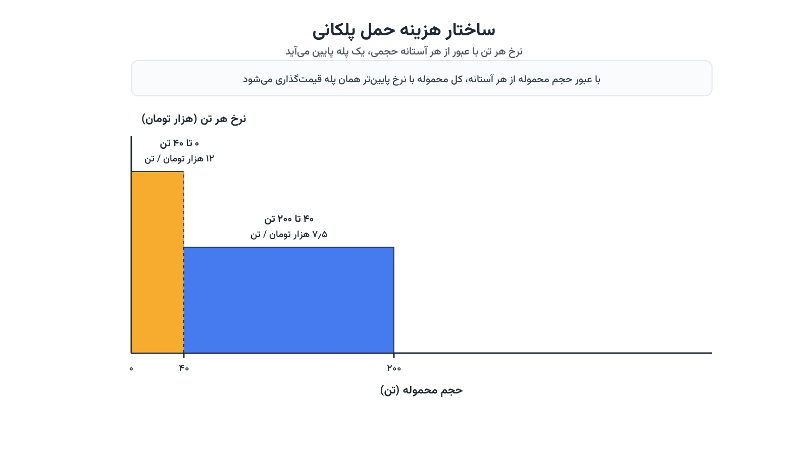

یک شرکت پخش مواد غذایی، هر هفته ده‌ها محموله به فروشگاه‌های مختلف می‌فرستد. برای هر مسیر، چند گزینه حمل وجود دارد. محموله کوچک، نرخ هر تن بالاتری دارد. محموله بزرگ‌تر، از تخفیف حجمی شرکت حمل‌ونقل بهره می‌برد. مدیر لجستیک باید هم‌زمان تصمیم بگیرد: از کدام انبار، به کدام فروشگاه، و با چه حجمی ارسال کند. انتخاب ساده به‌نظر می‌رسد، اما ساختار هزینه پلکانی آن را پیچیده می‌کند.

این مسئله نسخه گسترش‌یافته مسئله کلاسیک حمل‌ونقل است. در مدل ساده، هزینه هر واحد ثابت و مستقل از حجم محموله فرض می‌شود. اما در دنیای واقعی، اغلب شرکت‌های حمل‌ونقل نرخ پلکانی ارائه می‌دهند. محموله زیر چهل تن، نرخ بالا دارد؛ محموله بالای چهل تن، نرخ پایین‌تری می‌گیرد. همین ساختار هزینه، مسئله را از یک برنامه خطی ساده به یک مدل عدد صحیح مختلط تبدیل می‌کند.

## اهمیت این موضوع در دنیای واقعی

نادیده‌گرفتن تخفیف حجمی، هزینه واقعی حمل را به‌شدت دست‌کم می‌گیرد. شرکتی مثل والمارت، روزانه هزاران محموله بین انبارهای توزیع و فروشگاه‌هایش جابه‌جا می‌کند. تصمیم درباره حجم هر محموله، مستقیم روی هزینه کل ناوگان حمل اثر می‌گذارد. ادغام چند سفارش کوچک در یک محموله بزرگ‌تر، گاهی ده‌ها درصد در هزینه حمل صرفه‌جویی می‌کند.

این موضوع با طراحی شبکه توزیع هم پیوند مستقیم دارد. انتخاب اینکه کدام انبار به کدام فروشگاه سرویس بدهد، به ساختار هزینه حمل هر مسیر وابسته است. مسئله [مکان‌یابی تسهیلات توزیع](/notes/facility-location-problem/) دقیقاً همین تعامل بین هزینه ثابت و هزینه حمل متغیر را بررسی می‌کند. دوره [بهینه‌سازی زنجیره تأمین و حمل‌ونقل با پایتون](/courses/vrp-python/) هم مدل‌سازی این نوع تصمیمات شبکه‌ای را پوشش می‌دهد.



## فرمول‌بندی ریاضی مسئله

فرض کنید مجموعه مبادی (انبارها) را با $I$ و مجموعه مقاصد (فروشگاه‌ها) را با $J$ نشان دهیم. عرضه هر انبار $i$ برابر $s_i$ و تقاضای هر مقصد $j$ برابر $d_j$ است. برای هر مسیر $(i,j)$، تابع هزینه حمل پلکانی است. $K$ سطح تعرفه داریم. آستانه‌های حجمی $q_0=0 < q_1 < \ldots < q_K$ و نرخ‌های نزولی $c_1 > c_2 > \ldots > c_K$ است.

متغیر $x_{ijk}$ نشان می‌دهد چه مقداری از مسیر $(i,j)$ در سطح تعرفه $k$ حمل می‌شود. متغیر دودویی $y_{ijk}$ هم نشان می‌دهد آیا این مسیر از سطح تعرفه $k$ استفاده می‌کند یا نه. هدف مدل، کمینه‌کردن هزینه کل حمل است:

$$ \min \sum_{i \in I} \sum_{j \in J} \sum_{k=1}^{K} c_k\, x_{ijk} $$

هر مسیر فقط می‌تواند یک سطح تعرفه را فعال کند، و مقدار حمل در آن سطح باید بین دو آستانه بماند:

$$ q_{k-1}\, y_{ijk} \le x_{ijk} \le q_k\, y_{ijk} \qquad \forall i,j,k $$

$$ \sum_{k=1}^{K} y_{ijk} \le 1 \qquad \forall i,j $$

ظرفیت هر انبار و تقاضای هر فروشگاه هم باید رعایت شود:

$$ \sum_{j \in J} \sum_{k=1}^{K} x_{ijk} \le s_i \qquad \forall i \in I $$

$$ \sum_{i \in I} \sum_{k=1}^{K} x_{ijk} \ge d_j \qquad \forall j \in J $$

این فرمول‌بندی، کل حجم هر مسیر را با نرخ همان سطح تعرفه قیمت‌گذاری می‌کند. این دقیقاً شبیه قراردادهای واقعی حمل است. وقتی محموله از یک آستانه عبور می‌کند، کل آن با نرخ پایین‌تر حساب می‌شود، نه فقط بخش اضافه. از نظر ریاضی، این یک تابع هزینه مقعر (Concave) است، چون نرخ نهایی هر واحد با افزایش حجم کاهش می‌یابد.

## ظرفیت کار آکادمیک و پژوهشی

این حوزه جای کار پژوهشی زیادی دارد. مسیر اول، درنظرگرفتن عدم‌قطعیت در تقاضای هر فروشگاه است. مسیر دوم، ترکیب این مدل با انتخاب مسیر خودرو، یعنی بهینه‌سازی هم‌زمان حجم محموله و توالی توزیع. مسیر سوم، مدل‌سازی قراردادهای چندساله با شرکت‌های حمل‌ونقل است؛ جایی که آستانه‌های تعرفه خود موضوع مذاکره‌اند.

جنبه دیگر، مقایسه روش‌های حل دقیق با روش‌های ابتکاری برای شبکه‌های بزرگ است. وقتی تعداد مسیرها و سطوح تعرفه زیاد شود، مدل عدد صحیح مختلط به‌سرعت رشد می‌کند. این‌که روش دقیق تا چه اندازه عملی می‌ماند و کِی باید سراغ ابتکاری رفت، پرسش مهمی است. پاسخ به آن، موضوع خوبی برای پایان‌نامه یا مقاله علمی است. ترکیب این مدل با هزینه کربن حمل هم آن را به حوزه زنجیره تأمین سبز نزدیک می‌کند.

## پیاده‌سازی با پایتون

خبر خوب این است که حل این مدل، نیاز به سالور تجاری گران‌قیمت ندارد. کتابخانه [OR-Tools](https://developers.google.com/optimization) گوگل، با ماژول برنامه‌ریزی خطی خود، برای این نوع مدل عدد صحیح مختلط کاملاً مناسب است. سالورهای متن‌باز مثل [CBC](https://github.com/coin-or/Cbc) یا [HiGHS](https://highs.dev/) در پشت صحنه این کتابخانه، مسئله را به‌خوبی حل می‌کنند. برای مدل‌سازی انعطاف‌پذیرتر، کتابخانه [Pyomo](http://www.pyomo.org/) هم گزینه مناسبی است.

داده‌های مسئله را می‌توان از یک فایل اکسل یا CSV خواند. این فایل شامل نام انبارها و فروشگاه‌ها، عرضه و تقاضای هر کدام است. آستانه‌ها و نرخ هر سطح تعرفه هر مسیر هم در همان فایل می‌آید. کد زیر، نسخه ساده این مدل را با دو انبار، سه فروشگاه و دو سطح تعرفه حل می‌کند.

```python
from ortools.linear_solver import pywraplp

solver = pywraplp.Solver.CreateSolver("CBC")

origins = ["انبار A", "انبار B"]
destinations = ["فروشگاه ۱", "فروشگاه ۲", "فروشگاه ۳"]
supply = {"انبار A": 120, "انبار B": 150}
demand = {"فروشگاه ۱": 80, "فروشگاه ۲": 90, "فروشگاه ۳": 100}

# سطوح تعرفه هر مسیر: (آستانه بالای سطح به تن، نرخ هر تن)
tiers = [(40, 12.0), (200, 7.5)]

x, y = {}, {}
for i in origins:
    for j in destinations:
        for k, (cap, rate) in enumerate(tiers):
            prev_cap = tiers[k - 1][0] if k > 0 else 0
            x[i, j, k] = solver.NumVar(0, cap, f"x_{i}_{j}_{k}")
            y[i, j, k] = solver.IntVar(0, 1, f"y_{i}_{j}_{k}")
            solver.Add(x[i, j, k] >= prev_cap * y[i, j, k])
            solver.Add(x[i, j, k] <= cap * y[i, j, k])
        solver.Add(sum(y[i, j, k] for k in range(len(tiers))) <= 1)

for i in origins:
    solver.Add(sum(x[i, j, k] for j in destinations for k in range(len(tiers))) <= supply[i])

for j in destinations:
    solver.Add(sum(x[i, j, k] for i in origins for k in range(len(tiers))) >= demand[j])

solver.Minimize(
    sum(tiers[k][1] * x[i, j, k] for i in origins for j in destinations for k in range(len(tiers)))
)

status = solver.Solve()
if status == pywraplp.Solver.OPTIMAL:
    for i in origins:
        for j in destinations:
            shipped = sum(x[i, j, k].solution_value() for k in range(len(tiers)))
            if shipped > 0.01:
                print(f"{i} به {j}: {shipped:.1f} تن")
```

خروجی این کد، دقیق‌ترین ترکیب ارسال از هر انبار به هر فروشگاه را نشان می‌دهد. اگر تعداد مسیرها و سطوح تعرفه زیاد شود، همین ساختار متغیرها و قیود به‌راحتی گسترش پیدا می‌کند. فقط کافی است فهرست تعرفه هر مسیر را از داده واقعی شرکت حمل‌ونقل بخوانید.

## سوالات متداول

<h3>آیا این مدل فقط برای شرکت‌های بزرگ توزیع کاربرد دارد؟</h3>
<p>خیر. هر کسب‌وکاری که با چند گزینه حجم محموله و نرخ پلکانی حمل روبه‌رو است، از این مدل سود می‌برد. حتی دو یا سه سطح تعرفه ساده هم صرفه‌جویی قابل‌توجهی ایجاد می‌کند.</p>

<h3>چه دوره‌ای مدل‌سازی این نوع تصمیمات شبکه توزیع را آموزش می‌دهد؟</h3>
<p>دوره <a href="/courses/vrp-python/" style="color:#2563EB; font-weight:bold;">بهینه‌سازی زنجیره تأمین و حمل‌ونقل با پایتون</a> دقیقاً پایه مدل‌سازی این نوع مسائل تخصیص و شبکه توزیع را پوشش می‌دهد.</p>

<h3>آیا امکان پیاده‌سازی اختصاصی این مدل برای شبکه توزیع ما وجود دارد؟</h3>
<p>بله. تعداد انبارها، سطوح تعرفه هر مسیر و حتی قیود ظرفیت ناوگان، همگی قابل تنظیم با داده واقعی شما هستند. از طریق <a href="/consultation/" style="color:#2563EB; font-weight:bold;">مشاوره</a> می‌توانیم جزئیات پروژه را بررسی کنیم.</p>
