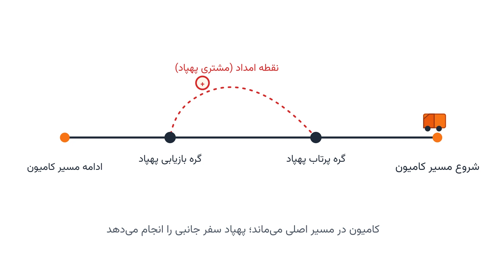

بعد از یک زلزله بزرگ، خیلی از جاده‌های روستایی قابل‌عبور نیستند. پل‌ها ریخته‌اند. خاک جاده را پوشانده. کامیون امداد فقط تا یک نقطه مشخص می‌تواند برود. از آن نقطه به بعد، فقط پهپاد می‌تواند برسد. این‌جاست که یک مسئله بهینه‌سازی جالب شکل می‌گیرد. چطور کامیون و پهپاد را با هم هماهنگ کنیم؟ هدف این است که هم سرعت کار بالا برود و هم هیچ روستایی بی‌نصیب نماند.

## مسئله واقعی چیست؟

این مسئله در ادبیات علمی به نام مسیریابی ترکیبی کامیون-پهپاد شناخته می‌شود. نسخه پایه‌اش را Flying Sidekick Traveling Salesman Problem یا به‌اختصار FSTSP می‌نامند. ایده ساده است. کامیون مسیر اصلی خودش را طی می‌کند. در یک نقطه، پهپاد از روی کامیون پرتاب می‌شود. پهپاد به یک نقطه امدادی صعب‌العبور سر می‌زند. سپس در نقطه‌ای دیگر، دوباره به کامیون می‌پیوندد. در این مدت، کامیون هم بی‌کار نمی‌ماند؛ خودش مسیر اصلی‌اش را ادامه می‌دهد.

نکته کلیدی، هماهنگی زمانی است. پهپاد باید دقیقاً وقتی به گره بازیابی برسد که کامیون هم آن‌جا باشد. اگر زودتر برسد، باید معطل بماند. اگر دیرتر برسد، کامیون باید صبر کند. هر دو حالت، وقت امدادرسانی را هدر می‌دهد. مسئله بهینه‌سازی دقیقاً همین هماهنگی را حل می‌کند. کدام نقطه با پهپاد سرویس بگیرد، کدام با کامیون؟ گره‌های پرتاب و بازیابی هم کجا باشند؟

محدودیت اصلی پهپاد هم روشن است. باتری پهپاد محدود است. وزن بسته کمکی هم محدود است. پهپاد نمی‌تواند مسافت‌های خیلی طولانی را بدون شارژ مجدد طی کند. به همین دلیل، فقط نقاط نزدیک به مسیر کامیون کاندیدای سرویس‌دهی هوایی هستند.

## اهمیت این موضوع

صنعت لجستیک پزشکی پهپادی، که شرکت‌هایی مثل Zipline در آن فعالند، دقیقاً با چنین چالشی روبه‌رو می‌شود. این شرکت در رواندا و غنا خون و داروهای اورژانسی را به کلینیک‌های دورافتاده می‌رساند. برنامه جهانی غذای سازمان ملل (WFP) هم در مالاوی، کریدورهای آزمایشی پرواز پهپاد برای لجستیک بشردوستانه راه‌اندازی کرده است. در هر دو مورد، چالش اصلی یکسان است. چطور ناوگان زمینی محدود را با پهپادهای برد-کوتاه ترکیب کنیم؟ هدف، پوشش بیشتر با همین منابع محدود است.

بدون بهینه‌سازی، تصمیم‌گیری دستی می‌شود. یک هماهنگ‌کننده باید حدس بزند کدام روستا با کامیون و کدام با پهپاد سرویس بگیرد. در شرایط بحرانی، با ده‌ها روستای آسیب‌دیده و ساعت‌های طلایی محدود، این حدس زدن هزینه جانی دارد. یک مدل ریاضی خوب، در چند ثانیه، بهترین تخصیص را پیدا می‌کند. همین سرعت تصمیم‌گیری، در امداد پس از بلایا حیاتی است.

این موضوع فقط به بلایای طبیعی محدود نیست. در لجستیک تجاری هم، ترکیب کامیون و پهپاد می‌تواند هزینه تحویل آخرین مایل را به‌شدت کاهش دهد. اما در شرایط بحرانی، معیار اصلی دیگر فقط هزینه نیست؛ سرعت رسیدن کمک، معیار اول است.

## فرمول‌بندی ریاضی

برای ساده‌سازی، گره‌ها را به دو دسته تقسیم می‌کنیم. دسته اول نقاطی هستند که کامیون هم می‌تواند مستقیم به آن‌ها برسد. دسته دوم فقط با پهپاد قابل‌دسترسی‌اند، چون جاده‌شان قطع شده.

مجموعه گره‌ها را $N$ می‌نامیم، با گره ۰ به‌عنوان پایگاه کامیون. متغیر $x_{ij}$ برابر یک است اگر کامیون مستقیماً از گره $i$ به گره $j$ برود. متغیر $y_i$ برابر یک است اگر نقطه $i$ با پهپاد سرویس‌دهی شود. متغیر $z_{ikj}$ برابر یک است اگر پهپاد از گره پرتاب $i$ بلند شود. سپس به نقطه $k$ سر می‌زند و در گره بازیابی $j$ به کامیون برمی‌گردد.

هر نقطه امدادی باید دقیقاً یک‌بار سرویس بگیرد:

$$\sum_{j} x_{ij} + y_i = 1 \quad \forall i \in C$$

زمان رفت‌وبرگشت پهپاد نباید از استقامت باتری‌اش بیشتر شود:

$$\tau_k \le E \quad \forall k \text{ با } y_k = 1$$

و مهم‌تر از همه، قید هماهنگی زمانی است. پهپاد باید رفت‌وبرگشتش را درست در همان بازه‌ای تمام کند که کامیون بین گره پرتاب و گره بازیابی در حرکت است:

$$\tau_k \le T_j - T_i \quad \text{برای هر } z_{ikj}=1$$

تابع هدف معمولاً کمینه‌کردن زمان کل عملیات امدادرسانی است، یعنی زمان رسیدن به آخرین گره مسیر. در نسخه‌های پیشرفته‌تر، می‌توان عدالت در پوشش روستاها را هم به تابع هدف اضافه کرد.



## پیاده‌سازی با پایتون

خبر خوب این است که برای حل این مسئله، نیازی به نرم‌افزار تجاری گران‌قیمت نیست. ابزارهای متن‌باز پایتون، به‌خصوص [OR-Tools](https://developers.google.com/optimization) گوگل، برای این نوع مسئله ترکیبی مناسب‌اند. بخش انتخاب گره‌های پرتاب و بازیابی، و تخصیص نقاط به کامیون یا پهپاد، را می‌توان با سالور CP-SAT مدل کرد. برای محاسبه فاصله و زمان حرکت روی شبکه جاده‌ای، کتابخانه [NetworkX](https://networkx.org/) هم بسیار کاربردی است.

برای مسئله‌های کوچک و متوسط (چند ده نقطه امدادی)، سالور CP-SAT می‌تواند جواب بهینه دقیق را در زمان معقول پیدا کند. برای مقیاس‌های بزرگ‌تر، ترکیب یک مسیریابی اولیه کامیون با جستجوی همسایگی بزرگ، روش عملی‌تری است. در یادداشت [جستجوی همسایگی بزرگ](/notes/large-neighborhood-search-guide/) این تکنیک را با جزئیات بیشتری توضیح داده‌ام.

اسکلت اولیه مدل در CP-SAT این‌طور شروع می‌شود:

```python
from ortools.sat.python import cp_model

model = cp_model.CpModel()
n = len(relief_points)

# آیا نقطه i با پهپاد سرویس می‌گیرد؟
served_by_drone = [model.NewBoolVar(f"drone_{i}") for i in range(n)]

# آیا کامیون مستقیماً قوس (i, j) را طی می‌کند؟
truck_arc = {}
for i in range(n + 1):
    for j in range(n + 1):
        if i != j:
            truck_arc[i, j] = model.NewBoolVar(f"arc_{i}_{j}")

# هر نقطه دقیقاً یک‌بار سرویس بگیرد (یا کامیون یا پهپاد)
# ادامه قیود هماهنگی زمانی و تابع هدف به همین شیوه تعریف می‌شوند
```

این فقط نقطه شروع است. قیدهای هماهنگی زمانی، محدودیت باتری پهپاد، و تابع هدف نهایی باید روی همین اسکلت اضافه شوند. برای آشنایی کامل‌تر با مدل‌سازی مسیریابی وسایل نقلیه در پایتون، دوره [مسیریابی وسایل نقلیه با پایتون](/courses/vrp-python/) را ببینید.

## ظرفیت کار آکادمیک و پژوهشی

FSTSP و نسخه خواهرش TSP-D، یکی از پرتکرارترین موضوعات پژوهشی تحقیق در عملیات در ده سال اخیرند. برای کاربرد امداد پس از بلایا، فضای پژوهشی باز زیاد است. چند مسیر را مرور کنیم.

نسخه چند-پهپادی مسئله، جایی که هر کامیون چند پهپاد هم‌زمان حمل می‌کند، هنوز به‌طور کامل حل نشده است. نسخه با مناطق پرواز ممنوع هم جذاب است؛ در مناطق جنگی یا بحرانی، برخی آسمان‌ها برای پرواز پهپاد بسته‌اند. مدل‌سازی زمان پرواز به‌صورت تصادفی، به‌خاطر باد و شرایط جوی، هم یک جهت پژوهشی واقع‌گرایانه است.

ترکیب این مسئله با عدالت در توزیع امداد، فضای جالب دیگری است. گاهی کوتاه‌ترین زمان کل، به قیمت نادیده‌گرفتن یک روستای دورافتاده تمام می‌شود. یک تابع هدف دوهدفه، هم زمان کل و هم عدالت پوشش را هم‌زمان در نظر می‌گیرد. این موضوع برای پایان‌نامه کارشناسی ارشد یا دکتری مهندسی صنایع، ظرفیت پژوهشی بالایی دارد.

## سوالات متداول

<h3>آیا این مدل فقط برای بلایای طبیعی کاربرد دارد؟</h3>
<p>نه. همین مدل در لجستیک تجاری آخرین مایل هم کاربرد دارد. تفاوت اصلی در تابع هدف است. در امداد، سرعت و عدالت پوشش اولویت دارند. در لجستیک تجاری، معمولاً هزینه کل اولویت اول است.</p>

<h3>چرا از MILP کامل به‌جای CP-SAT استفاده نکنیم؟</h3>
<p>هر دو رویکرد ممکن است. اما قیدهای منطقی هماهنگی زمانی (اگر-آنگاه) در CP-SAT با <code>only_enforce_if</code> ساده‌تر بیان می‌شوند. برای مسئله‌های ترکیبی مثل این، CP-SAT اغلب سریع‌تر به جواب می‌رسد.</p>

<h3>برای پیاده‌سازی این مدل روی داده واقعی سازمانم به کمک نیاز دارم؛ از کجا شروع کنم؟</h3>
<p>بهترین قدم اول، تعریف دقیق محدودیت‌های پهپاد (برد، وزن، باتری) و ساختار شبکه جاده‌ای منطقه شماست. اگر می‌خواهید این مدل را برای داده و محدودیت‌های واقعی سازمان خودتان پیاده‌سازی کنید، می‌توانید از طریق <a href="/consultation/" style="color:#2563EB; font-weight:bold;">مشاوره</a> با من در تماس باشید.</p>
