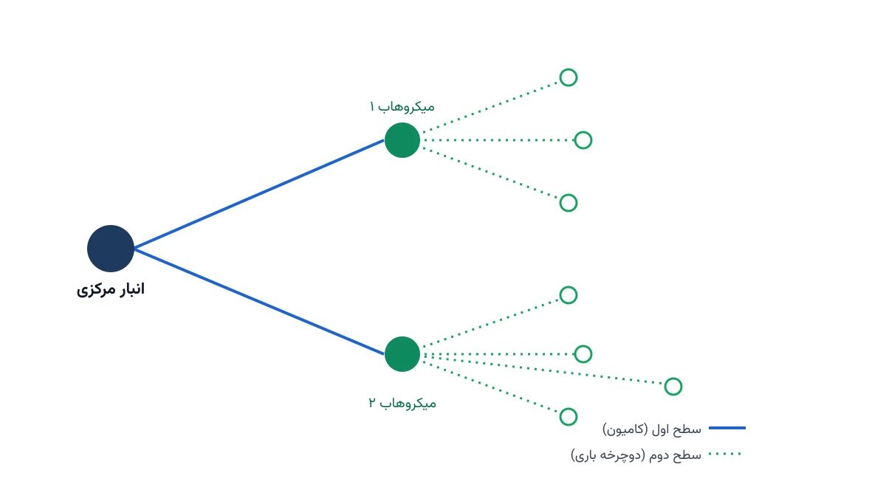

هر روز صبح، ده‌ها کامیون سنگین از انبارهای حومه شهر به سمت مرکز شهر حرکت می‌کنند. این کامیون‌ها در خیابان‌های باریک شهری گیر می‌کنند و ترافیک را سنگین‌تر می‌کنند. بسیاری از کلان‌شهرهای اروپا، دیگر اجازه ورود کامیون‌های سنگین به هسته مرکزی را نمی‌دهند. راه‌حلی که طراحان شبکه لجستیک شهری به آن رسیده‌اند، تحویل دوسطحی با میکروهاب است. کامیون بزرگ فقط تا یک انبار کوچک در حاشیه شهر می‌رود. از آنجا، وسایل نقلیه کوچک و سبز، بار را به در خانه مشتری می‌رسانند.

در این یادداشت، مسئله مسیریابی دوسطحی وسایل نقلیه (Two-Echelon Vehicle Routing Problem) را از صفر مدل‌سازی می‌کنیم. ابتدا می‌بینیم چرا این مسئله برای لجستیک شهری سبز اهمیت دارد. سپس فرمول ریاضی آن را می‌نویسیم و در پایان، مسیر پیاده‌سازی با ابزارهای متن‌باز پایتون را نشان می‌دهیم.

## اهمیت موضوع

تجارت الکترونیک، حجم بسته‌های تحویلی به درب منزل را چند برابر کرده است. هر بسته اضافه، یعنی ترافیک بیشتر، آلودگی بیشتر و هزینه حمل‌ونقل بالاتر برای فروشنده. شهرهایی مثل آمستردام، پاریس و لندن اکنون مناطق کم‌انتشار (Low Emission Zone) دارند. در این مناطق، ورود وسایل نقلیه آلاینده محدود یا جریمه‌دار است. شرکتی مثل DHL در چند شهر اروپایی، میکروهاب‌هایی در لبه هسته مرکزی ایجاد کرده است. از آنجا، با دوچرخه‌های باری و واگن‌های دستی، تحویل نهایی انجام می‌شود.

این تغییر، یک مسئله بهینه‌سازی تازه خلق می‌کند. باید تصمیم بگیریم کدام میکروهاب‌ها باز شوند و کدام مشتری به کدام میکروهاب سپرده شود. همچنین باید مسیر وسایل نقلیه کوچک در هر میکروهاب را مشخص کنیم. تصمیم اشتباه در هر یک از این سه لایه، می‌تواند هزینه کل شبکه را بالا ببرد. همچنین می‌تواند ظرفیت میکروهاب را بی‌دلیل هدر دهد. برای همین، حل جداگانه هر لایه بدون دیدن کل تصویر، معمولاً جواب خوبی نمی‌دهد و باید مسئله را یکپارچه مدل کرد.

از منظر پژوهشی و صنعتی، این مسئله یکی از فعال‌ترین زیرشاخه‌های پژوهش مسیریابی در دهه اخیر است. دلیلش ساده است: شهرداری‌ها به کاهش آلودگی فشار می‌آورند. شرکت‌های لجستیک نیز به دنبال راهی هستند که این فشار را با کمترین هزینه ممکن پاسخ دهند.



## مسئله مسیریابی دوسطحی با میکروهاب چیست؟

تصور کنید یک انبار مرکزی بزرگ در حومه شهر دارید. چند نقطه کوچک‌تر به نام میکروهاب یا مرکز تجمیع، در نقاط مختلف شهر پراکنده‌اند. مشتریان شما نیز در سطح شهر پخش شده‌اند. شبکه تحویل از دو سطح تشکیل می‌شود.

**سطح اول** شامل حرکت کامیون‌های بزرگ از انبار مرکزی به میکروهاب‌هاست. در این سطح، مسیریابی معمولاً ساده‌تر است چون تعداد میکروهاب‌ها کم است و خیابان‌های اصلی شهر برای کامیون باز هستند.

**سطح دوم** شامل حرکت وسایل نقلیه کوچک، مثل دوچرخه باری یا ون برقی، از هر میکروهاب به مشتریان اطراف آن است. این سطح، پیچیدگی اصلی مسئله را می‌سازد. باید هم تخصیص مشتری به میکروهاب و هم ترتیب بازدید از مشتریان را هم‌زمان تعیین کنیم.

هدف کلی، کمینه‌کردن مجموع سه هزینه است: هزینه بازکردن میکروهاب‌ها، هزینه حمل سطح اول، و هزینه مسیرهای سطح دوم. این دقیقاً جایی است که مسئله مکان‌یابی تسهیلات با مسئله مسیریابی وسایل نقلیه، ادغام می‌شود. [مکان‌یابی هاب در شبکه‌های لجستیک](/notes/generalized-vehicle-routing-problem/) پیش‌زمینه خوبی برای درک این نوع تصمیم‌های ترکیبی می‌دهد.

## فرمول‌بندی ریاضی مسئله

برای ساده‌نگه‌داشتن مدل، یک فرض ساده‌کننده می‌گذاریم. مسیر هر میکروهاب در سطح دوم، یک مسیر دایره‌ای واحد است که همه مشتریان تخصیص‌یافته به آن را پوشش می‌دهد. مجموعه میکروهاب‌های کاندید را با $S$ و مجموعه مشتریان را با $C$ نشان می‌دهیم.

متغیرهای تصمیم اصلی مدل عبارت‌اند از:

$$
y_s \in \{0,1\} \quad \text{(۱ اگر میکروهاب } s \text{ باز شود)}
$$

$$
x_{cs} \in \{0,1\} \quad \text{(۱ اگر مشتری } c \text{ به میکروهاب } s \text{ تخصیص یابد)}
$$

تابع هدف، کمینه‌کردن هزینه کل باز‌کردن میکروهاب‌ها و حمل سطح اول است:

$$
\min \; Z = \sum_{s \in S} f_s y_s + \sum_{s \in S} d_s y_s + \sum_{c \in C}\sum_{s \in S} h_{cs} x_{cs}
$$

در این رابطه، $f_s$ هزینه ثابت بازکردن میکروهاب $s$ است. $d_s$ نیز هزینه رفت‌وبرگشت کامیون سطح اول به آن میکروهاب را نشان می‌دهد. $h_{cs}$ برآوردی از سهم هزینه مسیر سطح دوم، برای تخصیص مشتری $c$ به میکروهاب $s$ است. قیدهای اصلی مدل این‌ها هستند:

$$
\sum_{s \in S} x_{cs} = 1 \qquad \forall c \in C \quad \text{(هر مشتری دقیقاً یک میکروهاب دارد)}
$$

$$
x_{cs} \le y_s \qquad \forall c \in C,\, s \in S \quad \text{(فقط میکروهاب باز، مشتری می‌پذیرد)}
$$

$$
\sum_{c \in C} q_c \, x_{cs} \le Q_s \, y_s \qquad \forall s \in S \quad \text{(ظرفیت وسیله نقلیه سطح دوم)}
$$

در این‌جا $q_c$ تقاضای مشتری $c$ و $Q_s$ ظرفیت کل ناوگان سطح دوم آن میکروهاب است. وقتی تخصیص‌ها مشخص شدند، مسیر دقیق سطح دوم در هر میکروهاب باقی می‌ماند. این مسیر، خودش یک زیرمسئله TSP یا VRP کوچک‌تر است که جداگانه حل می‌شود.

## ظرفیت کار آکادمیک و پژوهشی

این مسئله، میدان بسیار زنده‌ای برای پژوهش دانشگاهی است. یک مسیر پژوهشی، افزودن عدم‌قطعیت تقاضاست؛ یعنی فرض‌کردن اینکه تقاضای هر مشتری از قبل دقیق معلوم نیست. مسیر دیگر، مدل‌سازی هم‌زمان‌سازی زمانی بین سطح اول و سطح دوم است. در این حالت، کامیون سطح اول باید دقیقاً پیش از شروع مسیرهای سطح دوم به میکروهاب برسد.

زاویه پژوهشی سوم، بهینه‌سازی چندهدفه است: کمینه‌کردن هم‌زمان هزینه و میزان انتشار کربن، به‌جای تجمیع آن‌ها در یک تابع هدف واحد. روش $\varepsilon$-constraint می‌تواند این دو هدف را به‌طور جداگانه کاوش کند. این روش می‌تواند مسئله را از نظر پژوهشی جذاب‌تر هم بکند. در نهایت، انتخاب پویای میکروهاب‌ها بر اساس ساعت روز، هنوز مسیر کمتر کاوش‌شده‌ای در ادبیات است. منظور از انتخاب پویا، باز یا بسته‌بودن هر میکروهاب بسته به بار ترافیکی است.

## پیاده‌سازی با پایتون

خبر خوب این است که برای حل این مسئله، نیازی به هیچ نرم‌افزار تجاری گران‌قیمت نیست. ابزار متن‌باز [OR-Tools](https://developers.google.com/optimization) گوگل، به‌خصوص سالور CP-SAT آن، برای این نوع مسئله ترکیبیاتی بسیار مناسب است. تخصیص مشتری به میکروهاب را می‌توان با متغیرهای بولی CP-SAT مدل کرد. برای مسیر سطح دوم هر میکروهاب هم، از همان تکنیک `add_circuit` استفاده می‌شود. این تکنیک را پیش‌تر در یادداشت [فروشنده دوره‌گرد با add_circuit در CP-SAT](/notes/tsp-add-circuit/) دیدیم.

برای مسائل بزرگ‌تر که تعداد میکروهاب و مشتری زیاد است، کتابخانه [NetworkX](https://networkx.org/) هم برای ساخت و تحلیل اولیه گراف فاصله‌ها بسیار کاربردی است. ترکیب این دو ابزار یعنی NetworkX برای ساختار داده، و CP-SAT برای حل ترکیبیاتی. این ترکیب، یک مسیر کاملاً رایگان برای حل مسائل واقعی این حوزه فراهم می‌کند.

کد زیر، تنها اسکلت اولیه بخش تخصیص مشتری به میکروهاب را نشان می‌دهد:

```python
from ortools.sat.python import cp_model

model = cp_model.CpModel()

# y_s: آیا میکروهاب s باز شود؟
open_hub = {s: model.NewBoolVar(f"open_{s}") for s in hubs}

# x_cs: آیا مشتری c به میکروهاب s تخصیص یابد؟
assign = {
    (c, s): model.NewBoolVar(f"assign_{c}_{s}")
    for c in customers for s in hubs
}

# هر مشتری دقیقاً یک میکروهاب دارد
for c in customers:
    model.Add(sum(assign[c, s] for s in hubs) == 1)
```

ادامه قیود ظرفیت، تابع هدف، و مسیرهای سطح دوم با `add_circuit` به همین شیوه تعریف می‌شوند.

اگر به [انجام پروژه بهینه‌سازی](/consultation/) برای مسئله خودتان نیاز دارید یا می‌خواهید [مدل‌سازی ریاضی](/courses/optimization-modeling/) را از پایه یاد بگیرید، این دو صفحه نقطه شروع خوبی هستند.

## سوالات متداول

<h3>تفاوت 2E-VRP با مسئله مسیریابی کلاسیک (VRP) چیست؟</h3>
<p>در VRP کلاسیک، فقط یک سطح وسیله نقلیه از یک انبار به مشتریان داریم. در 2E-VRP، یک لایه میانی به نام میکروهاب اضافه می‌شود. باید هم مکان‌یابی این لایه و هم مسیریابی دو سطح جداگانه را هم‌زمان حل کنیم.</p>

<h3>آیا برای شهرهای کوچک‌تر هم این مدل کاربرد دارد؟</h3>
<p>بله، اگرچه منافع آن در کلان‌شهرهای پرترافیک بیشتر دیده می‌شود. حتی در شهرهای متوسط، تجمیع بار در یک یا دو میکروهاب می‌تواند هزینه تحویل نهایی را کاهش دهد.</p>

<h3>برای یادگیری کامل این نوع مسائل مسیریابی از کجا شروع کنم؟</h3>
<p>دوره <a href="/courses/vrp-python/" style="color:#2563EB; font-weight:bold;">مسیریابی وسایل نقلیه با پایتون</a> از مبانی VRP تا مسائل ترکیبی و چندسطحی را با OR-Tools پوشش می‌دهد. برای پیاده‌سازی اختصاصی این مدل روی داده واقعی شرکت خودتان هم می‌توانید از <a href="/consultation/" style="color:#2563EB; font-weight:bold;">مشاوره</a> کمک بگیرید.</p>
