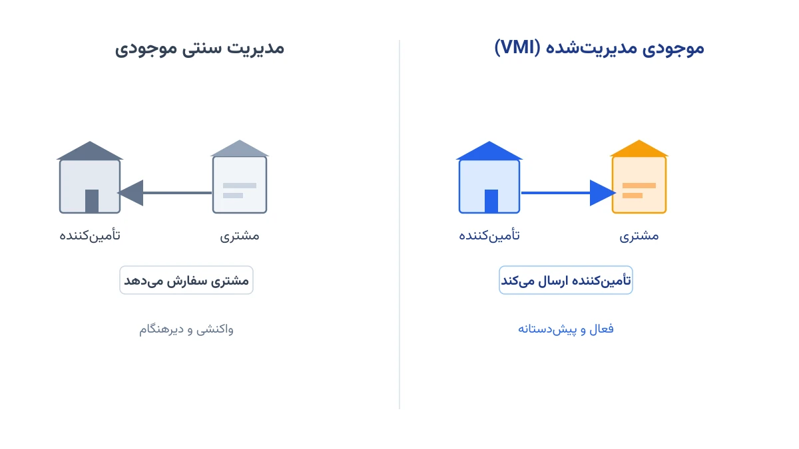

در بیشتر زنجیره‌های تأمین، این مشتری است که تصمیم می‌گیرد چه زمانی سفارش بدهد. اما در مدل موجودی مدیریت‌شده توسط فروشنده (Vendor-Managed Inventory یا VMI)، این قاعده برعکس می‌شود. تأمین‌کننده به داده‌های فروش و موجودی مشتری دسترسی مستقیم پیدا می‌کند. او خودش تصمیم می‌گیرد چه زمانی انبار مشتری را پر کند. این تغییر ساده در مالکیت تصمیم، می‌تواند هزینه کل زنجیره تأمین را محسوس کاهش دهد. در این یادداشت، مدل ریاضی VMI را می‌سازیم و با ابزار متن‌باز پایتون حل می‌کنیم.

## موجودی مدیریت‌شده توسط فروشنده دقیقاً چیست؟

در مدیریت سنتی موجودی، هر مشتری (مثلاً یک فروشگاه زنجیره‌ای) خودش سطح موجودی را رصد می‌کند. وقتی موجودی به نقطه سفارش مجدد برسد، یک سفارش جدید به تأمین‌کننده می‌فرستد. این یعنی تأمین‌کننده هیچ دیدی به وضعیت واقعی انبار مشتری ندارد. او فقط به سفارش‌هایی که می‌رسد واکنش نشان می‌دهد، نه به تقاضای واقعی پشت آن سفارش.

در مدل VMI، این رابطه معکوس می‌شود. مشتری داده‌های فروش روزانه و سطح موجودی فعلی را در اختیار تأمین‌کننده قرار می‌دهد. تأمین‌کننده با دیدن تصویر کامل تقاضا در همه مشتری‌هایش، تصمیم می‌گیرد چه زمانی و چقدر برای هر مشتری ارسال کند. این کار معمولاً تحت یک قرارداد با سقف و کف موجودی توافق‌شده انجام می‌شود. به این ترتیب نه مشتری کمبود کالا را تجربه می‌کند، نه تأمین‌کننده موجودی بیش‌ازحد در انبار او انباشته می‌کند.

## چرا VMI هزینه کل زنجیره تأمین را کاهش می‌دهد؟

بزرگ‌ترین مزیت VMI، تضعیف اثر شلاق چرمی (Bullwhip Effect) است. وقتی هر مشتری جدا سفارش می‌دهد، نوسان‌های کوچک تقاضا در هر سطح زنجیره تأمین بزرگ‌تر می‌شود. اما وقتی یک تأمین‌کننده واحد، تقاضای همه مشتری‌ها را هم‌زمان می‌بیند، می‌تواند سفارش‌ها را هماهنگ کند. این هماهنگی، نوسان‌های غیرواقعی ناشی از سفارش‌دهی پراکنده را تا حد زیادی خنثی می‌کند.

علاوه بر این، تأمین‌کننده می‌تواند ارسال به چند مشتری نزدیک به هم را در یک مسیر کامیون ترکیب کند. نتیجه، صرفه‌جویی در هزینه حمل‌ونقل است، درست کنار صرفه‌جویی در هزینه نگهداری موجودی. اما این هماهنگی به یک مدل بهینه‌سازی دقیق نیاز دارد. تأمین‌کننده باید دقیقاً بداند چه زمانی و چقدر برای هر مشتری ارسال کند. در غیر این صورت، هزینه کل سیستم ممکن است از حالت بدون VMI هم بیشتر شود.

## مدل‌سازی ریاضی VMI به‌صورت یک مسئله برنامه‌ریزی عدد صحیح مختلط

فرض کنید تأمین‌کننده باید در یک افق برنامه‌ریزی چنددوره‌ای تصمیم بگیرد. در هر دوره، باید مشخص شود به هر مشتری چقدر کالا ارسال شود. هدف، کمینه‌کردن مجموع هزینه نگهداری موجودی و هزینه ثابت هر بار ارسال است. در همین حال، موجودی هر مشتری باید همیشه بین کف و سقف قرارداد باقی بماند.

متغیرهای تصمیم اصلی عبارت‌اند از مقدار ارسالی به هر مشتری در هر دوره. یک متغیر دودویی هم مشخص می‌کند آیا اصلاً در آن دوره ارسالی به آن مشتری انجام می‌شود یا نه. قید موازنه موجودی، سطح انبار هر مشتری را دوره به دوره به‌روزرسانی می‌کند.

$$
\min \sum_{i} \sum_{t} \left( h_i \cdot I_{i,t} + K_i \cdot y_{i,t} \right)
$$

$$
I_{i,t} = I_{i,t-1} + q_{i,t} - d_{i,t} \quad \forall i, t
$$

$$
S^{\min}_i \le I_{i,t} \le S^{\max}_i \quad \forall i, t
$$

$$
q_{i,t} \le M \cdot y_{i,t} \quad \forall i, t
$$

در این فرمول‌بندی، $I_{i,t}$ موجودی مشتری $i$ در پایان دوره $t$ است. $q_{i,t}$ مقدار ارسالی همان دوره است و $d_{i,t}$ تقاضای پیش‌بینی‌شده آن است. پارامتر $h_i$ هزینه نگهداری هر واحد است و $K_i$ هزینه ثابت هر بار ارسال. قید سوم تضمین می‌کند موجودی همیشه در بازه قراردادی $S^{\min}_i$ تا $S^{\max}_i$ بماند. قید چهارم، متغیر دودویی $y_{i,t}$ را به تصمیم ارسال متصل می‌کند؛ اگر ارسالی صورت نگیرد، $q_{i,t}$ هم صفر می‌شود.

## اهمیت این موضوع در صنعت واقعی

VMI یکی از موفق‌ترین نوآوری‌های مدیریت زنجیره تأمین در دهه‌های اخیر است. شرکتی مثل پراکتر اند گمبل (P&G) از اوایل دهه ۹۰ میلادی با والمارت یک سیستم VMI راه‌اندازی کرد. در این مدل، پی‌اندجی مستقیماً داده‌های فروش فروشگاه‌های والمارت را می‌بیند. او خودش تصمیم پرکردن قفسه‌ها را می‌گیرد، بدون آنکه منتظر سفارش رسمی والمارت بماند.

نتیجه این همکاری، کاهش چشمگیر کمبود کالا در قفسه‌ها بود. هم‌زمان، موجودی راکد در انبارهای والمارت هم کاهش یافت. امروز صنایعی مثل خرده‌فروشی مواد غذایی، قطعات خودرو و کالاهای دارویی هم از مدل‌های مشابه VMI استفاده می‌کنند. در همه این صنایع، هماهنگ‌کردن سفارش‌های چند مشتری پراکنده، ارزش واقعی اقتصادی دارد.



## ظرفیت کار آکادمیک و پژوهشی این حوزه

مدل پایه VMI که در بالا دیدیم، نقطه شروع خوبی برای پژوهش است، نه نقطه پایان. می‌توان تقاضای هر مشتری را به‌جای یک مقدار قطعی، یک متغیر تصادفی در نظر گرفت. مدل در این صورت به یک مسئله برنامه‌ریزی تصادفی یا بهینه‌سازی مقاوم تبدیل می‌شود. این رویکرد شبیه چیزی است که در یادداشت [طراحی زنجیره تأمین دومرحله‌ای زیر عدم‌قطعیت تقاضا](/notes/stochastic-supply-chain-design/) دیدیم.

زمینه پژوهشی دیگر، ترکیب تصمیم VMI با مسیریابی ناوگان تحویل است. در این حالت، هم‌زمان تصمیم می‌گیریم چه زمانی هر مشتری را پر کنیم و کامیون‌ها با چه ترتیبی مسیرشان را طی کنند. این ترکیب، نسخه‌ای نزدیک به مسئله کلاسیک مسیریابی-موجودی (Inventory Routing Problem) در ادبیات پژوهشی است. سومین مسیر پژوهشی، طراحی مکانیزم تقسیم سود بین تأمین‌کننده و مشتری است، جایی که نظریه بازی‌ها هم وارد مدل می‌شود.

## پیاده‌سازی با پایتون: سالور PuLP برای مدل VMI

خبر خوب این است که این مدل MILP نیازی به سالور تجاری گران‌قیمت ندارد. کتابخانه [PuLP](https://coin-or.github.io/pulp/) در پایتون، به‌صورت پیش‌فرض با سالور متن‌باز [CBC](https://github.com/coin-or/Cbc) کار می‌کند. برای مسائل VMI با چند ده مشتری و چند ده دوره، این سالور کاملاً کافی است. اگر مقیاس مسئله بزرگ‌تر شد، می‌توان به‌سادگی سالور [HiGHS](https://highs.dev/) را هم به همان کد PuLP متصل کرد.

ساختار کد با تعریف مجموعه مشتریان و دوره‌ها شروع می‌شود. سپس متغیرهای تصمیم و تابع هدف را می‌سازیم. قید سوم و چهارم فرمول بالا هم باید به همین ترتیب به کد اضافه شوند.

```python
from pulp import LpProblem, LpMinimize, LpVariable, LpBinary, lpSum

customers = ["A", "B", "C"]
periods = range(1, 13)
M = 10_000  # کران بالای بزرگ برای متغیر دودویی

model = LpProblem("VMI_Replenishment", LpMinimize)

q = LpVariable.dicts("ship", (customers, periods), lowBound=0)
y = LpVariable.dicts("send", (customers, periods), cat=LpBinary)
I = LpVariable.dicts("inv", (customers, periods), lowBound=0)

# ادامه قیود موازنه موجودی، کف و سقف قرارداد، و تابع هدف به همین شیوه تعریف می‌شوند.
```

## سوالات متداول

<h3>آیا مدل VMI فقط برای شرکت‌های بزرگ مثل والمارت کاربرد دارد؟</h3>
<p>نه. حتی یک کارخانه کوچک با چند مشتری ثابت هم می‌تواند از یک نسخه ساده VMI سود ببرد. نکته کلیدی، اشتراک‌گذاری داده فروش است، نه اندازه شرکت.</p>

<h3>تفاوت VMI با مسئله کلاسیک مسیریابی-موجودی چیست؟</h3>
<p>مسیریابی-موجودی تصمیم مسیر کامیون را هم وارد مدل می‌کند. اما VMI در هسته خودش فقط درباره زمان و مقدار ارسال به هر مشتری تصمیم می‌گیرد.</p>

<h3>اگر بخواهم یک مدل VMI اختصاصی برای کسب‌وکار خودم بسازم، از کجا شروع کنم؟</h3>
<p>بهترین نقطه شروع، دوره <a href="/courses/vrp-python/" style="color:#2563EB; font-weight:bold;">بهینه‌سازی زنجیره تأمین و حمل‌ونقل با پایتون</a> است. اگر مسئله شما داده‌های خاص خودش را دارد، می‌توانید با یک جلسه <a href="/consultation/" style="color:#2563EB; font-weight:bold;">مشاوره</a> به یک مدل اختصاصی برسید.</p>
