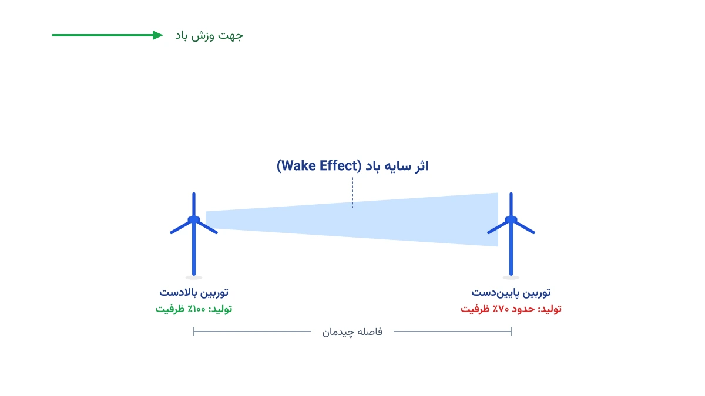

وقتی یک شرکت توسعه‌دهنده انرژی بادی، زمینی برای احداث مزرعه بادی اجاره می‌کند، بزرگ‌ترین تصمیمش هنوز باقی مانده. باید دقیقاً مشخص کند هر توربین کجا بایستد. این تصمیم، برخلاف ظاهر ساده‌اش، می‌تواند تولید انرژی سالانه مزرعه را تا ده تا بیست درصد تغییر دهد. علتش پدیده‌ای به نام اثر سایه باد (Wake Effect) است: وقتی باد از یک توربین عبور می‌کند، سرعتش کم و آشفته می‌شود. هر توربین پشت‌سری که در این جریان کندشده بایستد، انرژی کمتری تولید می‌کند. این یادداشت نشان می‌دهد چطور می‌توان این تصمیم چیدمان را به یک مدل بهینه‌سازی عدد صحیح مختلط (MILP) تبدیل کرد. سپس نشان می‌دهیم چطور با ابزارهای متن‌باز پایتون حلش کنیم.

## مسئله واقعی چیست؟

فرض کنید یک قطعه زمین مستطیلی برای احداث مزرعه بادی در اختیار دارید. مهندسان باد یک نقشه از سرعت و جهت غالب باد منطقه در اختیارتان گذاشته‌اند. شما باید روی این زمین، مثلاً بیست توربین را طوری بچینید که بیشترین انرژی سالانه را تولید کنند. اگر محدودیتی نبود، بهترین کار این بود که همه توربین‌ها را کاملاً دور از هم بچینید. این‌طوری هیچ‌کدام سایه باد دیگری را تجربه نمی‌کرد. اما زمین محدود است و فاصله زیاد یعنی هزینه بیشتر کابل‌کشی زیرزمینی و جاده دسترسی. از طرف دیگر، چیدن توربین‌ها خیلی نزدیک به هم یعنی بیشتر آن‌ها در سایه باد یکدیگر قرار می‌گیرند. در این حالت انرژی واقعی تولیدی، خیلی کمتر از جمع ساده ظرفیت اسمی‌شان خواهد بود.

برای جلوگیری از همین افت، معمولاً یک قانون سرانگشتی قدیمی به کار می‌رود. طبق این قانون، فاصله هر دو توربین باید حداقل پنج تا هفت برابر قطر پره‌ها باشد. این قانون ساده است، اما همیشه بهترین جواب را نمی‌دهد. گاهی چیدمانی نامنظم و نامتقارن، با رعایت دقیق فیزیک وزش باد غالب منطقه، عملکرد بهتری نسبت به یک شبکه منظم دارد. دقیقاً همین‌جاست که بهینه‌سازی ریاضی وارد می‌شود؛ به‌جای قانون سرانگشتی، مسئله را دقیق و عددی حل می‌کنیم.

## فرمول‌بندی ریاضی مسئله

ساده‌ترین و پرکاربردترین رویکرد برای این مسئله، گسسته‌سازی زمین به یک شبکه از نقاط کاندید است. به‌جای جست‌وجو در فضای پیوسته مختصات، فقط به نقاط همین شبکه اجازه نصب توربین می‌دهیم. این ترفند، مسئله غیرخطی چیدمان را به یک مدل خطی عدد صحیح تبدیل می‌کند. همین رویکرد در ادبیات علمی این حوزه هم رایج است.

برای هر نقطه کاندید $i$ در شبکه، متغیر دودویی $y_i$ برابر یک است اگر در آن نقطه توربین نصب شود. برای هر جفت نقطه $(i,j)$ که ممکن است یکی در مسیر سایه باد دیگری باشد، یک متغیر کمکی دودویی $z_{ij}$ تعریف می‌کنیم. این متغیر یک است وقتی هر دو نقطه توربین دارند و واقعاً اثر سایه باد بین‌شان برقرار است. چون مختصات نقاط از قبل مشخص است، افت توان ناشی از سایه باد بین هر جفت نقطه از پیش محاسبه‌پذیر است. این مقدار را $L_{ij}$ می‌نامیم که برگرفته از مدل کلاسیک Jensen است و خارج از مدل بهینه‌سازی محاسبه می‌شود. تابع هدف، حداکثرسازی انرژی خالص شبکه است.

$$\max \sum_{i} P_i \, y_i - \sum_{(i,j) \in W} L_{ij} \, z_{ij}$$

در این رابطه، $P_i$ توان اسمی توربین در شرایط باد آزاد است. $W$ هم مجموعه جفت‌نقاطی است که احتمال سایه باد بین‌شان وجود دارد. رابطه میان $z_{ij}$ و متغیرهای $y_i$، $y_j$ با سه قید خطی استاندارد برقرار می‌شود.

$$z_{ij} \le y_i, \quad z_{ij} \le y_j, \quad z_{ij} \ge y_i + y_j - 1$$

این سه قید دقیقاً معادل عبارت منطقی «AND» هستند. در نهایت، تعداد کل توربین‌ها را با بودجه پروژه محدود می‌کنیم.

$$\sum_i y_i \le K$$

برای نقاطی که فاصله‌شان از حداقل مجاز ایمنی کمتر است هم قید جداگانه‌ای می‌گذاریم که هر دو هم‌زمان انتخاب نشوند. نکته جالب این فرمول‌بندی این است که مدل نهایی کاملاً خطی است، با وجود پدیده فیزیکی غیرخطی پشت آن. دلیلش این است که همه فاصله‌ها، و برهم‌کنش جریان هوا میان‌شان، از پیش محاسبه و معلوم‌اند. این الگوی «گسسته‌سازی فضا، سپس خطی‌سازی با قید AND» در [برنامه‌ریزی توسعه انتقال](/notes/transmission-expansion-planning-milp/) هم دیده بودیم. آنجا هم فیزیک پیوسته با یک تصمیم گسسته ترکیب می‌شد.

## اهمیت این موضوع

هزینه ساخت یک مزرعه بادی دریایی به‌سادگی به صدها میلیون دلار می‌رسد. در چنین مقیاسی، حتی چند درصد بهبود در تولید انرژی سالانه اهمیت زیادی دارد. این بهبود، در طول عمر بیست تا بیست‌وپنج ساله پروژه، به میلیون‌ها دلار درآمد اضافه تبدیل می‌شود. شرکتی مثل Ørsted از پیشگامان توسعه مزارع بادی دریایی در اروپاست. چنین شرکتی باید پیش از هر سرمایه‌گذاری، ده‌ها طرح چیدمان مختلف را برای هر سایت بررسی کند. انتخاب چیدمان نهایی باید تولید انرژی را حداکثر کند. هم‌زمان باید محدودیت‌های واقعی مثل مسیرهای کشتی‌رانی، کابل‌های زیردریایی و فاصله ایمنی از سکوهای نفتی را هم رعایت کند. تفاوت میان یک چیدمان متوسط و یک چیدمان بهینه، می‌تواند تفاوت میان یک پروژه سودآور و یک پروژه حاشیه‌ای باشد.

این مسئله برای مزارع بادی خشکی هم اهمیت مشابهی دارد، فقط با قیدهای متفاوت. برای نمونه شکل نامنظم زمین کشاورزی، فاصله از مناطق مسکونی به‌خاطر آلودگی صوتی، و جاده‌های موجود برای حمل پره‌های غول‌پیکر مهم‌اند. در هر دو حالت، همان ایده ریاضی مشترک حاکم است؛ موازنه میان تراکم بیشتر توربین و افت تولید ناشی از سایه باد.

## ظرفیت کار آکادمیک و پژوهشی

این مسئله یکی از حوزه‌های فعال پژوهش در تقاطع بهینه‌سازی عدد صحیح و دینامیک سیالات محاسباتی است. مدل ساده Jensen که در بالا دیدیم، تقریبی خطی و نسبتاً محافظه‌کارانه از واقعیت است. مدل‌های پیشرفته‌تر مثل مدل گاوسی سایه باد دقت فیزیکی بیشتری دارند، اما غیرخطی هستند. یک مسیر پژوهشی جذاب، خطی‌سازی تکه‌ای همین مدل‌های دقیق‌تر برای حفظ قابلیت حل با سالورهای MILP است.

مسیر پژوهشی دیگر، افزودن عدم‌قطعیت جهت و سرعت باد به مدل است؛ چون در واقعیت، باد همیشه از یک جهت ثابت نمی‌وزد. یک چیدمان خوب باید در طیفی از جهت‌های ممکن باد عملکرد قابل‌قبولی داشته باشد، نه فقط در جهت غالب. این موضوع مسئله را به سمت بهینه‌سازی تصادفی یا استوار می‌برد. ترکیب این مسئله با طراحی هم‌زمان شبکه کابل‌کشی داخلی مزرعه هم یک حوزه پژوهشی فعال است. این ترکیب ابعاد مسئله را به‌شدت بزرگ‌تر می‌کند.



## پیاده‌سازی با پایتون

خبر خوب این است که برای حل این مسئله نیازی به نرم‌افزار تجاری گران‌قیمت نیست. می‌توان کل مدل را با [Pyomo](https://www.pyomo.org/) نوشت و با یک سالور متن‌باز مثل [CBC](https://github.com/coin-or/Cbc) یا [HiGHS](https://highs.dev/) حل کرد. برای مسائل کوچک و متوسط، یعنی چند ده تا چند صد نقطه کاندید، این سالورهای رایگان کارآمدند. این سالورها معمولاً در زمان معقولی به جواب بهینه یا نزدیک به بهینه می‌رسند.

نکته عملی مهم، پیش‌پردازش داده‌هاست. پیش از نوشتن مدل، باید فاصله و زاویه هر جفت نقطه کاندید نسبت به جهت غالب باد محاسبه شود. فقط جفت‌نقاطی که واقعاً در مخروط سایه باد هم قرار می‌گیرند وارد مجموعه $W$ می‌شوند. این کار حجم مدل را به‌شدت کاهش می‌دهد. اسکلت اولیه مدل در Pyomo این‌طور شروع می‌شود:

```python
from pyomo.environ import *

model = ConcreteModel()

# مجموعه نقاط کاندید و جفت‌نقاط در معرض سایه باد
model.SITES = Set(initialize=candidate_sites)
model.WAKE_PAIRS = Set(initialize=wake_pairs, dimen=2)

# متغیرهای تصمیم
model.y = Var(model.SITES, within=Binary)
model.z = Var(model.WAKE_PAIRS, within=Binary)

# قید بودجه تعداد توربین
model.turbine_budget = Constraint(
    expr=sum(model.y[i] for i in model.SITES) <= max_turbines
)

# ادامه قیود خطی‌سازی z و تابع هدف به همین شیوه تعریف می‌شوند
```

این اسکلت فقط نقطه شروع است. باید سه قید خطی‌سازی $z_{ij}$، قید حداقل فاصله ایمنی، و تابع هدف نهایی را هم به مدل اضافه کنید.

## سوالات متداول

<h3>آیا می‌شود این مسئله را به‌جای MILP با الگوریتم فرا‌ابتکاری حل کرد؟</h3>
<p>بله، بسیاری از مقالات این حوزه از الگوریتم ژنتیک یا ازدحام ذرات هم استفاده می‌کنند. مزیت رویکرد MILP این است که برای نقاط کاندید گسسته، جواب بهینه قطعی را تضمین می‌کند، نه فقط یک جواب خوب تقریبی.</p>

<h3>برای مزرعه‌ای با چند صد توربین، این مدل قابل حل است؟</h3>
<p>با افزایش تعداد نقاط کاندید، تعداد متغیرهای $z_{ij}$ به‌سرعت رشد می‌کند. در این مقیاس، معمولاً باید شبکه را به خوشه‌های کوچک‌تر تقسیم کرد یا از تکنیک‌های کران‌گذاری و برش استفاده کرد. اگر می‌خواهید با مدل‌سازی مسائل سیستم قدرت در این مقیاس بیشتر آشنا شوید، دوره <a href="/courses/advanced-power-system/" style="color:#2563EB; font-weight:bold;">سیستم قدرت پیشرفته</a> نقطه شروع خوبی است.</p>

<h3>آیا می‌توان این مدل را برای یک پروژه واقعی پیاده‌سازی کرد؟</h3>
<p>بله، اما هر سایت واقعی قیدهای خاص خودش را دارد: نقشه ارتفاعی زمین، مسیر کابل‌کشی، و مقررات محلی فاصله. برای پیاده‌سازی اختصاصی روی داده‌های سایت شما، می‌توانید از طریق صفحه <a href="/consultation/" style="color:#2563EB; font-weight:bold;">مشاوره</a> با من در تماس باشید.</p>
